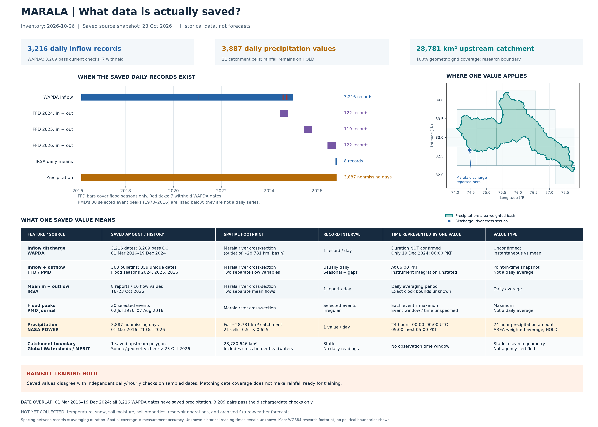

# Marala saved-data inventory — 2026-10-26

Based on the saved files; latest collection/audit snapshot is 2026-10-23. No new source data was downloaded.

Record interval means spacing between saved observations. It does not establish the time period averaged or accumulated into one value.

| Feature / source | Saved amount and history | Area represented | Record interval | Time represented by one value | Type / limitation |
|---|---|---|---|---|---|
| Inflow discharge / WAPDA | 3,216 records; 2016-03-01 to 2024-12-19 | Marala river cross-section; upstream drainage approx. 28,781 km2 | One dated record per day; continuous within saved span | Historical measurement/averaging duration unconfirmed; 06:00 PKT confirmed only on 2024-12-19 | Dated discharge reading; neither instantaneous nor daily mean confirmed for full archive; 3,209 pass current date-level checks; 7 withheld; 3,215 times unconfirmed |
| Inflow and outflow discharge / FFD / PMD | 363 records; 2024-06-16 to 2026-10-15 | Marala river cross-section; upstream drainage approx. 28,781 km2 | Usually one bulletin per day during flood seasons; gaps and duplicate dates retained | At 06:00 Pakistan time; instrument integration duration not stated | Reported point-in-time snapshot; not a daily average; Flood-season coverage only; archive/printed-date conflicts and duplicates require review |
| Mean inflow and mean outflow / IRSA | 8 records; 2026-10-16 to 2026-10-23 | Marala river cross-section; upstream drainage approx. 28,781 km2 | One report per day for the eight saved dates | Daily averaging period; exact start/end clock times not published in saved reports | Daily mean (average), kept separate from FFD snapshots; Only eight days collected; not a complete annual series |
| Selected flood peak discharge / PMD journal | 30 records; 1970-07-02 to 2016-08-07 | Marala river cross-section; upstream drainage approx. 28,781 km2 | Selected flood events; no regular sampling interval | Maximum within each selected event; event window and clock time unspecified | Event maximum; not a daily average or continuous daily series; Selected events only; do not join to daily observations as interchangeable values |
| Catchment precipitation / NASA POWER | 3,887 records; 2016-03-01 to 2026-10-21 | Full saved catchment: 28,780.646 km2; 21 intersecting 0.5 x 0.625 degree native cells | One catchment value per day | 24 hours: 00:00 to next 00:00 UTC = 05:00 to next 05:00 Pakistan time | 24-hour precipitation amount; spatial area-weighted mean across catchment; not instantaneous; HOLD: unresolved request-period-dependent source discrepancy; 2026-10-22 requested but missing |
| Upstream catchment boundary / Global Watersheds / MERIT | 1 static geometry | 28,780.646 km2 upstream of Marala; 74.05041-77.80625 E, 32.08875-34.21208 N | Static geometry; not a time series | Not applicable; no daily observation period | Static research delineation; nominal source raster about 90 m at equator; Nine source/geometry checks passed; not agency-certified or field-surveyed |

The combined discharge catalog has 3,988 measurement rows. These are overlapping source records, two different flow variables, averages and event peaks; they are not that many unique training days.

Precipitation has 3,887 nonmissing catchment days and 81,627 nonmissing cell-day values across 21 cells. The requested 2026-10-22 date remains blank (21 missing source-cell values).

The common saved-date interval is 2016-03-01 to 2024-12-19. All 3,216 WAPDA dates have a saved precipitation value; 3,209 date pairs pass the existing discharge checks. This does not resolve observation-time alignment or rainfall accuracy.

**Rainfall remains on hold for training.** Saved long-period NASA values disagree with shorter-period daily/hourly checks on sampled dates. Originals and evidence are retained; no blanket scaling correction has been applied. See [the scientific audit](marala_feature_coverage_audit.json).

Temperature, snow, soil moisture, soil properties, reservoir operations and archived future-weather forecasts have not been collected.

Source tables: [WAPDA](../discharge/marala_daily_inflow_clean.csv), [FFD 2024](../discharge/marala_ffd_2024_bulletin_discharge.csv), [FFD 2025](../discharge/marala_ffd_2025_bulletin_discharge.csv), [FFD 2026](../discharge/marala_ffd_2026_bulletin_discharge.csv), [IRSA](../discharge/marala_irsa_daily_mean_discharge.csv), [PMD peaks](../discharge/marala_pmd_historical_flood_peaks.csv), [precipitation](../rainfall/marala_catchment_daily_precipitation.csv), [boundary](../catchment/marala_upstream_catchment.geojson). Exact publication URLs remain in those source tables and receipts.

Map attribution: Heberger (2022), Global Watersheds; Yamazaki et al. (2019), MERIT Hydro; Lin et al. (2019), MERIT-Basins. Derived boundary terms: CC BY-NC-SA 4.0; see [catchment notes](../catchment/README.md).
