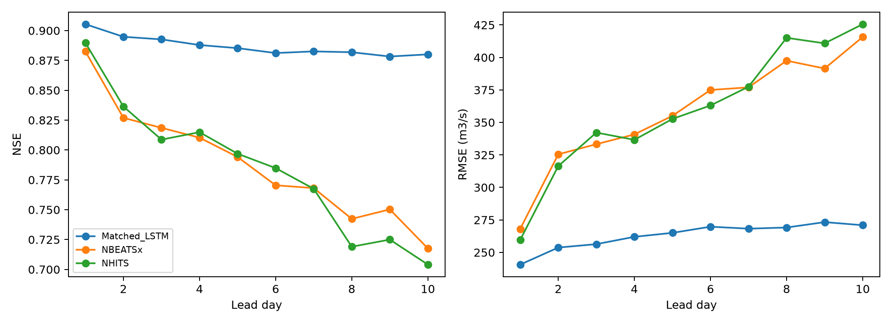

# N-HiTS and N-BEATSx: actual Marala experiment

All three models use identical data, chronological splits, predictor channels, future weather noise, quantiles and seed. The matched LSTM uses the same past discharge and weather inputs as the new MLP forecasters. Learning rates and architecture-specific settings were frozen before training.

| model | n | NSE | KGE | RMSE_cumecs | MAE_cumecs | peak_MAPE_pct |
| --- | --- | --- | --- | --- | --- | --- |
| NHITS | 1075 | 0.704 | 0.849 | 425.593 | 248.540 | 28.709 |
| NBEATSx | 1075 | 0.718 | 0.830 | 415.743 | 236.153 | 32.678 |
| Matched_LSTM | 1075 | 0.880 | 0.936 | 270.918 | 162.780 | 17.370 |

| model | group | n | NSE | RMSE_cumecs | MAE_cumecs | PBIAS_pct |
| --- | --- | --- | --- | --- | --- | --- |
| NHITS | flood | 51 | -2.989 | 1091.647 | 864.918 | -18.912 |
| NHITS | non_flood | 1024 | 0.668 | 361.661 | 217.842 | 6.070 |
| NBEATSx | flood | 51 | -4.055 | 1228.967 | 1007.744 | -30.628 |
| NBEATSx | non_flood | 1024 | 0.730 | 325.926 | 197.724 | 1.390 |
| Matched_LSTM | flood | 51 | -0.973 | 767.831 | 552.927 | -16.987 |
| Matched_LSTM | non_flood | 1024 | 0.879 | 218.378 | 143.349 | 2.468 |

| seed | epochs_run | selected_epoch | validation_pinball | training_seconds | trainable_parameters | train_samples | validation_samples | model |
| --- | --- | --- | --- | --- | --- | --- | --- | --- |
| 42 | 17 | 10 | 0.092 | 36.987 | 829980 | 1767 | 356 | NHITS |
| 42 | 19 | 12 | 0.096 | 24.225 | 1737437 | 1767 | 356 | NBEATSx |
| 42 | 18 | 11 | 0.065 | 42.190 | 43413 | 1767 | 356 | Matched_LSTM |

These are noisy-reanalysis experiments, not established operational forecast skill. Individual model folders contain all lead, seasonal, calibration and detection results. The separate cross-model flood/non-flood report includes the existing models on common observed dates.

[Full cross-model flood/non-flood comparison](../all_models_comparison/report.md)
