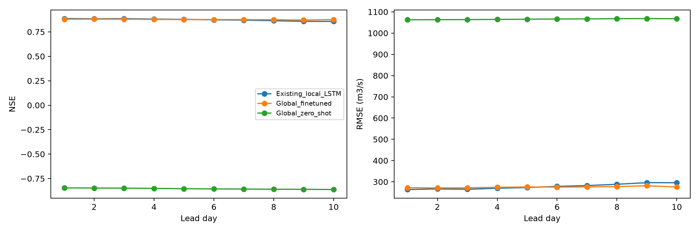

# Global pretrained LSTM: Marala comparison

Fine-tuning improved day-10 NSE over the existing local LSTM.

Day-10 peak-flow MAPE: existing local 16.507% versus fine-tuned global 19.026%. Check flood metrics separately from overall NSE; the existing local model also has higher NSE at leads 1 and 5 in this run.

**These are observed-discharge test scores under noisy future reanalysis weather, not measured operational 10-day forecast skill.**

The published Fine Flood Forecasts Caravan model was pretrained on 6,375 basins in 2001-2020. All eight original weight tensors were loaded exactly. The original 256-unit daily rainfall-runoff LSTM was continued into a 10-day weather rollout and then fine-tuned on Marala. Its original global normalization and linear runoff head were retained; this is not a separately pretrained 10-day encoder-decoder.

Local train: [2016, 2020]; validation: [2021, 2021]; test: [2022, 2024]. Best epoch: 25. Test years were excluded from both global/local training and model selection. The earlier global validation period was 1981-1990.

**1084 unique observed test days**, 1084 issue windows, 10795 scored issue/lead pairs. 45 missing-target pairs were excluded. Overlapping forecast windows are not independent observations.

| year | observed_days |
| --- | --- |
| 2022 | 365 |
| 2023 | 365 |
| 2024 | 354 |

## Accuracy comparison

| model | lead_day | n | NSE | KGE | PBIAS_pct | RMSE_cumecs | peak_MAPE_pct |
| --- | --- | --- | --- | --- | --- | --- | --- |
| Existing_local_LSTM | 1 | 1084 | 0.886 | 0.902 | -2.371 | 263.760 | 17.520 |
| Global_zero_shot | 1 | 1084 | -0.846 | -0.316 | -88.912 | 1062.686 | 93.946 |
| Global_finetuned | 1 | 1084 | 0.879 | 0.918 | 4.203 | 272.268 | 17.707 |
| Existing_local_LSTM | 5 | 1080 | 0.878 | 0.928 | 0.503 | 273.180 | 16.081 |
| Global_zero_shot | 5 | 1080 | -0.854 | -0.319 | -88.940 | 1065.479 | 94.109 |
| Global_finetuned | 5 | 1080 | 0.876 | 0.927 | 3.724 | 275.641 | 17.011 |
| Existing_local_LSTM | 10 | 1075 | 0.857 | 0.910 | 5.644 | 295.702 | 16.507 |
| Global_zero_shot | 10 | 1075 | -0.862 | -0.329 | -88.980 | 1067.596 | 94.569 |
| Global_finetuned | 10 | 1075 | 0.876 | 0.931 | 3.182 | 275.453 | 19.026 |

Day-10 NSE difference (fine-tuned global minus existing local): +0.018897. NSE is a skill score, not percentage accuracy.

## Comparable inputs and limits

Both models receive the same physical future rain and temperature stand-in, with the same lead-growing Gaussian error (maximum floating-point discrepancy 1.2185876e-05). All other 12 inputs of the global model are held at issue-day values throughout the rollout; no future soil moisture, snow, radiation or wind states are used.

The comparison uses identical issue dates and observed target values. The global model has 14 dynamic inputs, 51 static attributes, 256 hidden units and a point/MSE objective. The old local LSTM has 8 dynamic inputs, calendar features, 64 hidden units and a log-flow quantile objective; its median is scored. Architecture and input differences mean this comparison alone cannot isolate a causal pretraining benefit.

Quantile calibration is not applicable to the global point-regression checkpoint. No synthetic intervals were added. The existing local model has its original quantiles in its separate report.

Global statistics remain frozen. Missing predictors receive their global mean in normalized space and separate zero-initialized indicator adapters; missing discharge remains NaN and is masked. Static attributes come from area-weighted HydroATLAS intersections and 1981-2020 weather climatology. Marala area is about 28,794 km2, a substantial basin-size domain shift. UTC daily weather differs from the parent Caravan local-day extraction.

Only five local training years and one validation year are used for comparability. Regulation, diversions, few independent flood events, future weather stand-in bias and publication/observation latency remain limits. The 2022-2024 period was inspected in earlier project experiments; it is held out of this training run, not an untouched project-wide research holdout.

Peak and default flood thresholds use training-period Q95 = 2494.714 m3/s. This is not an official flood warning threshold. Peak error is mean absolute percentage error on observed exceedance days. PBIAS is positive for overprediction; KGE uses the original correlation/variability/bias definition. False-alarm rate is false alerts divided by observed non-exceedances, and false-alarm ratio is false alerts divided by predicted exceedances.

## Every lead day

| model | lead_day | n | NSE | KGE | PBIAS_pct | RMSE_cumecs | MAE_cumecs | peak_MAPE_pct | peak_n | flood_hit_rate | false_alarm_rate | false_alarm_ratio |
| --- | --- | --- | --- | --- | --- | --- | --- | --- | --- | --- | --- | --- |
| Existing_local_LSTM | 1 | 1084 | 0.886 | 0.902 | -2.371 | 263.760 | 157.279 | 17.520 | 51 | 0.431 | 0.005 | 0.185 |
| Global_zero_shot | 1 | 1084 | -0.846 | -0.316 | -88.912 | 1062.686 | 751.951 | 93.946 | 51 | 0.000 | 0.000 | NA |
| Global_finetuned | 1 | 1084 | 0.879 | 0.918 | 4.203 | 272.268 | 167.251 | 17.707 | 51 | 0.745 | 0.031 | 0.457 |
| Existing_local_LSTM | 2 | 1083 | 0.884 | 0.920 | -1.081 | 266.586 | 159.626 | 16.641 | 51 | 0.451 | 0.009 | 0.281 |
| Global_zero_shot | 2 | 1083 | -0.847 | -0.316 | -88.917 | 1063.162 | 752.554 | 93.923 | 51 | 0.000 | 0.000 | NA |
| Global_finetuned | 2 | 1083 | 0.880 | 0.922 | 4.035 | 271.059 | 167.380 | 17.338 | 51 | 0.745 | 0.030 | 0.449 |
| Existing_local_LSTM | 3 | 1082 | 0.885 | 0.920 | -0.901 | 264.887 | 159.200 | 16.283 | 51 | 0.431 | 0.006 | 0.214 |
| Global_zero_shot | 3 | 1082 | -0.848 | -0.316 | -88.917 | 1063.656 | 753.109 | 93.963 | 51 | 0.000 | 0.000 | NA |
| Global_finetuned | 3 | 1082 | 0.879 | 0.924 | 3.934 | 271.664 | 168.211 | 17.714 | 51 | 0.725 | 0.027 | 0.431 |
| Existing_local_LSTM | 4 | 1081 | 0.881 | 0.932 | 0.423 | 269.735 | 162.602 | 15.453 | 51 | 0.529 | 0.011 | 0.289 |
| Global_zero_shot | 4 | 1081 | -0.851 | -0.317 | -88.923 | 1064.477 | 753.714 | 94.048 | 51 | 0.000 | 0.000 | NA |
| Global_finetuned | 4 | 1081 | 0.877 | 0.925 | 3.862 | 274.203 | 169.453 | 17.702 | 51 | 0.725 | 0.024 | 0.403 |
| Existing_local_LSTM | 5 | 1080 | 0.878 | 0.928 | 0.503 | 273.180 | 164.853 | 16.081 | 51 | 0.549 | 0.015 | 0.349 |
| Global_zero_shot | 5 | 1080 | -0.854 | -0.319 | -88.940 | 1065.479 | 754.406 | 94.109 | 51 | 0.000 | 0.000 | NA |
| Global_finetuned | 5 | 1080 | 0.876 | 0.927 | 3.724 | 275.641 | 170.316 | 17.011 | 51 | 0.745 | 0.031 | 0.457 |
| Existing_local_LSTM | 6 | 1079 | 0.873 | 0.928 | 2.244 | 278.576 | 169.887 | 15.985 | 51 | 0.588 | 0.017 | 0.362 |
| Global_zero_shot | 6 | 1079 | -0.856 | -0.320 | -88.964 | 1066.350 | 755.160 | 94.133 | 51 | 0.000 | 0.000 | NA |
| Global_finetuned | 6 | 1079 | 0.876 | 0.929 | 3.524 | 275.234 | 171.897 | 18.044 | 51 | 0.667 | 0.024 | 0.424 |
| Existing_local_LSTM | 7 | 1078 | 0.870 | 0.925 | 3.709 | 282.328 | 173.495 | 15.302 | 51 | 0.588 | 0.019 | 0.400 |
| Global_zero_shot | 7 | 1078 | -0.857 | -0.321 | -88.953 | 1066.918 | 755.531 | 94.181 | 51 | 0.000 | 0.000 | NA |
| Global_finetuned | 7 | 1078 | 0.876 | 0.930 | 3.433 | 276.017 | 172.300 | 17.674 | 51 | 0.686 | 0.024 | 0.417 |
| Existing_local_LSTM | 8 | 1077 | 0.864 | 0.917 | 5.009 | 288.485 | 178.890 | 14.982 | 51 | 0.647 | 0.022 | 0.411 |
| Global_zero_shot | 8 | 1077 | -0.859 | -0.323 | -88.965 | 1067.847 | 756.033 | 94.311 | 51 | 0.000 | 0.000 | NA |
| Global_finetuned | 8 | 1077 | 0.874 | 0.930 | 3.334 | 277.545 | 173.303 | 17.511 | 51 | 0.686 | 0.025 | 0.426 |
| Existing_local_LSTM | 9 | 1076 | 0.857 | 0.909 | 5.887 | 296.085 | 184.016 | 14.626 | 51 | 0.647 | 0.026 | 0.450 |
| Global_zero_shot | 9 | 1076 | -0.860 | -0.326 | -88.960 | 1068.490 | 756.151 | 94.432 | 51 | 0.000 | 0.000 | NA |
| Global_finetuned | 9 | 1076 | 0.871 | 0.928 | 3.185 | 281.554 | 175.423 | 17.927 | 51 | 0.647 | 0.029 | 0.476 |
| Existing_local_LSTM | 10 | 1075 | 0.857 | 0.910 | 5.644 | 295.702 | 187.128 | 16.507 | 51 | 0.588 | 0.021 | 0.423 |
| Global_zero_shot | 10 | 1075 | -0.862 | -0.329 | -88.980 | 1067.596 | 755.022 | 94.569 | 51 | 0.000 | 0.000 | NA |
| Global_finetuned | 10 | 1075 | 0.876 | 0.931 | 3.182 | 275.453 | 174.181 | 19.026 | 51 | 0.647 | 0.025 | 0.441 |

## Seasonal verification

| model | lead_day | season | n | NSE | KGE | PBIAS_pct | RMSE_cumecs | MAE_cumecs | peak_MAPE_pct | peak_n | flood_hit_rate | false_alarm_rate | false_alarm_ratio |
| --- | --- | --- | --- | --- | --- | --- | --- | --- | --- | --- | --- | --- | --- |
| Existing_local_LSTM | 1 | Apr-Jun | 273 | 0.732 | 0.787 | -1.821 | 240.008 | 173.036 | 16.885 | 3 | 0.000 | 0.000 | NA |
| Global_zero_shot | 1 | Apr-Jun | 273 | -2.775 | -0.403 | -90.732 | 900.128 | 777.342 | 94.999 | 3 | 0.000 | 0.000 | NA |
| Global_finetuned | 1 | Apr-Jun | 273 | 0.742 | 0.848 | 5.988 | 235.276 | 179.624 | 15.294 | 3 | 1.000 | 0.004 | 0.250 |
| Existing_local_LSTM | 1 | Jul-Sep | 276 | 0.689 | 0.718 | -1.827 | 404.138 | 279.943 | 16.142 | 47 | 0.468 | 0.022 | 0.185 |
| Global_zero_shot | 1 | Jul-Sep | 276 | -5.551 | -0.388 | -92.027 | 1854.736 | 1716.068 | 93.776 | 47 | 0.000 | 0.000 | NA |
| Global_finetuned | 1 | Jul-Sep | 276 | 0.652 | 0.826 | 5.294 | 427.426 | 319.991 | 16.586 | 47 | 0.745 | 0.135 | 0.470 |
| Existing_local_LSTM | 1 | Oct-Mar | 535 | 0.338 | 0.517 | -4.799 | 165.247 | 85.958 | 84.177 | 1 | 0.000 | 0.000 | NA |
| Global_zero_shot | 1 | Oct-Mar | 535 | -1.424 | -0.604 | -76.849 | 316.283 | 241.618 | 98.763 | 1 | 0.000 | 0.000 | NA |
| Global_finetuned | 1 | Oct-Mar | 535 | 0.329 | 0.321 | -1.615 | 166.443 | 82.140 | 77.676 | 1 | 0.000 | 0.000 | NA |
| Existing_local_LSTM | 2 | Apr-Jun | 273 | 0.731 | 0.804 | 1.247 | 240.155 | 176.903 | 16.637 | 3 | 0.000 | 0.000 | NA |
| Global_zero_shot | 2 | Apr-Jun | 273 | -2.780 | -0.408 | -90.767 | 900.670 | 777.640 | 95.416 | 3 | 0.000 | 0.000 | NA |
| Global_finetuned | 2 | Apr-Jun | 273 | 0.745 | 0.841 | 5.527 | 234.108 | 179.583 | 13.322 | 3 | 1.000 | 0.004 | 0.250 |
| Existing_local_LSTM | 2 | Jul-Sep | 276 | 0.684 | 0.733 | -0.096 | 407.030 | 286.860 | 15.213 | 47 | 0.489 | 0.039 | 0.281 |
| Global_zero_shot | 2 | Jul-Sep | 276 | -5.549 | -0.383 | -92.028 | 1854.452 | 1716.089 | 93.726 | 47 | 0.000 | 0.000 | NA |
| Global_finetuned | 2 | Jul-Sep | 276 | 0.657 | 0.831 | 5.170 | 424.110 | 318.626 | 16.298 | 47 | 0.745 | 0.131 | 0.462 |
| Existing_local_LSTM | 2 | Oct-Mar | 534 | 0.297 | 0.469 | -7.336 | 170.349 | 85.031 | 83.774 | 1 | 0.000 | 0.000 | NA |
| Global_zero_shot | 2 | Oct-Mar | 534 | -1.426 | -0.617 | -76.814 | 316.546 | 241.721 | 98.715 | 1 | 0.000 | 0.000 | NA |
| Global_finetuned | 2 | Oct-Mar | 534 | 0.321 | 0.317 | -1.517 | 167.407 | 82.970 | 78.288 | 1 | 0.000 | 0.000 | NA |
| Existing_local_LSTM | 3 | Apr-Jun | 273 | 0.734 | 0.790 | 1.597 | 238.743 | 177.655 | 17.508 | 3 | 0.000 | 0.000 | NA |
| Global_zero_shot | 3 | Apr-Jun | 273 | -2.785 | -0.415 | -90.804 | 901.317 | 777.960 | 95.814 | 3 | 0.000 | 0.000 | NA |
| Global_finetuned | 3 | Apr-Jun | 273 | 0.743 | 0.830 | 5.040 | 234.774 | 179.495 | 14.936 | 3 | 1.000 | 0.004 | 0.250 |
| Existing_local_LSTM | 3 | Jul-Sep | 276 | 0.693 | 0.740 | -0.118 | 401.379 | 285.849 | 14.806 | 47 | 0.468 | 0.026 | 0.214 |
| Global_zero_shot | 3 | Jul-Sep | 276 | -5.548 | -0.383 | -92.012 | 1854.238 | 1715.799 | 93.749 | 47 | 0.000 | 0.000 | NA |
| Global_finetuned | 3 | Jul-Sep | 276 | 0.658 | 0.832 | 5.176 | 423.786 | 320.056 | 16.572 | 47 | 0.723 | 0.118 | 0.443 |
| Existing_local_LSTM | 3 | Oct-Mar | 533 | 0.279 | 0.442 | -6.782 | 172.679 | 84.165 | 82.074 | 1 | 0.000 | 0.000 | NA |
| Global_zero_shot | 3 | Oct-Mar | 533 | -1.424 | -0.604 | -76.796 | 316.568 | 241.876 | 98.491 | 1 | 0.000 | 0.000 | NA |
| Global_finetuned | 3 | Oct-Mar | 533 | 0.308 | 0.310 | -1.412 | 169.080 | 83.802 | 79.710 | 1 | 0.000 | 0.000 | NA |
| Existing_local_LSTM | 4 | Apr-Jun | 273 | 0.718 | 0.801 | 3.718 | 246.088 | 183.396 | 15.550 | 3 | 0.000 | 0.000 | NA |
| Global_zero_shot | 4 | Apr-Jun | 273 | -2.791 | -0.418 | -90.853 | 902.021 | 778.379 | 96.105 | 3 | 0.000 | 0.000 | NA |
| Global_finetuned | 4 | Apr-Jun | 273 | 0.753 | 0.823 | 4.469 | 230.100 | 174.871 | 11.561 | 3 | 1.000 | 0.000 | 0.000 |
| Existing_local_LSTM | 4 | Jul-Sep | 276 | 0.684 | 0.755 | 1.710 | 407.505 | 293.546 | 14.010 | 47 | 0.574 | 0.048 | 0.289 |
| Global_zero_shot | 4 | Jul-Sep | 276 | -5.551 | -0.396 | -91.999 | 1854.717 | 1715.549 | 93.826 | 47 | 0.000 | 0.000 | NA |
| Global_finetuned | 4 | Jul-Sep | 276 | 0.645 | 0.826 | 5.241 | 431.926 | 328.221 | 16.773 | 47 | 0.723 | 0.109 | 0.424 |
| Existing_local_LSTM | 4 | Oct-Mar | 532 | 0.260 | 0.419 | -8.123 | 174.960 | 83.998 | 82.985 | 1 | 0.000 | 0.000 | NA |
| Global_zero_shot | 4 | Oct-Mar | 532 | -1.423 | -0.591 | -76.792 | 316.634 | 242.060 | 98.289 | 1 | 0.000 | 0.000 | NA |
| Global_finetuned | 4 | Oct-Mar | 532 | 0.304 | 0.311 | -1.218 | 169.766 | 84.305 | 79.804 | 1 | 0.000 | 0.000 | NA |
| Existing_local_LSTM | 5 | Apr-Jun | 273 | 0.704 | 0.790 | 4.192 | 252.149 | 188.180 | 15.937 | 3 | 0.000 | 0.000 | NA |
| Global_zero_shot | 5 | Apr-Jun | 273 | -2.797 | -0.434 | -90.880 | 902.753 | 778.612 | 96.488 | 3 | 0.000 | 0.000 | NA |
| Global_finetuned | 5 | Apr-Jun | 273 | 0.752 | 0.814 | 3.875 | 230.652 | 176.015 | 11.191 | 3 | 1.000 | 0.000 | 0.000 |
| Existing_local_LSTM | 5 | Jul-Sep | 276 | 0.677 | 0.750 | 1.402 | 411.664 | 298.461 | 14.687 | 47 | 0.596 | 0.066 | 0.349 |
| Global_zero_shot | 5 | Jul-Sep | 276 | -5.557 | -0.408 | -92.025 | 1855.611 | 1716.029 | 93.866 | 47 | 0.000 | 0.000 | NA |
| Global_finetuned | 5 | Jul-Sep | 276 | 0.641 | 0.822 | 5.145 | 434.201 | 328.244 | 16.043 | 47 | 0.745 | 0.140 | 0.478 |
| Existing_local_LSTM | 5 | Oct-Mar | 531 | 0.251 | 0.409 | -7.408 | 176.103 | 83.413 | 82.028 | 1 | 0.000 | 0.000 | NA |
| Global_zero_shot | 5 | Oct-Mar | 531 | -1.420 | -0.578 | -76.753 | 316.622 | 242.134 | 98.385 | 1 | 0.000 | 0.000 | NA |
| Global_finetuned | 5 | Oct-Mar | 531 | 0.295 | 0.315 | -0.849 | 170.842 | 85.299 | 79.996 | 1 | 0.000 | 0.000 | NA |
| Existing_local_LSTM | 6 | Apr-Jun | 273 | 0.675 | 0.789 | 7.417 | 264.192 | 196.594 | 13.304 | 3 | 0.333 | 0.000 | 0.000 |
| Global_zero_shot | 6 | Apr-Jun | 273 | -2.800 | -0.437 | -90.904 | 903.113 | 778.817 | 96.546 | 3 | 0.000 | 0.000 | NA |
| Global_finetuned | 6 | Apr-Jun | 273 | 0.751 | 0.803 | 3.278 | 231.276 | 176.917 | 12.228 | 3 | 1.000 | 0.000 | 0.000 |
| Existing_local_LSTM | 6 | Jul-Sep | 276 | 0.668 | 0.734 | 2.826 | 417.238 | 306.489 | 14.783 | 47 | 0.617 | 0.074 | 0.370 |
| Global_zero_shot | 6 | Jul-Sep | 276 | -5.563 | -0.405 | -92.065 | 1856.338 | 1716.771 | 93.887 | 47 | 0.000 | 0.000 | NA |
| Global_finetuned | 6 | Jul-Sep | 276 | 0.644 | 0.820 | 4.964 | 432.559 | 333.133 | 17.107 | 47 | 0.660 | 0.109 | 0.446 |
| Existing_local_LSTM | 6 | Oct-Mar | 530 | 0.243 | 0.416 | -6.776 | 177.151 | 84.995 | 80.537 | 1 | 0.000 | 0.000 | NA |
| Global_zero_shot | 6 | Oct-Mar | 530 | -1.420 | -0.579 | -76.714 | 316.754 | 242.211 | 98.471 | 1 | 0.000 | 0.000 | NA |
| Global_finetuned | 6 | Oct-Mar | 530 | 0.295 | 0.321 | -0.563 | 170.982 | 85.348 | 79.556 | 1 | 0.000 | 0.000 | NA |
| Existing_local_LSTM | 7 | Apr-Jun | 273 | 0.654 | 0.789 | 9.169 | 272.478 | 200.674 | 10.841 | 3 | 0.667 | 0.000 | 0.000 |
| Global_zero_shot | 7 | Apr-Jun | 273 | -2.804 | -0.440 | -90.942 | 903.505 | 779.144 | 96.545 | 3 | 0.000 | 0.000 | NA |
| Global_finetuned | 7 | Apr-Jun | 273 | 0.749 | 0.801 | 2.909 | 232.278 | 176.578 | 14.083 | 3 | 0.667 | 0.000 | 0.000 |
| Existing_local_LSTM | 7 | Jul-Sep | 276 | 0.664 | 0.732 | 4.397 | 420.321 | 313.578 | 14.194 | 47 | 0.596 | 0.087 | 0.417 |
| Global_zero_shot | 7 | Jul-Sep | 276 | -5.563 | -0.422 | -92.040 | 1856.450 | 1716.309 | 93.942 | 47 | 0.000 | 0.000 | NA |
| Global_finetuned | 7 | Jul-Sep | 276 | 0.642 | 0.815 | 4.882 | 433.560 | 332.991 | 16.602 | 47 | 0.702 | 0.109 | 0.431 |
| Existing_local_LSTM | 7 | Oct-Mar | 529 | 0.231 | 0.417 | -6.054 | 178.722 | 86.381 | 80.749 | 1 | 0.000 | 0.000 | NA |
| Global_zero_shot | 7 | Oct-Mar | 529 | -1.413 | -0.569 | -76.657 | 316.637 | 242.069 | 98.301 | 1 | 0.000 | 0.000 | NA |
| Global_finetuned | 7 | Oct-Mar | 529 | 0.294 | 0.326 | -0.294 | 171.271 | 86.254 | 78.826 | 1 | 0.000 | 0.000 | NA |
| Existing_local_LSTM | 8 | Apr-Jun | 273 | 0.637 | 0.791 | 9.845 | 278.956 | 205.332 | 10.184 | 3 | 0.667 | 0.000 | 0.000 |
| Global_zero_shot | 8 | Apr-Jun | 273 | -2.804 | -0.436 | -90.946 | 903.563 | 779.177 | 96.739 | 3 | 0.000 | 0.000 | NA |
| Global_finetuned | 8 | Apr-Jun | 273 | 0.747 | 0.788 | 2.164 | 232.983 | 175.701 | 12.399 | 3 | 0.667 | 0.000 | 0.000 |
| Existing_local_LSTM | 8 | Jul-Sep | 276 | 0.645 | 0.729 | 6.261 | 431.714 | 328.119 | 13.887 | 47 | 0.660 | 0.100 | 0.426 |
| Global_zero_shot | 8 | Jul-Sep | 276 | -5.571 | -0.436 | -92.067 | 1857.527 | 1716.821 | 94.070 | 47 | 0.000 | 0.000 | NA |
| Global_finetuned | 8 | Jul-Sep | 276 | 0.639 | 0.809 | 4.930 | 435.383 | 334.159 | 16.517 | 47 | 0.702 | 0.114 | 0.441 |
| Existing_local_LSTM | 8 | Oct-Mar | 528 | 0.229 | 0.417 | -5.646 | 179.158 | 87.212 | 80.842 | 1 | 0.000 | 0.000 | NA |
| Global_zero_shot | 8 | Oct-Mar | 528 | -1.408 | -0.566 | -76.608 | 316.538 | 241.837 | 98.348 | 1 | 0.000 | 0.000 | NA |
| Global_finetuned | 8 | Oct-Mar | 528 | 0.280 | 0.323 | 0.049 | 173.128 | 87.979 | 79.547 | 1 | 0.000 | 0.000 | NA |
| Existing_local_LSTM | 9 | Apr-Jun | 273 | 0.614 | 0.781 | 9.723 | 287.732 | 211.180 | 10.472 | 3 | 0.667 | 0.000 | 0.000 |
| Global_zero_shot | 9 | Apr-Jun | 273 | -2.806 | -0.443 | -90.956 | 903.845 | 779.259 | 96.722 | 3 | 0.000 | 0.000 | NA |
| Global_finetuned | 9 | Apr-Jun | 273 | 0.729 | 0.769 | 1.361 | 241.029 | 178.351 | 9.110 | 3 | 1.000 | 0.000 | 0.000 |
| Existing_local_LSTM | 9 | Jul-Sep | 276 | 0.623 | 0.713 | 7.531 | 444.825 | 339.648 | 13.484 | 47 | 0.660 | 0.118 | 0.466 |
| Global_zero_shot | 9 | Jul-Sep | 276 | -5.576 | -0.457 | -92.075 | 1858.184 | 1716.964 | 94.206 | 47 | 0.000 | 0.000 | NA |
| Global_finetuned | 9 | Jul-Sep | 276 | 0.631 | 0.799 | 4.814 | 440.148 | 337.531 | 17.180 | 47 | 0.638 | 0.131 | 0.500 |
| Existing_local_LSTM | 9 | Oct-Mar | 527 | 0.217 | 0.423 | -4.613 | 180.214 | 88.437 | 80.761 | 1 | 0.000 | 0.000 | NA |
| Global_zero_shot | 9 | Oct-Mar | 527 | -1.398 | -0.544 | -76.492 | 315.414 | 240.984 | 98.187 | 1 | 0.000 | 0.000 | NA |
| Global_finetuned | 9 | Oct-Mar | 527 | 0.270 | 0.324 | 0.703 | 174.069 | 89.007 | 79.480 | 1 | 0.000 | 0.000 | NA |
| Existing_local_LSTM | 10 | Apr-Jun | 273 | 0.601 | 0.771 | 9.419 | 292.728 | 215.580 | 12.579 | 3 | 0.333 | 0.000 | 0.000 |
| Global_zero_shot | 10 | Apr-Jun | 273 | -2.811 | -0.447 | -91.004 | 904.332 | 779.675 | 96.699 | 3 | 0.000 | 0.000 | NA |
| Global_finetuned | 10 | Apr-Jun | 273 | 0.735 | 0.759 | 0.650 | 238.567 | 171.469 | 11.011 | 3 | 1.000 | 0.000 | 0.000 |
| Existing_local_LSTM | 10 | Jul-Sep | 276 | 0.602 | 0.671 | 6.689 | 456.941 | 351.428 | 15.384 | 47 | 0.617 | 0.096 | 0.431 |
| Global_zero_shot | 10 | Jul-Sep | 276 | -5.591 | -0.480 | -92.146 | 1860.358 | 1718.284 | 94.356 | 47 | 0.000 | 0.000 | NA |
| Global_finetuned | 10 | Jul-Sep | 276 | 0.627 | 0.794 | 4.618 | 442.846 | 344.560 | 18.274 | 47 | 0.638 | 0.114 | 0.464 |
| Existing_local_LSTM | 10 | Oct-Mar | 526 | 0.254 | 0.520 | -3.041 | 157.070 | 86.150 | 81.073 | 1 | 0.000 | 0.000 | NA |
| Global_zero_shot | 10 | Oct-Mar | 526 | -1.687 | -0.508 | -76.130 | 298.165 | 236.789 | 98.177 | 1 | 0.000 | 0.000 | NA |
| Global_finetuned | 10 | Oct-Mar | 526 | 0.316 | 0.410 | 2.283 | 150.413 | 86.188 | 78.405 | 1 | 0.000 | 0.000 | NA |

Sources: [authors' model](https://huggingface.co/EmilRyd/caravan_model), [Fine Flood Forecasts](https://github.com/EmilRyd/Fine-Flood-Forecasts). The pinned revision and downloaded hashes are saved in ../../pretrained/download_receipt.json.
