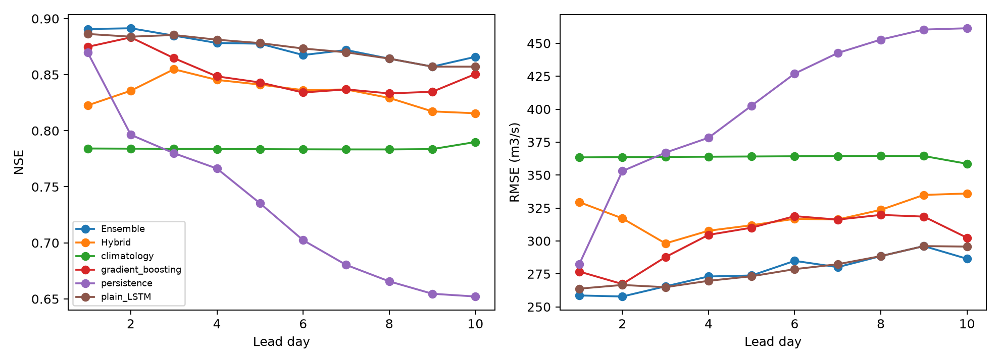

# Hybrid physics-ML evaluation

## Measured accuracy on Marala

At lead 10, hybrid NSE is **0.816**, lower than the matched-input plain LSTM (**0.857**); NSE difference: -0.0416. This single-seed experiment does not establish general improvement in extreme floods.

Observed test years: **[2022, 2023, 2024]**. Unique observed test days across leads: **1084**; observed issue/lead/target pairs: **10795**. Individual missing targets were excluded.

**These results use realized future ERA5-Land weather plus noise. They are not operational TIGGE/GFS forecast accuracy. NSE is a skill score, not an accuracy percentage.**

| model | lead_day | n | NSE | KGE | PBIAS_pct | RMSE_cumecs |
| --- | --- | --- | --- | --- | --- | --- |
| Hybrid | 1 | 1084 | 0.823 | 0.832 | 10.276 | 329.437 |
| plain_LSTM | 1 | 1084 | 0.886 | 0.902 | -2.371 | 263.760 |
| persistence | 1 | 1084 | 0.870 | 0.935 | 0.000 | 282.358 |
| climatology | 1 | 1084 | 0.784 | 0.849 | 7.793 | 363.415 |
| gradient_boosting | 1 | 1084 | 0.875 | 0.916 | 2.670 | 276.755 |
| Ensemble | 1 | 1084 | 0.891 | 0.912 | -0.231 | 258.621 |
| Hybrid | 10 | 1075 | 0.816 | 0.851 | 11.003 | 335.983 |
| plain_LSTM | 10 | 1075 | 0.857 | 0.910 | 5.644 | 295.702 |
| persistence | 10 | 1075 | 0.652 | 0.826 | 0.364 | 461.403 |
| climatology | 10 | 1075 | 0.790 | 0.850 | 8.144 | 358.575 |
| gradient_boosting | 10 | 1075 | 0.851 | 0.877 | 0.541 | 302.424 |
| Ensemble | 10 | 1075 | 0.866 | 0.916 | 4.630 | 286.462 |

### Hybrid seasonal results at lead 10

| model | lead_day | season | n | NSE | KGE | PBIAS_pct | RMSE_cumecs | MAE_cumecs | peak_MAPE_pct | peak_n | flood_hit_rate | false_alarm_rate | false_alarm_ratio |
| --- | --- | --- | --- | --- | --- | --- | --- | --- | --- | --- | --- | --- | --- |
| Hybrid | 10 | Apr-Jun | 273 | 0.534 | 0.733 | 15.466 | 316.333 | 241.274 | 8.947 | 3 | 1.000 | 0.000 | 0.000 |
| Hybrid | 10 | Jul-Sep | 276 | 0.447 | 0.648 | 13.137 | 538.820 | 437.292 | 15.713 | 47 | 0.617 | 0.179 | 0.586 |
| Hybrid | 10 | Oct-Mar | 526 | 0.201 | 0.513 | -2.091 | 162.576 | 87.205 | 83.703 | 1 | 0.000 | 0.000 | NA |

### Hybrid quantile calibration

| lead_day | n | nominal_coverage | actual_coverage |
| --- | --- | --- | --- |
| 1 | 1084 | 0.900 | 0.878 |
| 2 | 1083 | 0.900 | 0.850 |
| 3 | 1082 | 0.900 | 0.839 |
| 4 | 1081 | 0.900 | 0.826 |
| 5 | 1080 | 0.900 | 0.833 |
| 6 | 1079 | 0.900 | 0.814 |
| 7 | 1078 | 0.900 | 0.821 |
| 8 | 1077 | 0.900 | 0.815 |
| 9 | 1076 | 0.900 | 0.798 |
| 10 | 1075 | 0.900 | 0.786 |

High-flow errors and flood exceedances use a training-derived peak threshold of **2494.71 cumecs** and flood threshold of **2494.71 cumecs**. Defaults use training Q95, not official flood categories or return-period floods. Positive PBIAS means overprediction. False-alarm rate = false alerts/non-exceedance days; false-alarm ratio = false alerts/all alerts.

### Training and physics checks

| seed | epochs_run | selected_epoch | validation_pinball | training_seconds | train_samples | validation_samples |
| --- | --- | --- | --- | --- | --- | --- |
| 42 | 16 | 10 | 0.081 | 234.176 | 1767 | 356 |

| seed | maximum_water_balance_residual_mm | minimum_state_or_flux_mm | forecast_missing_pct | negative_noisy_precipitation_clipped_in_bucket |
| --- | --- | --- | --- | --- |
| 42 | 0.000 | 0.000 | 0.000 | 2191 |

Maximum measured daily bucket residual: **0.00035048 mm**, within the configured **0.002 mm** tolerance.

Water balance is checked inside the conceptual bucket, including its initial water stores. Final LSTM discharge is not constrained to this balance. Internal conservation is not proof of accurate or physically correct basin runoff. Negative precipitation caused by Gaussian forecast noise is clipped only inside the physical module, and is counted above; source values are unchanged.

All 15 shared and 5 hybrid synthetic correctness tests passed. They check implementation, not real accuracy. Observed targets and their NaN positions were not modified. The saved daily-file hash matches both training checkpoints.

[Full evaluation](<evaluation_report.md>) | [Prediction CSV](<predictions.csv>) | [Training history](<../../runs/initial/seed_42/history.json>)

## Observed days per year

| year | observed_days |
| --- | --- |
| 2022 | 365 |
| 2023 | 365 |
| 2024 | 354 |

## All seasonal lead-by-lead metrics

| model | lead_day | season | n | NSE | KGE | PBIAS_pct | RMSE_cumecs | MAE_cumecs | peak_MAPE_pct | peak_n | flood_hit_rate | false_alarm_rate | false_alarm_ratio |
| --- | --- | --- | --- | --- | --- | --- | --- | --- | --- | --- | --- | --- | --- |
| Hybrid | 1 | Apr-Jun | 273 | 0.660 | 0.791 | 7.340 | 270.095 | 202.074 | 12.806 | 3 | 0.333 | 0.000 | 0.000 |
| plain_LSTM | 1 | Apr-Jun | 273 | 0.732 | 0.787 | -1.821 | 240.008 | 173.036 | 16.885 | 3 | 0.000 | 0.000 | NA |
| persistence | 1 | Apr-Jun | 273 | 0.813 | 0.899 | -1.821 | 200.460 | 124.781 | 21.215 | 3 | 0.667 | 0.004 | 0.333 |
| climatology | 1 | Apr-Jun | 273 | 0.283 | 0.571 | 22.996 | 392.331 | 310.523 | 40.333 | 3 | 0.000 | 0.000 | NA |
| gradient_boosting | 1 | Apr-Jun | 273 | 0.561 | 0.693 | 10.764 | 306.782 | 241.935 | 26.051 | 3 | 0.000 | 0.000 | NA |
| Ensemble | 1 | Apr-Jun | 273 | 0.694 | 0.754 | 3.520 | 256.176 | 193.336 | 20.776 | 3 | 0.000 | 0.000 | NA |
| Hybrid | 1 | Jul-Sep | 276 | 0.427 | 0.732 | 16.266 | 548.495 | 430.953 | 11.017 | 47 | 0.872 | 0.284 | 0.613 |
| plain_LSTM | 1 | Jul-Sep | 276 | 0.689 | 0.718 | -1.827 | 404.138 | 279.943 | 16.142 | 47 | 0.468 | 0.022 | 0.185 |
| persistence | 1 | Jul-Sep | 276 | 0.612 | 0.803 | 0.708 | 451.497 | 284.851 | 21.537 | 47 | 0.596 | 0.083 | 0.404 |
| climatology | 1 | Jul-Sep | 276 | 0.470 | 0.657 | -0.117 | 527.632 | 380.299 | 20.938 | 47 | 0.277 | 0.087 | 0.606 |
| gradient_boosting | 1 | Jul-Sep | 276 | 0.700 | 0.781 | 0.390 | 396.776 | 282.661 | 16.181 | 47 | 0.468 | 0.048 | 0.333 |
| Ensemble | 1 | Jul-Sep | 276 | 0.718 | 0.744 | -0.886 | 384.523 | 269.648 | 15.059 | 47 | 0.511 | 0.031 | 0.226 |
| Hybrid | 1 | Oct-Mar | 535 | 0.334 | 0.475 | -3.968 | 165.739 | 81.865 | 85.756 | 1 | 0.000 | 0.000 | NA |
| plain_LSTM | 1 | Oct-Mar | 535 | 0.338 | 0.517 | -4.799 | 165.247 | 85.958 | 84.177 | 1 | 0.000 | 0.000 | NA |
| persistence | 1 | Oct-Mar | 535 | 0.131 | 0.568 | 0.369 | 189.394 | 61.244 | 92.079 | 1 | 0.000 | 0.002 | 1.000 |
| climatology | 1 | Oct-Mar | 535 | -0.101 | 0.218 | 10.855 | 213.148 | 118.160 | 88.229 | 1 | 0.000 | 0.000 | NA |
| gradient_boosting | 1 | Oct-Mar | 535 | 0.371 | 0.470 | -1.605 | 161.087 | 75.802 | 80.530 | 1 | 0.000 | 0.000 | NA |
| Ensemble | 1 | Oct-Mar | 535 | 0.376 | 0.499 | -3.443 | 160.478 | 77.688 | 82.629 | 1 | 0.000 | 0.000 | NA |
| Hybrid | 2 | Apr-Jun | 273 | 0.660 | 0.799 | 8.556 | 270.105 | 203.625 | 13.645 | 3 | 0.333 | 0.000 | 0.000 |
| plain_LSTM | 2 | Apr-Jun | 273 | 0.731 | 0.804 | 1.247 | 240.155 | 176.903 | 16.637 | 3 | 0.000 | 0.000 | NA |
| persistence | 2 | Apr-Jun | 273 | 0.707 | 0.834 | -3.557 | 250.589 | 172.225 | 16.403 | 3 | 0.333 | 0.007 | 0.667 |
| climatology | 2 | Apr-Jun | 273 | 0.283 | 0.571 | 22.996 | 392.331 | 310.523 | 40.333 | 3 | 0.000 | 0.000 | NA |
| gradient_boosting | 2 | Apr-Jun | 273 | 0.560 | 0.685 | 12.830 | 307.203 | 245.382 | 19.691 | 3 | 0.000 | 0.000 | NA |
| Ensemble | 2 | Apr-Jun | 273 | 0.658 | 0.735 | 8.357 | 271.111 | 211.058 | 18.512 | 3 | 0.000 | 0.000 | NA |
| Hybrid | 2 | Jul-Sep | 276 | 0.496 | 0.742 | 13.511 | 514.537 | 403.907 | 11.927 | 47 | 0.787 | 0.210 | 0.565 |
| plain_LSTM | 2 | Jul-Sep | 276 | 0.684 | 0.733 | -0.096 | 407.030 | 286.860 | 15.213 | 47 | 0.489 | 0.039 | 0.281 |
| persistence | 2 | Jul-Sep | 276 | 0.360 | 0.671 | 1.341 | 579.876 | 369.802 | 21.704 | 47 | 0.553 | 0.092 | 0.447 |
| climatology | 2 | Jul-Sep | 276 | 0.470 | 0.657 | -0.117 | 527.632 | 380.299 | 20.938 | 47 | 0.277 | 0.087 | 0.606 |
| gradient_boosting | 2 | Jul-Sep | 276 | 0.731 | 0.792 | -0.059 | 375.833 | 269.281 | 15.762 | 47 | 0.553 | 0.070 | 0.381 |
| Ensemble | 2 | Jul-Sep | 276 | 0.734 | 0.768 | -0.073 | 373.939 | 262.638 | 14.744 | 47 | 0.574 | 0.052 | 0.308 |
| Hybrid | 2 | Oct-Mar | 534 | 0.277 | 0.433 | -5.588 | 172.753 | 83.643 | 84.979 | 1 | 0.000 | 0.000 | NA |
| plain_LSTM | 2 | Oct-Mar | 534 | 0.297 | 0.469 | -7.336 | 170.349 | 85.031 | 83.774 | 1 | 0.000 | 0.000 | NA |
| persistence | 2 | Oct-Mar | 534 | -0.134 | 0.443 | 0.854 | 216.435 | 76.705 | 91.419 | 1 | 0.000 | 0.002 | 1.000 |
| climatology | 2 | Oct-Mar | 534 | -0.102 | 0.217 | 10.848 | 213.343 | 118.324 | 88.229 | 1 | 0.000 | 0.000 | NA |
| gradient_boosting | 2 | Oct-Mar | 534 | 0.428 | 0.495 | -0.889 | 153.747 | 74.017 | 78.734 | 1 | 0.000 | 0.000 | NA |
| Ensemble | 2 | Oct-Mar | 534 | 0.395 | 0.487 | -3.378 | 158.016 | 74.036 | 80.680 | 1 | 0.000 | 0.000 | NA |
| Hybrid | 3 | Apr-Jun | 273 | 0.681 | 0.796 | 8.448 | 261.823 | 200.068 | 15.697 | 3 | 0.000 | 0.000 | NA |
| plain_LSTM | 3 | Apr-Jun | 273 | 0.734 | 0.790 | 1.597 | 238.743 | 177.655 | 17.508 | 3 | 0.000 | 0.000 | NA |
| persistence | 3 | Apr-Jun | 273 | 0.600 | 0.767 | -5.319 | 293.090 | 207.273 | 23.820 | 3 | 0.000 | 0.007 | 1.000 |
| climatology | 3 | Apr-Jun | 273 | 0.283 | 0.571 | 22.996 | 392.331 | 310.523 | 40.333 | 3 | 0.000 | 0.000 | NA |
| gradient_boosting | 3 | Apr-Jun | 273 | 0.485 | 0.675 | 14.351 | 332.571 | 262.554 | 18.392 | 3 | 0.000 | 0.000 | NA |
| Ensemble | 3 | Apr-Jun | 273 | 0.646 | 0.738 | 8.191 | 275.758 | 214.171 | 17.965 | 3 | 0.000 | 0.000 | NA |
| Hybrid | 3 | Jul-Sep | 276 | 0.578 | 0.748 | 9.127 | 470.744 | 360.121 | 12.435 | 47 | 0.723 | 0.166 | 0.528 |
| plain_LSTM | 3 | Jul-Sep | 276 | 0.693 | 0.740 | -0.118 | 401.379 | 285.849 | 14.806 | 47 | 0.468 | 0.026 | 0.214 |
| persistence | 3 | Jul-Sep | 276 | 0.352 | 0.665 | 1.865 | 583.387 | 396.395 | 22.179 | 47 | 0.468 | 0.114 | 0.542 |
| climatology | 3 | Jul-Sep | 276 | 0.470 | 0.657 | -0.117 | 527.632 | 380.299 | 20.938 | 47 | 0.277 | 0.087 | 0.606 |
| gradient_boosting | 3 | Jul-Sep | 276 | 0.686 | 0.786 | -1.138 | 405.989 | 290.636 | 18.015 | 47 | 0.468 | 0.074 | 0.436 |
| Ensemble | 3 | Jul-Sep | 276 | 0.716 | 0.765 | -0.645 | 386.140 | 272.237 | 15.644 | 47 | 0.468 | 0.044 | 0.312 |
| Hybrid | 3 | Oct-Mar | 533 | 0.261 | 0.413 | -5.806 | 174.756 | 83.344 | 83.237 | 1 | 0.000 | 0.000 | NA |
| plain_LSTM | 3 | Oct-Mar | 533 | 0.279 | 0.442 | -6.782 | 172.679 | 84.165 | 82.074 | 1 | 0.000 | 0.000 | NA |
| persistence | 3 | Oct-Mar | 533 | -0.287 | 0.381 | 1.719 | 230.626 | 90.109 | 92.409 | 1 | 0.000 | 0.002 | 1.000 |
| climatology | 3 | Oct-Mar | 533 | -0.103 | 0.216 | 10.844 | 213.541 | 118.502 | 88.229 | 1 | 0.000 | 0.000 | NA |
| gradient_boosting | 3 | Oct-Mar | 533 | 0.369 | 0.438 | -0.763 | 161.468 | 73.384 | 80.875 | 1 | 0.000 | 0.000 | NA |
| Ensemble | 3 | Oct-Mar | 533 | 0.348 | 0.442 | -3.670 | 164.191 | 74.646 | 81.454 | 1 | 0.000 | 0.000 | NA |
| Hybrid | 4 | Apr-Jun | 273 | 0.646 | 0.788 | 12.158 | 275.676 | 210.753 | 11.455 | 3 | 0.667 | 0.000 | 0.000 |
| plain_LSTM | 4 | Apr-Jun | 273 | 0.718 | 0.801 | 3.718 | 246.088 | 183.396 | 15.550 | 3 | 0.000 | 0.000 | NA |
| persistence | 4 | Apr-Jun | 273 | 0.552 | 0.702 | -7.322 | 310.120 | 220.228 | 32.545 | 3 | 0.000 | 0.004 | 1.000 |
| climatology | 4 | Apr-Jun | 273 | 0.283 | 0.571 | 22.996 | 392.331 | 310.523 | 40.333 | 3 | 0.000 | 0.000 | NA |
| gradient_boosting | 4 | Apr-Jun | 273 | 0.424 | 0.652 | 13.740 | 351.533 | 270.651 | 26.561 | 3 | 0.000 | 0.000 | NA |
| Ensemble | 4 | Apr-Jun | 273 | 0.638 | 0.746 | 7.852 | 278.748 | 211.167 | 20.093 | 3 | 0.000 | 0.000 | NA |
| Hybrid | 4 | Jul-Sep | 276 | 0.554 | 0.740 | 10.187 | 483.748 | 374.368 | 13.133 | 47 | 0.702 | 0.175 | 0.548 |
| plain_LSTM | 4 | Jul-Sep | 276 | 0.684 | 0.755 | 1.710 | 407.505 | 293.546 | 14.010 | 47 | 0.574 | 0.048 | 0.289 |
| persistence | 4 | Jul-Sep | 276 | 0.325 | 0.653 | 2.455 | 595.346 | 420.218 | 22.419 | 47 | 0.468 | 0.118 | 0.551 |
| climatology | 4 | Jul-Sep | 276 | 0.470 | 0.657 | -0.117 | 527.632 | 380.299 | 20.938 | 47 | 0.277 | 0.087 | 0.606 |
| gradient_boosting | 4 | Jul-Sep | 276 | 0.636 | 0.750 | -2.636 | 436.960 | 304.756 | 19.049 | 47 | 0.362 | 0.057 | 0.433 |
| Ensemble | 4 | Jul-Sep | 276 | 0.692 | 0.754 | -0.083 | 401.892 | 281.132 | 15.335 | 47 | 0.511 | 0.052 | 0.333 |
| Hybrid | 4 | Oct-Mar | 532 | 0.226 | 0.401 | -7.164 | 178.959 | 84.763 | 84.526 | 1 | 0.000 | 0.000 | NA |
| plain_LSTM | 4 | Oct-Mar | 532 | 0.260 | 0.419 | -8.123 | 174.960 | 83.998 | 82.985 | 1 | 0.000 | 0.000 | NA |
| persistence | 4 | Oct-Mar | 532 | -0.391 | 0.349 | 2.714 | 239.891 | 96.943 | 91.419 | 1 | 0.000 | 0.002 | 1.000 |
| climatology | 4 | Oct-Mar | 532 | -0.104 | 0.214 | 10.853 | 213.741 | 118.714 | 88.229 | 1 | 0.000 | 0.000 | NA |
| gradient_boosting | 4 | Oct-Mar | 532 | 0.371 | 0.417 | -1.243 | 161.399 | 72.778 | 78.414 | 1 | 0.000 | 0.000 | NA |
| Ensemble | 4 | Oct-Mar | 532 | 0.328 | 0.421 | -5.284 | 166.748 | 75.294 | 81.099 | 1 | 0.000 | 0.000 | NA |
| Hybrid | 5 | Apr-Jun | 273 | 0.640 | 0.779 | 13.098 | 278.114 | 214.497 | 10.312 | 3 | 0.667 | 0.000 | 0.000 |
| plain_LSTM | 5 | Apr-Jun | 273 | 0.704 | 0.790 | 4.192 | 252.149 | 188.180 | 15.937 | 3 | 0.000 | 0.000 | NA |
| persistence | 5 | Apr-Jun | 273 | 0.479 | 0.645 | -8.791 | 334.435 | 235.528 | 36.857 | 3 | 0.000 | 0.000 | NA |
| climatology | 5 | Apr-Jun | 273 | 0.283 | 0.571 | 22.996 | 392.331 | 310.523 | 40.333 | 3 | 0.000 | 0.000 | NA |
| gradient_boosting | 5 | Apr-Jun | 273 | 0.383 | 0.634 | 15.423 | 364.003 | 283.155 | 25.520 | 3 | 0.000 | 0.000 | NA |
| Ensemble | 5 | Apr-Jun | 273 | 0.656 | 0.756 | 7.106 | 271.561 | 205.827 | 18.423 | 3 | 0.000 | 0.000 | NA |
| Hybrid | 5 | Jul-Sep | 276 | 0.540 | 0.737 | 10.422 | 491.570 | 381.990 | 13.462 | 47 | 0.745 | 0.183 | 0.545 |
| plain_LSTM | 5 | Jul-Sep | 276 | 0.677 | 0.750 | 1.402 | 411.664 | 298.461 | 14.687 | 47 | 0.596 | 0.066 | 0.349 |
| persistence | 5 | Jul-Sep | 276 | 0.224 | 0.599 | 2.941 | 638.156 | 471.650 | 24.815 | 47 | 0.362 | 0.144 | 0.660 |
| climatology | 5 | Jul-Sep | 276 | 0.470 | 0.657 | -0.117 | 527.632 | 380.299 | 20.938 | 47 | 0.277 | 0.087 | 0.606 |
| gradient_boosting | 5 | Jul-Sep | 276 | 0.633 | 0.728 | -3.382 | 438.816 | 308.767 | 19.413 | 47 | 0.298 | 0.052 | 0.462 |
| Ensemble | 5 | Jul-Sep | 276 | 0.688 | 0.745 | 0.161 | 404.728 | 290.311 | 15.134 | 47 | 0.553 | 0.048 | 0.297 |
| Hybrid | 5 | Oct-Mar | 531 | 0.216 | 0.395 | -5.904 | 180.233 | 84.691 | 84.280 | 1 | 0.000 | 0.000 | NA |
| plain_LSTM | 5 | Oct-Mar | 531 | 0.251 | 0.409 | -7.408 | 176.103 | 83.413 | 82.028 | 1 | 0.000 | 0.000 | NA |
| persistence | 5 | Oct-Mar | 531 | -0.463 | 0.322 | 3.303 | 246.144 | 104.938 | 92.849 | 1 | 0.000 | 0.002 | 1.000 |
| climatology | 5 | Oct-Mar | 531 | -0.105 | 0.213 | 10.859 | 213.942 | 118.923 | 88.229 | 1 | 0.000 | 0.000 | NA |
| gradient_boosting | 5 | Oct-Mar | 531 | 0.341 | 0.393 | -1.220 | 165.258 | 76.031 | 80.093 | 1 | 0.000 | 0.000 | NA |
| Ensemble | 5 | Oct-Mar | 531 | 0.291 | 0.407 | -5.803 | 171.417 | 78.322 | 81.526 | 1 | 0.000 | 0.000 | NA |
| Hybrid | 6 | Apr-Jun | 273 | 0.620 | 0.772 | 13.942 | 285.421 | 217.542 | 8.567 | 3 | 1.000 | 0.000 | 0.000 |
| plain_LSTM | 6 | Apr-Jun | 273 | 0.675 | 0.789 | 7.417 | 264.192 | 196.594 | 13.304 | 3 | 0.333 | 0.000 | 0.000 |
| persistence | 6 | Apr-Jun | 273 | 0.438 | 0.607 | -10.149 | 347.177 | 243.992 | 42.209 | 3 | 0.000 | 0.000 | NA |
| climatology | 6 | Apr-Jun | 273 | 0.283 | 0.571 | 22.996 | 392.331 | 310.523 | 40.333 | 3 | 0.000 | 0.000 | NA |
| gradient_boosting | 6 | Apr-Jun | 273 | 0.358 | 0.630 | 13.567 | 371.251 | 291.178 | 22.223 | 3 | 0.000 | 0.000 | NA |
| Ensemble | 6 | Apr-Jun | 273 | 0.575 | 0.727 | 10.148 | 301.860 | 231.005 | 17.264 | 3 | 0.000 | 0.000 | NA |
| Hybrid | 6 | Jul-Sep | 276 | 0.527 | 0.719 | 10.587 | 498.526 | 391.970 | 14.195 | 47 | 0.702 | 0.179 | 0.554 |
| plain_LSTM | 6 | Jul-Sep | 276 | 0.668 | 0.734 | 2.826 | 417.238 | 306.489 | 14.783 | 47 | 0.617 | 0.074 | 0.370 |
| persistence | 6 | Jul-Sep | 276 | 0.093 | 0.528 | 3.356 | 690.221 | 504.307 | 25.766 | 47 | 0.383 | 0.140 | 0.640 |
| climatology | 6 | Jul-Sep | 276 | 0.470 | 0.657 | -0.117 | 527.632 | 380.299 | 20.938 | 47 | 0.277 | 0.087 | 0.606 |
| gradient_boosting | 6 | Jul-Sep | 276 | 0.600 | 0.717 | -5.002 | 458.546 | 324.694 | 21.454 | 47 | 0.255 | 0.044 | 0.455 |
| Ensemble | 6 | Jul-Sep | 276 | 0.671 | 0.729 | -0.650 | 415.573 | 296.299 | 16.937 | 47 | 0.447 | 0.039 | 0.300 |
| Hybrid | 6 | Oct-Mar | 530 | 0.206 | 0.393 | -6.957 | 181.443 | 85.182 | 84.097 | 1 | 0.000 | 0.000 | NA |
| plain_LSTM | 6 | Oct-Mar | 530 | 0.243 | 0.416 | -6.776 | 177.151 | 84.995 | 80.537 | 1 | 0.000 | 0.000 | NA |
| persistence | 6 | Oct-Mar | 530 | -0.471 | 0.325 | 3.972 | 246.985 | 109.084 | 91.419 | 1 | 0.000 | 0.002 | 1.000 |
| climatology | 6 | Oct-Mar | 530 | -0.106 | 0.212 | 10.866 | 214.144 | 119.133 | 88.229 | 1 | 0.000 | 0.000 | NA |
| gradient_boosting | 6 | Oct-Mar | 530 | 0.362 | 0.408 | -1.614 | 162.606 | 76.594 | 74.813 | 1 | 0.000 | 0.000 | NA |
| Ensemble | 6 | Oct-Mar | 530 | 0.316 | 0.415 | -4.484 | 168.373 | 77.906 | 77.996 | 1 | 0.000 | 0.000 | NA |
| Hybrid | 7 | Apr-Jun | 273 | 0.621 | 0.770 | 12.938 | 285.389 | 213.406 | 9.432 | 3 | 1.000 | 0.000 | 0.000 |
| plain_LSTM | 7 | Apr-Jun | 273 | 0.654 | 0.789 | 9.169 | 272.478 | 200.674 | 10.841 | 3 | 0.667 | 0.000 | 0.000 |
| persistence | 7 | Apr-Jun | 273 | 0.413 | 0.585 | -11.376 | 355.056 | 248.753 | 46.180 | 3 | 0.000 | 0.000 | NA |
| climatology | 7 | Apr-Jun | 273 | 0.283 | 0.571 | 22.996 | 392.331 | 310.523 | 40.333 | 3 | 0.000 | 0.000 | NA |
| gradient_boosting | 7 | Apr-Jun | 273 | 0.369 | 0.639 | 14.631 | 368.096 | 290.676 | 15.757 | 3 | 0.333 | 0.000 | 0.000 |
| Ensemble | 7 | Apr-Jun | 273 | 0.631 | 0.770 | 10.019 | 281.480 | 210.032 | 11.606 | 3 | 0.667 | 0.000 | 0.000 |
| Hybrid | 7 | Jul-Sep | 276 | 0.529 | 0.702 | 9.581 | 497.194 | 390.719 | 14.443 | 47 | 0.660 | 0.166 | 0.551 |
| plain_LSTM | 7 | Jul-Sep | 276 | 0.664 | 0.732 | 4.397 | 420.321 | 313.578 | 14.194 | 47 | 0.596 | 0.087 | 0.417 |
| persistence | 7 | Jul-Sep | 276 | 0.011 | 0.482 | 3.658 | 720.569 | 539.056 | 28.539 | 47 | 0.362 | 0.144 | 0.660 |
| climatology | 7 | Jul-Sep | 276 | 0.470 | 0.657 | -0.117 | 527.632 | 380.299 | 20.938 | 47 | 0.277 | 0.087 | 0.606 |
| gradient_boosting | 7 | Jul-Sep | 276 | 0.610 | 0.719 | -6.606 | 452.469 | 319.533 | 21.728 | 47 | 0.298 | 0.044 | 0.417 |
| Ensemble | 7 | Jul-Sep | 276 | 0.678 | 0.733 | 2.684 | 411.492 | 303.650 | 15.012 | 47 | 0.532 | 0.079 | 0.419 |
| Hybrid | 7 | Oct-Mar | 529 | 0.210 | 0.398 | -6.850 | 181.150 | 85.672 | 83.399 | 1 | 0.000 | 0.000 | NA |
| plain_LSTM | 7 | Oct-Mar | 529 | 0.231 | 0.417 | -6.054 | 178.722 | 86.381 | 80.749 | 1 | 0.000 | 0.000 | NA |
| persistence | 7 | Oct-Mar | 529 | -0.524 | 0.310 | 4.836 | 251.588 | 115.050 | 84.378 | 1 | 0.000 | 0.002 | 1.000 |
| climatology | 7 | Oct-Mar | 529 | -0.105 | 0.212 | 10.952 | 214.291 | 119.146 | 88.229 | 1 | 0.000 | 0.000 | NA |
| gradient_boosting | 7 | Oct-Mar | 529 | 0.350 | 0.404 | -1.085 | 164.305 | 80.391 | 73.409 | 1 | 0.000 | 0.000 | NA |
| Ensemble | 7 | Oct-Mar | 529 | 0.262 | 0.417 | -5.280 | 175.102 | 83.634 | 79.607 | 1 | 0.000 | 0.000 | NA |
| Hybrid | 8 | Apr-Jun | 273 | 0.596 | 0.761 | 13.942 | 294.488 | 221.053 | 9.221 | 3 | 0.667 | 0.000 | 0.000 |
| plain_LSTM | 8 | Apr-Jun | 273 | 0.637 | 0.791 | 9.845 | 278.956 | 205.332 | 10.184 | 3 | 0.667 | 0.000 | 0.000 |
| persistence | 8 | Apr-Jun | 273 | 0.392 | 0.555 | -13.055 | 361.165 | 253.908 | 51.803 | 3 | 0.000 | 0.000 | NA |
| climatology | 8 | Apr-Jun | 273 | 0.283 | 0.571 | 22.996 | 392.331 | 310.523 | 40.333 | 3 | 0.000 | 0.000 | NA |
| gradient_boosting | 8 | Apr-Jun | 273 | 0.391 | 0.603 | 13.288 | 361.500 | 286.122 | 27.065 | 3 | 0.000 | 0.000 | NA |
| Ensemble | 8 | Apr-Jun | 273 | 0.637 | 0.791 | 9.845 | 278.956 | 205.332 | 10.184 | 3 | 0.667 | 0.000 | 0.000 |
| Hybrid | 8 | Jul-Sep | 276 | 0.506 | 0.688 | 11.055 | 509.177 | 405.333 | 15.151 | 47 | 0.596 | 0.148 | 0.548 |
| plain_LSTM | 8 | Jul-Sep | 276 | 0.645 | 0.729 | 6.261 | 431.714 | 328.119 | 13.887 | 47 | 0.660 | 0.100 | 0.426 |
| persistence | 8 | Jul-Sep | 276 | -0.045 | 0.447 | 4.169 | 740.693 | 550.127 | 28.781 | 47 | 0.362 | 0.144 | 0.660 |
| climatology | 8 | Jul-Sep | 276 | 0.470 | 0.657 | -0.117 | 527.632 | 380.299 | 20.938 | 47 | 0.277 | 0.087 | 0.606 |
| gradient_boosting | 8 | Jul-Sep | 276 | 0.592 | 0.704 | -8.192 | 462.938 | 322.446 | 23.174 | 47 | 0.213 | 0.031 | 0.412 |
| Ensemble | 8 | Jul-Sep | 276 | 0.645 | 0.729 | 6.261 | 431.714 | 328.119 | 13.887 | 47 | 0.660 | 0.100 | 0.426 |
| Hybrid | 8 | Oct-Mar | 528 | 0.202 | 0.408 | -5.943 | 182.286 | 86.608 | 83.743 | 1 | 0.000 | 0.000 | NA |
| plain_LSTM | 8 | Oct-Mar | 528 | 0.229 | 0.417 | -5.646 | 179.158 | 87.212 | 80.842 | 1 | 0.000 | 0.000 | NA |
| persistence | 8 | Oct-Mar | 528 | -0.538 | 0.311 | 5.776 | 252.964 | 117.000 | 84.378 | 1 | 0.000 | 0.002 | 1.000 |
| climatology | 8 | Oct-Mar | 528 | -0.104 | 0.212 | 11.089 | 214.339 | 119.018 | 88.229 | 1 | 0.000 | 0.000 | NA |
| gradient_boosting | 8 | Oct-Mar | 528 | 0.304 | 0.393 | -0.406 | 170.162 | 85.317 | 71.255 | 1 | 0.000 | 0.000 | NA |
| Ensemble | 8 | Oct-Mar | 528 | 0.229 | 0.417 | -5.646 | 179.158 | 87.212 | 80.842 | 1 | 0.000 | 0.000 | NA |
| Hybrid | 9 | Apr-Jun | 273 | 0.553 | 0.742 | 15.051 | 309.598 | 234.871 | 10.525 | 3 | 0.667 | 0.000 | 0.000 |
| plain_LSTM | 9 | Apr-Jun | 273 | 0.614 | 0.781 | 9.723 | 287.732 | 211.180 | 10.472 | 3 | 0.667 | 0.000 | 0.000 |
| persistence | 9 | Apr-Jun | 273 | 0.366 | 0.536 | -14.187 | 368.884 | 256.988 | 55.333 | 3 | 0.000 | 0.000 | NA |
| climatology | 9 | Apr-Jun | 273 | 0.283 | 0.571 | 22.996 | 392.331 | 310.523 | 40.333 | 3 | 0.000 | 0.000 | NA |
| gradient_boosting | 9 | Apr-Jun | 273 | 0.365 | 0.603 | 12.563 | 369.234 | 289.761 | 25.195 | 3 | 0.000 | 0.000 | NA |
| Ensemble | 9 | Apr-Jun | 273 | 0.614 | 0.781 | 9.723 | 287.732 | 211.180 | 10.472 | 3 | 0.667 | 0.000 | 0.000 |
| Hybrid | 9 | Jul-Sep | 276 | 0.472 | 0.662 | 12.489 | 526.471 | 422.021 | 14.818 | 47 | 0.660 | 0.157 | 0.537 |
| plain_LSTM | 9 | Jul-Sep | 276 | 0.623 | 0.713 | 7.531 | 444.825 | 339.648 | 13.484 | 47 | 0.660 | 0.118 | 0.466 |
| persistence | 9 | Jul-Sep | 276 | -0.074 | 0.428 | 4.404 | 751.043 | 562.818 | 29.698 | 47 | 0.340 | 0.148 | 0.680 |
| climatology | 9 | Jul-Sep | 276 | 0.470 | 0.657 | -0.117 | 527.632 | 380.299 | 20.938 | 47 | 0.277 | 0.087 | 0.606 |
| gradient_boosting | 9 | Jul-Sep | 276 | 0.616 | 0.728 | -6.402 | 449.102 | 326.115 | 21.146 | 47 | 0.298 | 0.039 | 0.391 |
| Ensemble | 9 | Jul-Sep | 276 | 0.623 | 0.713 | 7.531 | 444.825 | 339.648 | 13.484 | 47 | 0.660 | 0.118 | 0.466 |
| Hybrid | 9 | Oct-Mar | 527 | 0.175 | 0.417 | -4.805 | 184.979 | 89.444 | 84.315 | 1 | 0.000 | 0.000 | NA |
| plain_LSTM | 9 | Oct-Mar | 527 | 0.217 | 0.423 | -4.613 | 180.214 | 88.437 | 80.761 | 1 | 0.000 | 0.000 | NA |
| persistence | 9 | Oct-Mar | 527 | -0.613 | 0.290 | 6.962 | 258.702 | 120.446 | 94.279 | 1 | 0.000 | 0.002 | 1.000 |
| climatology | 9 | Oct-Mar | 527 | -0.100 | 0.216 | 11.410 | 213.601 | 118.370 | 88.229 | 1 | 0.000 | 0.000 | NA |
| gradient_boosting | 9 | Oct-Mar | 527 | 0.257 | 0.363 | -1.346 | 175.541 | 84.540 | 81.716 | 1 | 0.000 | 0.000 | NA |
| Ensemble | 9 | Oct-Mar | 527 | 0.217 | 0.423 | -4.613 | 180.214 | 88.437 | 80.761 | 1 | 0.000 | 0.000 | NA |
| Hybrid | 10 | Apr-Jun | 273 | 0.534 | 0.733 | 15.466 | 316.333 | 241.274 | 8.947 | 3 | 1.000 | 0.000 | 0.000 |
| plain_LSTM | 10 | Apr-Jun | 273 | 0.601 | 0.771 | 9.419 | 292.728 | 215.580 | 12.579 | 3 | 0.333 | 0.000 | 0.000 |
| persistence | 10 | Apr-Jun | 273 | 0.339 | 0.514 | -15.373 | 376.671 | 258.337 | 56.748 | 3 | 0.000 | 0.000 | NA |
| climatology | 10 | Apr-Jun | 273 | 0.283 | 0.571 | 22.996 | 392.331 | 310.523 | 40.333 | 3 | 0.000 | 0.000 | NA |
| gradient_boosting | 10 | Apr-Jun | 273 | 0.412 | 0.595 | 12.946 | 355.271 | 279.989 | 25.720 | 3 | 0.000 | 0.000 | NA |
| Ensemble | 10 | Apr-Jun | 273 | 0.588 | 0.745 | 10.120 | 297.456 | 222.642 | 15.189 | 3 | 0.333 | 0.000 | 0.000 |
| Hybrid | 10 | Jul-Sep | 276 | 0.447 | 0.648 | 13.137 | 538.820 | 437.292 | 15.713 | 47 | 0.617 | 0.179 | 0.586 |
| plain_LSTM | 10 | Jul-Sep | 276 | 0.602 | 0.671 | 6.689 | 456.941 | 351.428 | 15.384 | 47 | 0.617 | 0.096 | 0.431 |
| persistence | 10 | Jul-Sep | 276 | -0.107 | 0.406 | 4.699 | 762.450 | 582.927 | 28.371 | 47 | 0.298 | 0.157 | 0.720 |
| climatology | 10 | Jul-Sep | 276 | 0.470 | 0.657 | -0.117 | 527.632 | 380.299 | 20.938 | 47 | 0.277 | 0.087 | 0.606 |
| gradient_boosting | 10 | Jul-Sep | 276 | 0.642 | 0.762 | -5.154 | 433.528 | 319.371 | 19.793 | 47 | 0.340 | 0.057 | 0.448 |
| Ensemble | 10 | Jul-Sep | 276 | 0.643 | 0.693 | 4.337 | 433.088 | 325.656 | 15.687 | 47 | 0.553 | 0.087 | 0.435 |
| Hybrid | 10 | Oct-Mar | 526 | 0.201 | 0.513 | -2.091 | 162.576 | 87.205 | 83.703 | 1 | 0.000 | 0.000 | NA |
| plain_LSTM | 10 | Oct-Mar | 526 | 0.254 | 0.520 | -3.041 | 157.070 | 86.150 | 81.073 | 1 | 0.000 | 0.000 | NA |
| persistence | 10 | Oct-Mar | 526 | -0.705 | 0.312 | 9.224 | 237.536 | 118.742 | 78.878 | 1 | 0.000 | 0.002 | 1.000 |
| climatology | 10 | Oct-Mar | 526 | -0.112 | 0.290 | 12.902 | 191.855 | 114.480 | 88.229 | 1 | 0.000 | 0.000 | NA |
| gradient_boosting | 10 | Oct-Mar | 526 | 0.311 | 0.451 | 0.725 | 150.974 | 80.811 | 80.909 | 1 | 0.000 | 0.000 | NA |
| Ensemble | 10 | Oct-Mar | 526 | 0.294 | 0.512 | -2.293 | 152.869 | 82.544 | 81.040 | 1 | 0.000 | 0.000 | NA |

## Learned bucket coefficients

| seed | parameter | initial | learned |
| --- | --- | --- | --- |
| 42 | rain_snow_threshold_c | 0.000 | -0.025 |
| 42 | degree_day_mm_per_c_day | 3.000 | 2.984 |
| 42 | soil_capacity_mm | 200.000 | 199.386 |
| 42 | recharge_fraction | 0.030 | 0.028 |
| 42 | groundwater_recession | 0.040 | 0.039 |
| 42 | evaporation_mm_per_c_day | 0.150 | 0.143 |

The reused plain LSTM has the same input variables, normalization, split, hidden size and quantiles. Physics adds six derived channels and a small number of learned coefficients; parameter counts are not identical. Persistence deliberately uses known past flow; other models here are weather-only. Saved gradient-boosting and ensemble predictions were reused with exact issue/date/lead alignment and matching observed targets, without refitting them on test data.

Known limits: short single-basin record; basin-average snow/temperature simplify elevation gradients and glacier processes; fixed initial soil/groundwater stores; temperature-only evaporation demand; regulation/diversions are not explicitly modeled; forcing/observation publication latency; forecast-input mismatch; sparse independent floods; overlapping windows. SWE, temperature and snowmelt inputs are reanalysis products, not new ground observations. Test years were inspected in earlier workspace experiments and are not a globally untouched research holdout.

