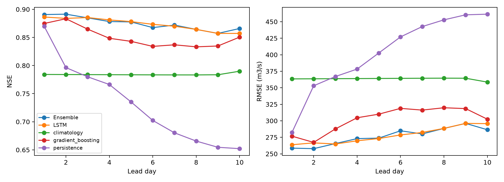

# Marala hindcast-forecast model evaluation

**Forecast-input stand-in experiment:** future ERA5-Land realized weather plus lead-dependent Gaussian noise was used. These are real held-out discharge scores conditioned on a stand-in forecast, NOT operational TIGGE/GFS forecast skill.

Observed test years: [2022, 2023, 2024]. Unique observed basin-days scored: **1084**. Observed issue/lead/target pairs: 10795. No missing target was scored or filled.

Training years ever used: [2016, 2017, 2018, 2019, 2020]. Validation/selection years ever used: [2021]. Test years were checked against both lists.

| basin_id | year | observed_days |
| --- | --- | --- |
| marala | 2022 | 365 |
| marala | 2023 | 365 |
| marala | 2024 | 354 |

## Models compared

LSTM uses median quantiles. Persistence deliberately uses the latest observed discharge available at issue time even when past-Q input is disabled for the LSTM. Climatology uses training month/day means, with training basin/global mean fallback. Gradient boosting uses the same normalized predictor/missingness channels and forecast prefix, summarized over configurable history windows; it is not given future observed discharge.

The heterogeneous Ensemble combines ['LSTM', 'gradient_boosting'] with nonnegative normalized per-lead weights fitted on validation years [2021] only. No test observation is used for those weights. Saved weights: ../../model/model_10 days/ensemble/runs/initial/weights.json. It is a point-forecast blend; quantile calibration below is for the LSTM, not a claimed probabilistic ensemble.

| lead_day | model | n | NSE | KGE | PBIAS_pct | RMSE_cumecs | MAE_cumecs |
| --- | --- | --- | --- | --- | --- | --- | --- |
| 1 | LSTM | 1084 | 0.886 | 0.902 | -2.371 | 263.760 | 157.279 |
| 1 | persistence | 1084 | 0.870 | 0.935 | 0.000 | 282.358 | 134.178 |
| 1 | climatology | 1084 | 0.784 | 0.849 | 7.793 | 363.415 | 233.349 |
| 1 | gradient_boosting | 1084 | 0.875 | 0.916 | 2.670 | 276.755 | 170.310 |
| 1 | Ensemble | 1084 | 0.891 | 0.912 | -0.231 | 258.621 | 155.689 |
| 2 | LSTM | 1083 | 0.884 | 0.920 | -1.081 | 266.586 | 159.626 |
| 2 | persistence | 1083 | 0.796 | 0.898 | 0.002 | 353.017 | 175.478 |
| 2 | climatology | 1083 | 0.784 | 0.849 | 7.791 | 363.582 | 233.537 |
| 2 | gradient_boosting | 1083 | 0.883 | 0.914 | 3.078 | 267.287 | 166.977 |
| 2 | Ensemble | 1083 | 0.891 | 0.919 | 1.472 | 257.827 | 156.641 |
| 3 | LSTM | 1082 | 0.885 | 0.920 | -0.901 | 264.887 | 159.200 |
| 3 | persistence | 1082 | 0.780 | 0.890 | 0.005 | 367.001 | 197.799 |
| 3 | climatology | 1082 | 0.784 | 0.849 | 7.790 | 363.749 | 233.731 |
| 3 | gradient_boosting | 1082 | 0.865 | 0.906 | 2.884 | 287.740 | 176.531 |
| 3 | Ensemble | 1082 | 0.885 | 0.915 | 1.056 | 265.519 | 160.252 |
| 4 | LSTM | 1081 | 0.881 | 0.932 | 0.423 | 269.735 | 162.602 |
| 4 | persistence | 1081 | 0.766 | 0.883 | 0.006 | 378.291 | 210.616 |
| 4 | climatology | 1081 | 0.784 | 0.849 | 7.790 | 363.917 | 233.942 |
| 4 | gradient_boosting | 1081 | 0.848 | 0.892 | 1.799 | 304.594 | 181.978 |
| 4 | Ensemble | 1081 | 0.878 | 0.918 | 0.991 | 273.029 | 162.163 |
| 5 | LSTM | 1080 | 0.878 | 0.928 | 0.503 | 273.180 | 164.853 |
| 5 | persistence | 1080 | 0.735 | 0.868 | 0.012 | 402.659 | 231.663 |
| 5 | climatology | 1080 | 0.784 | 0.849 | 7.791 | 364.085 | 234.151 |
| 5 | gradient_boosting | 1080 | 0.843 | 0.882 | 1.814 | 310.048 | 187.864 |
| 5 | Ensemble | 1080 | 0.878 | 0.918 | 0.843 | 273.769 | 164.727 |
| 6 | LSTM | 1079 | 0.873 | 0.928 | 2.244 | 278.576 | 169.887 |
| 6 | persistence | 1079 | 0.702 | 0.851 | 0.020 | 426.990 | 244.312 |
| 6 | climatology | 1079 | 0.783 | 0.848 | 7.792 | 364.254 | 234.361 |
| 6 | gradient_boosting | 1079 | 0.834 | 0.872 | 0.359 | 318.816 | 194.348 |
| 6 | Ensemble | 1079 | 0.868 | 0.908 | 1.407 | 284.877 | 172.505 |
| 7 | LSTM | 1078 | 0.870 | 0.925 | 3.709 | 282.328 | 173.495 |
| 7 | persistence | 1078 | 0.680 | 0.840 | 0.033 | 442.631 | 257.468 |
| 7 | climatology | 1078 | 0.783 | 0.848 | 7.806 | 364.407 | 234.475 |
| 7 | gradient_boosting | 1078 | 0.837 | 0.863 | -0.174 | 316.193 | 194.873 |
| 7 | Ensemble | 1078 | 0.872 | 0.923 | 3.105 | 280.113 | 171.975 |
| 8 | LSTM | 1077 | 0.864 | 0.917 | 5.009 | 288.485 | 178.890 |
| 8 | persistence | 1077 | 0.666 | 0.833 | 0.060 | 452.803 | 262.700 |
| 8 | climatology | 1077 | 0.783 | 0.848 | 7.830 | 364.532 | 234.519 |
| 8 | gradient_boosting | 1077 | 0.833 | 0.843 | -1.285 | 319.753 | 196.986 |
| 8 | Ensemble | 1077 | 0.864 | 0.917 | 5.009 | 288.485 | 178.890 |
| 9 | LSTM | 1076 | 0.857 | 0.909 | 5.887 | 296.085 | 184.016 |
| 9 | persistence | 1076 | 0.655 | 0.827 | 0.114 | 460.423 | 268.560 |
| 9 | climatology | 1076 | 0.784 | 0.848 | 7.886 | 364.430 | 234.309 |
| 9 | gradient_boosting | 1076 | 0.835 | 0.861 | -0.634 | 318.462 | 198.573 |
| 9 | Ensemble | 1076 | 0.857 | 0.909 | 5.887 | 296.085 | 184.016 |
| 10 | LSTM | 1075 | 0.857 | 0.910 | 5.644 | 295.702 | 187.128 |
| 10 | persistence | 1075 | 0.652 | 0.826 | 0.364 | 461.403 | 273.370 |
| 10 | climatology | 1075 | 0.790 | 0.850 | 8.144 | 358.575 | 232.513 |
| 10 | gradient_boosting | 1075 | 0.851 | 0.877 | 0.541 | 302.424 | 192.642 |
| 10 | Ensemble | 1075 | 0.866 | 0.916 | 4.630 | 286.462 | 180.540 |

## Seasonal lead-by-lead verification

| basin_id | lead_day | season | model | n | NSE | KGE | PBIAS_pct | RMSE_cumecs | MAE_cumecs | peak_MAPE_pct | peak_n | flood_hit_rate | false_alarm_rate | false_alarm_ratio |
| --- | --- | --- | --- | --- | --- | --- | --- | --- | --- | --- | --- | --- | --- | --- |
| marala | 1 | Apr-Jun | LSTM | 273 | 0.732 | 0.787 | -1.821 | 240.008 | 173.036 | 16.885 | 3 | 0.000 | 0.000 | NA |
| marala | 1 | Apr-Jun | persistence | 273 | 0.813 | 0.899 | -1.821 | 200.460 | 124.781 | 21.215 | 3 | 0.667 | 0.004 | 0.333 |
| marala | 1 | Apr-Jun | climatology | 273 | 0.283 | 0.571 | 22.996 | 392.331 | 310.523 | 40.333 | 3 | 0.000 | 0.000 | NA |
| marala | 1 | Apr-Jun | gradient_boosting | 273 | 0.561 | 0.693 | 10.764 | 306.782 | 241.935 | 26.051 | 3 | 0.000 | 0.000 | NA |
| marala | 1 | Apr-Jun | Ensemble | 273 | 0.694 | 0.754 | 3.520 | 256.176 | 193.336 | 20.776 | 3 | 0.000 | 0.000 | NA |
| marala | 1 | Jul-Sep | LSTM | 276 | 0.689 | 0.718 | -1.827 | 404.138 | 279.943 | 16.142 | 47 | 0.468 | 0.022 | 0.185 |
| marala | 1 | Jul-Sep | persistence | 276 | 0.612 | 0.803 | 0.708 | 451.497 | 284.851 | 21.537 | 47 | 0.596 | 0.083 | 0.404 |
| marala | 1 | Jul-Sep | climatology | 276 | 0.470 | 0.657 | -0.117 | 527.632 | 380.299 | 20.938 | 47 | 0.277 | 0.087 | 0.606 |
| marala | 1 | Jul-Sep | gradient_boosting | 276 | 0.700 | 0.781 | 0.390 | 396.776 | 282.661 | 16.181 | 47 | 0.468 | 0.048 | 0.333 |
| marala | 1 | Jul-Sep | Ensemble | 276 | 0.718 | 0.744 | -0.886 | 384.523 | 269.648 | 15.059 | 47 | 0.511 | 0.031 | 0.226 |
| marala | 1 | Oct-Mar | LSTM | 535 | 0.338 | 0.517 | -4.799 | 165.247 | 85.958 | 84.177 | 1 | 0.000 | 0.000 | NA |
| marala | 1 | Oct-Mar | persistence | 535 | 0.131 | 0.568 | 0.369 | 189.394 | 61.244 | 92.079 | 1 | 0.000 | 0.002 | 1.000 |
| marala | 1 | Oct-Mar | climatology | 535 | -0.101 | 0.218 | 10.855 | 213.148 | 118.160 | 88.229 | 1 | 0.000 | 0.000 | NA |
| marala | 1 | Oct-Mar | gradient_boosting | 535 | 0.371 | 0.470 | -1.605 | 161.087 | 75.802 | 80.530 | 1 | 0.000 | 0.000 | NA |
| marala | 1 | Oct-Mar | Ensemble | 535 | 0.376 | 0.499 | -3.443 | 160.478 | 77.688 | 82.629 | 1 | 0.000 | 0.000 | NA |
| marala | 2 | Apr-Jun | LSTM | 273 | 0.731 | 0.804 | 1.247 | 240.155 | 176.903 | 16.637 | 3 | 0.000 | 0.000 | NA |
| marala | 2 | Apr-Jun | persistence | 273 | 0.707 | 0.834 | -3.557 | 250.589 | 172.225 | 16.403 | 3 | 0.333 | 0.007 | 0.667 |
| marala | 2 | Apr-Jun | climatology | 273 | 0.283 | 0.571 | 22.996 | 392.331 | 310.523 | 40.333 | 3 | 0.000 | 0.000 | NA |
| marala | 2 | Apr-Jun | gradient_boosting | 273 | 0.560 | 0.685 | 12.830 | 307.203 | 245.382 | 19.691 | 3 | 0.000 | 0.000 | NA |
| marala | 2 | Apr-Jun | Ensemble | 273 | 0.658 | 0.735 | 8.357 | 271.111 | 211.058 | 18.512 | 3 | 0.000 | 0.000 | NA |
| marala | 2 | Jul-Sep | LSTM | 276 | 0.684 | 0.733 | -0.096 | 407.030 | 286.860 | 15.213 | 47 | 0.489 | 0.039 | 0.281 |
| marala | 2 | Jul-Sep | persistence | 276 | 0.360 | 0.671 | 1.341 | 579.876 | 369.802 | 21.704 | 47 | 0.553 | 0.092 | 0.447 |
| marala | 2 | Jul-Sep | climatology | 276 | 0.470 | 0.657 | -0.117 | 527.632 | 380.299 | 20.938 | 47 | 0.277 | 0.087 | 0.606 |
| marala | 2 | Jul-Sep | gradient_boosting | 276 | 0.731 | 0.792 | -0.059 | 375.833 | 269.281 | 15.762 | 47 | 0.553 | 0.070 | 0.381 |
| marala | 2 | Jul-Sep | Ensemble | 276 | 0.734 | 0.768 | -0.073 | 373.939 | 262.638 | 14.744 | 47 | 0.574 | 0.052 | 0.308 |
| marala | 2 | Oct-Mar | LSTM | 534 | 0.297 | 0.469 | -7.336 | 170.349 | 85.031 | 83.774 | 1 | 0.000 | 0.000 | NA |
| marala | 2 | Oct-Mar | persistence | 534 | -0.134 | 0.443 | 0.854 | 216.435 | 76.705 | 91.419 | 1 | 0.000 | 0.002 | 1.000 |
| marala | 2 | Oct-Mar | climatology | 534 | -0.102 | 0.217 | 10.848 | 213.343 | 118.324 | 88.229 | 1 | 0.000 | 0.000 | NA |
| marala | 2 | Oct-Mar | gradient_boosting | 534 | 0.428 | 0.495 | -0.889 | 153.747 | 74.017 | 78.734 | 1 | 0.000 | 0.000 | NA |
| marala | 2 | Oct-Mar | Ensemble | 534 | 0.395 | 0.487 | -3.378 | 158.016 | 74.036 | 80.680 | 1 | 0.000 | 0.000 | NA |
| marala | 3 | Apr-Jun | LSTM | 273 | 0.734 | 0.790 | 1.597 | 238.743 | 177.655 | 17.508 | 3 | 0.000 | 0.000 | NA |
| marala | 3 | Apr-Jun | persistence | 273 | 0.600 | 0.767 | -5.319 | 293.090 | 207.273 | 23.820 | 3 | 0.000 | 0.007 | 1.000 |
| marala | 3 | Apr-Jun | climatology | 273 | 0.283 | 0.571 | 22.996 | 392.331 | 310.523 | 40.333 | 3 | 0.000 | 0.000 | NA |
| marala | 3 | Apr-Jun | gradient_boosting | 273 | 0.485 | 0.675 | 14.351 | 332.571 | 262.554 | 18.392 | 3 | 0.000 | 0.000 | NA |
| marala | 3 | Apr-Jun | Ensemble | 273 | 0.646 | 0.738 | 8.191 | 275.758 | 214.171 | 17.965 | 3 | 0.000 | 0.000 | NA |
| marala | 3 | Jul-Sep | LSTM | 276 | 0.693 | 0.740 | -0.118 | 401.379 | 285.849 | 14.806 | 47 | 0.468 | 0.026 | 0.214 |
| marala | 3 | Jul-Sep | persistence | 276 | 0.352 | 0.665 | 1.865 | 583.387 | 396.395 | 22.179 | 47 | 0.468 | 0.114 | 0.542 |
| marala | 3 | Jul-Sep | climatology | 276 | 0.470 | 0.657 | -0.117 | 527.632 | 380.299 | 20.938 | 47 | 0.277 | 0.087 | 0.606 |
| marala | 3 | Jul-Sep | gradient_boosting | 276 | 0.686 | 0.786 | -1.138 | 405.989 | 290.636 | 18.015 | 47 | 0.468 | 0.074 | 0.436 |
| marala | 3 | Jul-Sep | Ensemble | 276 | 0.716 | 0.765 | -0.645 | 386.140 | 272.237 | 15.644 | 47 | 0.468 | 0.044 | 0.312 |
| marala | 3 | Oct-Mar | LSTM | 533 | 0.279 | 0.442 | -6.782 | 172.679 | 84.165 | 82.074 | 1 | 0.000 | 0.000 | NA |
| marala | 3 | Oct-Mar | persistence | 533 | -0.287 | 0.381 | 1.719 | 230.626 | 90.109 | 92.409 | 1 | 0.000 | 0.002 | 1.000 |
| marala | 3 | Oct-Mar | climatology | 533 | -0.103 | 0.216 | 10.844 | 213.541 | 118.502 | 88.229 | 1 | 0.000 | 0.000 | NA |
| marala | 3 | Oct-Mar | gradient_boosting | 533 | 0.369 | 0.438 | -0.763 | 161.468 | 73.384 | 80.875 | 1 | 0.000 | 0.000 | NA |
| marala | 3 | Oct-Mar | Ensemble | 533 | 0.348 | 0.442 | -3.670 | 164.191 | 74.646 | 81.454 | 1 | 0.000 | 0.000 | NA |
| marala | 4 | Apr-Jun | LSTM | 273 | 0.718 | 0.801 | 3.718 | 246.088 | 183.396 | 15.550 | 3 | 0.000 | 0.000 | NA |
| marala | 4 | Apr-Jun | persistence | 273 | 0.552 | 0.702 | -7.322 | 310.120 | 220.228 | 32.545 | 3 | 0.000 | 0.004 | 1.000 |
| marala | 4 | Apr-Jun | climatology | 273 | 0.283 | 0.571 | 22.996 | 392.331 | 310.523 | 40.333 | 3 | 0.000 | 0.000 | NA |
| marala | 4 | Apr-Jun | gradient_boosting | 273 | 0.424 | 0.652 | 13.740 | 351.533 | 270.651 | 26.561 | 3 | 0.000 | 0.000 | NA |
| marala | 4 | Apr-Jun | Ensemble | 273 | 0.638 | 0.746 | 7.852 | 278.748 | 211.167 | 20.093 | 3 | 0.000 | 0.000 | NA |
| marala | 4 | Jul-Sep | LSTM | 276 | 0.684 | 0.755 | 1.710 | 407.505 | 293.546 | 14.010 | 47 | 0.574 | 0.048 | 0.289 |
| marala | 4 | Jul-Sep | persistence | 276 | 0.325 | 0.653 | 2.455 | 595.346 | 420.218 | 22.419 | 47 | 0.468 | 0.118 | 0.551 |
| marala | 4 | Jul-Sep | climatology | 276 | 0.470 | 0.657 | -0.117 | 527.632 | 380.299 | 20.938 | 47 | 0.277 | 0.087 | 0.606 |
| marala | 4 | Jul-Sep | gradient_boosting | 276 | 0.636 | 0.750 | -2.636 | 436.960 | 304.756 | 19.049 | 47 | 0.362 | 0.057 | 0.433 |
| marala | 4 | Jul-Sep | Ensemble | 276 | 0.692 | 0.754 | -0.083 | 401.892 | 281.132 | 15.335 | 47 | 0.511 | 0.052 | 0.333 |
| marala | 4 | Oct-Mar | LSTM | 532 | 0.260 | 0.419 | -8.123 | 174.960 | 83.998 | 82.985 | 1 | 0.000 | 0.000 | NA |
| marala | 4 | Oct-Mar | persistence | 532 | -0.391 | 0.349 | 2.714 | 239.891 | 96.943 | 91.419 | 1 | 0.000 | 0.002 | 1.000 |
| marala | 4 | Oct-Mar | climatology | 532 | -0.104 | 0.214 | 10.853 | 213.741 | 118.714 | 88.229 | 1 | 0.000 | 0.000 | NA |
| marala | 4 | Oct-Mar | gradient_boosting | 532 | 0.371 | 0.417 | -1.243 | 161.399 | 72.778 | 78.414 | 1 | 0.000 | 0.000 | NA |
| marala | 4 | Oct-Mar | Ensemble | 532 | 0.328 | 0.421 | -5.284 | 166.748 | 75.294 | 81.099 | 1 | 0.000 | 0.000 | NA |
| marala | 5 | Apr-Jun | LSTM | 273 | 0.704 | 0.790 | 4.192 | 252.149 | 188.180 | 15.937 | 3 | 0.000 | 0.000 | NA |
| marala | 5 | Apr-Jun | persistence | 273 | 0.479 | 0.645 | -8.791 | 334.435 | 235.528 | 36.857 | 3 | 0.000 | 0.000 | NA |
| marala | 5 | Apr-Jun | climatology | 273 | 0.283 | 0.571 | 22.996 | 392.331 | 310.523 | 40.333 | 3 | 0.000 | 0.000 | NA |
| marala | 5 | Apr-Jun | gradient_boosting | 273 | 0.383 | 0.634 | 15.423 | 364.003 | 283.155 | 25.520 | 3 | 0.000 | 0.000 | NA |
| marala | 5 | Apr-Jun | Ensemble | 273 | 0.656 | 0.756 | 7.106 | 271.561 | 205.827 | 18.423 | 3 | 0.000 | 0.000 | NA |
| marala | 5 | Jul-Sep | LSTM | 276 | 0.677 | 0.750 | 1.402 | 411.664 | 298.461 | 14.687 | 47 | 0.596 | 0.066 | 0.349 |
| marala | 5 | Jul-Sep | persistence | 276 | 0.224 | 0.599 | 2.941 | 638.156 | 471.650 | 24.815 | 47 | 0.362 | 0.144 | 0.660 |
| marala | 5 | Jul-Sep | climatology | 276 | 0.470 | 0.657 | -0.117 | 527.632 | 380.299 | 20.938 | 47 | 0.277 | 0.087 | 0.606 |
| marala | 5 | Jul-Sep | gradient_boosting | 276 | 0.633 | 0.728 | -3.382 | 438.816 | 308.767 | 19.413 | 47 | 0.298 | 0.052 | 0.462 |
| marala | 5 | Jul-Sep | Ensemble | 276 | 0.688 | 0.745 | 0.161 | 404.728 | 290.311 | 15.134 | 47 | 0.553 | 0.048 | 0.297 |
| marala | 5 | Oct-Mar | LSTM | 531 | 0.251 | 0.409 | -7.408 | 176.103 | 83.413 | 82.028 | 1 | 0.000 | 0.000 | NA |
| marala | 5 | Oct-Mar | persistence | 531 | -0.463 | 0.322 | 3.303 | 246.144 | 104.938 | 92.849 | 1 | 0.000 | 0.002 | 1.000 |
| marala | 5 | Oct-Mar | climatology | 531 | -0.105 | 0.213 | 10.859 | 213.942 | 118.923 | 88.229 | 1 | 0.000 | 0.000 | NA |
| marala | 5 | Oct-Mar | gradient_boosting | 531 | 0.341 | 0.393 | -1.220 | 165.258 | 76.031 | 80.093 | 1 | 0.000 | 0.000 | NA |
| marala | 5 | Oct-Mar | Ensemble | 531 | 0.291 | 0.407 | -5.803 | 171.417 | 78.322 | 81.526 | 1 | 0.000 | 0.000 | NA |
| marala | 6 | Apr-Jun | LSTM | 273 | 0.675 | 0.789 | 7.417 | 264.192 | 196.594 | 13.304 | 3 | 0.333 | 0.000 | 0.000 |
| marala | 6 | Apr-Jun | persistence | 273 | 0.438 | 0.607 | -10.149 | 347.177 | 243.992 | 42.209 | 3 | 0.000 | 0.000 | NA |
| marala | 6 | Apr-Jun | climatology | 273 | 0.283 | 0.571 | 22.996 | 392.331 | 310.523 | 40.333 | 3 | 0.000 | 0.000 | NA |
| marala | 6 | Apr-Jun | gradient_boosting | 273 | 0.358 | 0.630 | 13.567 | 371.251 | 291.178 | 22.223 | 3 | 0.000 | 0.000 | NA |
| marala | 6 | Apr-Jun | Ensemble | 273 | 0.575 | 0.727 | 10.148 | 301.860 | 231.005 | 17.264 | 3 | 0.000 | 0.000 | NA |
| marala | 6 | Jul-Sep | LSTM | 276 | 0.668 | 0.734 | 2.826 | 417.238 | 306.489 | 14.783 | 47 | 0.617 | 0.074 | 0.370 |
| marala | 6 | Jul-Sep | persistence | 276 | 0.093 | 0.528 | 3.356 | 690.221 | 504.307 | 25.766 | 47 | 0.383 | 0.140 | 0.640 |
| marala | 6 | Jul-Sep | climatology | 276 | 0.470 | 0.657 | -0.117 | 527.632 | 380.299 | 20.938 | 47 | 0.277 | 0.087 | 0.606 |
| marala | 6 | Jul-Sep | gradient_boosting | 276 | 0.600 | 0.717 | -5.002 | 458.546 | 324.694 | 21.454 | 47 | 0.255 | 0.044 | 0.455 |
| marala | 6 | Jul-Sep | Ensemble | 276 | 0.671 | 0.729 | -0.650 | 415.573 | 296.299 | 16.937 | 47 | 0.447 | 0.039 | 0.300 |
| marala | 6 | Oct-Mar | LSTM | 530 | 0.243 | 0.416 | -6.776 | 177.151 | 84.995 | 80.537 | 1 | 0.000 | 0.000 | NA |
| marala | 6 | Oct-Mar | persistence | 530 | -0.471 | 0.325 | 3.972 | 246.985 | 109.084 | 91.419 | 1 | 0.000 | 0.002 | 1.000 |
| marala | 6 | Oct-Mar | climatology | 530 | -0.106 | 0.212 | 10.866 | 214.144 | 119.133 | 88.229 | 1 | 0.000 | 0.000 | NA |
| marala | 6 | Oct-Mar | gradient_boosting | 530 | 0.362 | 0.408 | -1.614 | 162.606 | 76.594 | 74.813 | 1 | 0.000 | 0.000 | NA |
| marala | 6 | Oct-Mar | Ensemble | 530 | 0.316 | 0.415 | -4.484 | 168.373 | 77.906 | 77.996 | 1 | 0.000 | 0.000 | NA |
| marala | 7 | Apr-Jun | LSTM | 273 | 0.654 | 0.789 | 9.169 | 272.478 | 200.674 | 10.841 | 3 | 0.667 | 0.000 | 0.000 |
| marala | 7 | Apr-Jun | persistence | 273 | 0.413 | 0.585 | -11.376 | 355.056 | 248.753 | 46.180 | 3 | 0.000 | 0.000 | NA |
| marala | 7 | Apr-Jun | climatology | 273 | 0.283 | 0.571 | 22.996 | 392.331 | 310.523 | 40.333 | 3 | 0.000 | 0.000 | NA |
| marala | 7 | Apr-Jun | gradient_boosting | 273 | 0.369 | 0.639 | 14.631 | 368.096 | 290.676 | 15.757 | 3 | 0.333 | 0.000 | 0.000 |
| marala | 7 | Apr-Jun | Ensemble | 273 | 0.631 | 0.770 | 10.019 | 281.480 | 210.032 | 11.606 | 3 | 0.667 | 0.000 | 0.000 |
| marala | 7 | Jul-Sep | LSTM | 276 | 0.664 | 0.732 | 4.397 | 420.321 | 313.578 | 14.194 | 47 | 0.596 | 0.087 | 0.417 |
| marala | 7 | Jul-Sep | persistence | 276 | 0.011 | 0.482 | 3.658 | 720.569 | 539.056 | 28.539 | 47 | 0.362 | 0.144 | 0.660 |
| marala | 7 | Jul-Sep | climatology | 276 | 0.470 | 0.657 | -0.117 | 527.632 | 380.299 | 20.938 | 47 | 0.277 | 0.087 | 0.606 |
| marala | 7 | Jul-Sep | gradient_boosting | 276 | 0.610 | 0.719 | -6.606 | 452.469 | 319.533 | 21.728 | 47 | 0.298 | 0.044 | 0.417 |
| marala | 7 | Jul-Sep | Ensemble | 276 | 0.678 | 0.733 | 2.684 | 411.492 | 303.650 | 15.012 | 47 | 0.532 | 0.079 | 0.419 |
| marala | 7 | Oct-Mar | LSTM | 529 | 0.231 | 0.417 | -6.054 | 178.722 | 86.381 | 80.749 | 1 | 0.000 | 0.000 | NA |
| marala | 7 | Oct-Mar | persistence | 529 | -0.524 | 0.310 | 4.836 | 251.588 | 115.050 | 84.378 | 1 | 0.000 | 0.002 | 1.000 |
| marala | 7 | Oct-Mar | climatology | 529 | -0.105 | 0.212 | 10.952 | 214.291 | 119.146 | 88.229 | 1 | 0.000 | 0.000 | NA |
| marala | 7 | Oct-Mar | gradient_boosting | 529 | 0.350 | 0.404 | -1.085 | 164.305 | 80.391 | 73.409 | 1 | 0.000 | 0.000 | NA |
| marala | 7 | Oct-Mar | Ensemble | 529 | 0.262 | 0.417 | -5.280 | 175.102 | 83.634 | 79.607 | 1 | 0.000 | 0.000 | NA |
| marala | 8 | Apr-Jun | LSTM | 273 | 0.637 | 0.791 | 9.845 | 278.956 | 205.332 | 10.184 | 3 | 0.667 | 0.000 | 0.000 |
| marala | 8 | Apr-Jun | persistence | 273 | 0.392 | 0.555 | -13.055 | 361.165 | 253.908 | 51.803 | 3 | 0.000 | 0.000 | NA |
| marala | 8 | Apr-Jun | climatology | 273 | 0.283 | 0.571 | 22.996 | 392.331 | 310.523 | 40.333 | 3 | 0.000 | 0.000 | NA |
| marala | 8 | Apr-Jun | gradient_boosting | 273 | 0.391 | 0.603 | 13.288 | 361.500 | 286.122 | 27.065 | 3 | 0.000 | 0.000 | NA |
| marala | 8 | Apr-Jun | Ensemble | 273 | 0.637 | 0.791 | 9.845 | 278.956 | 205.332 | 10.184 | 3 | 0.667 | 0.000 | 0.000 |
| marala | 8 | Jul-Sep | LSTM | 276 | 0.645 | 0.729 | 6.261 | 431.714 | 328.119 | 13.887 | 47 | 0.660 | 0.100 | 0.426 |
| marala | 8 | Jul-Sep | persistence | 276 | -0.045 | 0.447 | 4.169 | 740.693 | 550.127 | 28.781 | 47 | 0.362 | 0.144 | 0.660 |
| marala | 8 | Jul-Sep | climatology | 276 | 0.470 | 0.657 | -0.117 | 527.632 | 380.299 | 20.938 | 47 | 0.277 | 0.087 | 0.606 |
| marala | 8 | Jul-Sep | gradient_boosting | 276 | 0.592 | 0.704 | -8.192 | 462.938 | 322.446 | 23.174 | 47 | 0.213 | 0.031 | 0.412 |
| marala | 8 | Jul-Sep | Ensemble | 276 | 0.645 | 0.729 | 6.261 | 431.714 | 328.119 | 13.887 | 47 | 0.660 | 0.100 | 0.426 |
| marala | 8 | Oct-Mar | LSTM | 528 | 0.229 | 0.417 | -5.646 | 179.158 | 87.212 | 80.842 | 1 | 0.000 | 0.000 | NA |
| marala | 8 | Oct-Mar | persistence | 528 | -0.538 | 0.311 | 5.776 | 252.964 | 117.000 | 84.378 | 1 | 0.000 | 0.002 | 1.000 |
| marala | 8 | Oct-Mar | climatology | 528 | -0.104 | 0.212 | 11.089 | 214.339 | 119.018 | 88.229 | 1 | 0.000 | 0.000 | NA |
| marala | 8 | Oct-Mar | gradient_boosting | 528 | 0.304 | 0.393 | -0.406 | 170.162 | 85.317 | 71.255 | 1 | 0.000 | 0.000 | NA |
| marala | 8 | Oct-Mar | Ensemble | 528 | 0.229 | 0.417 | -5.646 | 179.158 | 87.212 | 80.842 | 1 | 0.000 | 0.000 | NA |
| marala | 9 | Apr-Jun | LSTM | 273 | 0.614 | 0.781 | 9.723 | 287.732 | 211.180 | 10.472 | 3 | 0.667 | 0.000 | 0.000 |
| marala | 9 | Apr-Jun | persistence | 273 | 0.366 | 0.536 | -14.187 | 368.884 | 256.988 | 55.333 | 3 | 0.000 | 0.000 | NA |
| marala | 9 | Apr-Jun | climatology | 273 | 0.283 | 0.571 | 22.996 | 392.331 | 310.523 | 40.333 | 3 | 0.000 | 0.000 | NA |
| marala | 9 | Apr-Jun | gradient_boosting | 273 | 0.365 | 0.603 | 12.563 | 369.234 | 289.761 | 25.195 | 3 | 0.000 | 0.000 | NA |
| marala | 9 | Apr-Jun | Ensemble | 273 | 0.614 | 0.781 | 9.723 | 287.732 | 211.180 | 10.472 | 3 | 0.667 | 0.000 | 0.000 |
| marala | 9 | Jul-Sep | LSTM | 276 | 0.623 | 0.713 | 7.531 | 444.825 | 339.648 | 13.484 | 47 | 0.660 | 0.118 | 0.466 |
| marala | 9 | Jul-Sep | persistence | 276 | -0.074 | 0.428 | 4.404 | 751.043 | 562.818 | 29.698 | 47 | 0.340 | 0.148 | 0.680 |
| marala | 9 | Jul-Sep | climatology | 276 | 0.470 | 0.657 | -0.117 | 527.632 | 380.299 | 20.938 | 47 | 0.277 | 0.087 | 0.606 |
| marala | 9 | Jul-Sep | gradient_boosting | 276 | 0.616 | 0.728 | -6.402 | 449.102 | 326.115 | 21.146 | 47 | 0.298 | 0.039 | 0.391 |
| marala | 9 | Jul-Sep | Ensemble | 276 | 0.623 | 0.713 | 7.531 | 444.825 | 339.648 | 13.484 | 47 | 0.660 | 0.118 | 0.466 |
| marala | 9 | Oct-Mar | LSTM | 527 | 0.217 | 0.423 | -4.613 | 180.214 | 88.437 | 80.761 | 1 | 0.000 | 0.000 | NA |
| marala | 9 | Oct-Mar | persistence | 527 | -0.613 | 0.290 | 6.962 | 258.702 | 120.446 | 94.279 | 1 | 0.000 | 0.002 | 1.000 |
| marala | 9 | Oct-Mar | climatology | 527 | -0.100 | 0.216 | 11.410 | 213.601 | 118.370 | 88.229 | 1 | 0.000 | 0.000 | NA |
| marala | 9 | Oct-Mar | gradient_boosting | 527 | 0.257 | 0.363 | -1.346 | 175.541 | 84.540 | 81.716 | 1 | 0.000 | 0.000 | NA |
| marala | 9 | Oct-Mar | Ensemble | 527 | 0.217 | 0.423 | -4.613 | 180.214 | 88.437 | 80.761 | 1 | 0.000 | 0.000 | NA |
| marala | 10 | Apr-Jun | LSTM | 273 | 0.601 | 0.771 | 9.419 | 292.728 | 215.580 | 12.579 | 3 | 0.333 | 0.000 | 0.000 |
| marala | 10 | Apr-Jun | persistence | 273 | 0.339 | 0.514 | -15.373 | 376.671 | 258.337 | 56.748 | 3 | 0.000 | 0.000 | NA |
| marala | 10 | Apr-Jun | climatology | 273 | 0.283 | 0.571 | 22.996 | 392.331 | 310.523 | 40.333 | 3 | 0.000 | 0.000 | NA |
| marala | 10 | Apr-Jun | gradient_boosting | 273 | 0.412 | 0.595 | 12.946 | 355.271 | 279.989 | 25.720 | 3 | 0.000 | 0.000 | NA |
| marala | 10 | Apr-Jun | Ensemble | 273 | 0.588 | 0.745 | 10.120 | 297.456 | 222.642 | 15.189 | 3 | 0.333 | 0.000 | 0.000 |
| marala | 10 | Jul-Sep | LSTM | 276 | 0.602 | 0.671 | 6.689 | 456.941 | 351.428 | 15.384 | 47 | 0.617 | 0.096 | 0.431 |
| marala | 10 | Jul-Sep | persistence | 276 | -0.107 | 0.406 | 4.699 | 762.450 | 582.927 | 28.371 | 47 | 0.298 | 0.157 | 0.720 |
| marala | 10 | Jul-Sep | climatology | 276 | 0.470 | 0.657 | -0.117 | 527.632 | 380.299 | 20.938 | 47 | 0.277 | 0.087 | 0.606 |
| marala | 10 | Jul-Sep | gradient_boosting | 276 | 0.642 | 0.762 | -5.154 | 433.528 | 319.371 | 19.793 | 47 | 0.340 | 0.057 | 0.448 |
| marala | 10 | Jul-Sep | Ensemble | 276 | 0.643 | 0.693 | 4.337 | 433.088 | 325.656 | 15.687 | 47 | 0.553 | 0.087 | 0.435 |
| marala | 10 | Oct-Mar | LSTM | 526 | 0.254 | 0.520 | -3.041 | 157.070 | 86.150 | 81.073 | 1 | 0.000 | 0.000 | NA |
| marala | 10 | Oct-Mar | persistence | 526 | -0.705 | 0.312 | 9.224 | 237.536 | 118.742 | 78.878 | 1 | 0.000 | 0.002 | 1.000 |
| marala | 10 | Oct-Mar | climatology | 526 | -0.112 | 0.290 | 12.902 | 191.855 | 114.480 | 88.229 | 1 | 0.000 | 0.000 | NA |
| marala | 10 | Oct-Mar | gradient_boosting | 526 | 0.311 | 0.451 | 0.725 | 150.974 | 80.811 | 80.909 | 1 | 0.000 | 0.000 | NA |
| marala | 10 | Oct-Mar | Ensemble | 526 | 0.294 | 0.512 | -2.293 | 152.869 | 82.544 | 81.040 | 1 | 0.000 | 0.000 | NA |

Peak MAPE applies to observed days above training-basin Q95 (or configured percentile). Default flood thresholds are training Q95, not official flood categories. Hit rate = hits/observed exceedances. False-alarm rate = false alerts/observed non-exceedances; false-alarm ratio = false alerts/all alerts. NA means an undefined denominator. These count daily exceedances, not independent flood events.

## Quantile calibration

| basin_id | lead_day | season | n | interval_nominal | interval_coverage | mean_interval_width_cumecs | empirical_q0.05 | empirical_q0.25 | empirical_q0.5 | empirical_q0.75 | empirical_q0.95 |
| --- | --- | --- | --- | --- | --- | --- | --- | --- | --- | --- | --- |
| marala | 1 | Apr-Jun | 273 | 0.900 | 0.883 | 690.447 | 0.033 | 0.311 | 0.487 | 0.707 | 0.916 |
| marala | 1 | Jul-Sep | 276 | 0.900 | 0.975 | 2099.656 | 0.000 | 0.159 | 0.533 | 0.848 | 0.975 |
| marala | 1 | Oct-Mar | 535 | 0.900 | 0.867 | 276.630 | 0.028 | 0.299 | 0.488 | 0.645 | 0.895 |
| marala | 2 | Apr-Jun | 273 | 0.900 | 0.864 | 656.497 | 0.059 | 0.392 | 0.542 | 0.722 | 0.923 |
| marala | 2 | Jul-Sep | 276 | 0.900 | 0.949 | 1834.888 | 0.000 | 0.225 | 0.572 | 0.833 | 0.949 |
| marala | 2 | Oct-Mar | 534 | 0.900 | 0.852 | 247.520 | 0.041 | 0.296 | 0.449 | 0.597 | 0.893 |
| marala | 3 | Apr-Jun | 273 | 0.900 | 0.857 | 652.840 | 0.081 | 0.403 | 0.564 | 0.722 | 0.938 |
| marala | 3 | Jul-Sep | 276 | 0.900 | 0.949 | 1777.310 | 0.000 | 0.246 | 0.554 | 0.815 | 0.949 |
| marala | 3 | Oct-Mar | 533 | 0.900 | 0.852 | 247.112 | 0.051 | 0.311 | 0.469 | 0.642 | 0.902 |
| marala | 4 | Apr-Jun | 273 | 0.900 | 0.835 | 652.000 | 0.103 | 0.414 | 0.571 | 0.758 | 0.938 |
| marala | 4 | Jul-Sep | 276 | 0.900 | 0.946 | 1698.987 | 0.000 | 0.308 | 0.569 | 0.808 | 0.946 |
| marala | 4 | Oct-Mar | 532 | 0.900 | 0.838 | 237.386 | 0.058 | 0.310 | 0.457 | 0.622 | 0.897 |
| marala | 5 | Apr-Jun | 273 | 0.900 | 0.864 | 717.049 | 0.084 | 0.396 | 0.597 | 0.788 | 0.949 |
| marala | 5 | Jul-Sep | 276 | 0.900 | 0.957 | 1810.282 | 0.000 | 0.257 | 0.587 | 0.812 | 0.957 |
| marala | 5 | Oct-Mar | 531 | 0.900 | 0.866 | 258.753 | 0.049 | 0.298 | 0.469 | 0.655 | 0.915 |
| marala | 6 | Apr-Jun | 273 | 0.900 | 0.839 | 735.284 | 0.117 | 0.473 | 0.615 | 0.810 | 0.956 |
| marala | 6 | Jul-Sep | 276 | 0.900 | 0.938 | 1730.880 | 0.011 | 0.330 | 0.620 | 0.833 | 0.949 |
| marala | 6 | Oct-Mar | 530 | 0.900 | 0.858 | 254.666 | 0.058 | 0.328 | 0.466 | 0.647 | 0.917 |
| marala | 7 | Apr-Jun | 273 | 0.900 | 0.861 | 770.385 | 0.106 | 0.451 | 0.634 | 0.839 | 0.967 |
| marala | 7 | Jul-Sep | 276 | 0.900 | 0.946 | 1783.428 | 0.014 | 0.395 | 0.656 | 0.855 | 0.960 |
| marala | 7 | Oct-Mar | 529 | 0.900 | 0.856 | 256.745 | 0.062 | 0.325 | 0.469 | 0.660 | 0.919 |
| marala | 8 | Apr-Jun | 273 | 0.900 | 0.853 | 786.108 | 0.117 | 0.440 | 0.637 | 0.846 | 0.971 |
| marala | 8 | Jul-Sep | 276 | 0.900 | 0.942 | 1791.307 | 0.025 | 0.417 | 0.681 | 0.866 | 0.967 |
| marala | 8 | Oct-Mar | 528 | 0.900 | 0.856 | 261.144 | 0.070 | 0.339 | 0.481 | 0.680 | 0.926 |
| marala | 9 | Apr-Jun | 273 | 0.900 | 0.821 | 750.958 | 0.136 | 0.458 | 0.634 | 0.832 | 0.956 |
| marala | 9 | Jul-Sep | 276 | 0.900 | 0.928 | 1741.789 | 0.036 | 0.453 | 0.710 | 0.877 | 0.964 |
| marala | 9 | Oct-Mar | 527 | 0.900 | 0.822 | 247.021 | 0.093 | 0.349 | 0.488 | 0.677 | 0.915 |
| marala | 10 | Apr-Jun | 273 | 0.900 | 0.810 | 750.178 | 0.143 | 0.462 | 0.652 | 0.824 | 0.952 |
| marala | 10 | Jul-Sep | 276 | 0.900 | 0.917 | 1720.082 | 0.040 | 0.467 | 0.703 | 0.862 | 0.957 |
| marala | 10 | Oct-Mar | 526 | 0.900 | 0.800 | 245.188 | 0.110 | 0.357 | 0.487 | 0.679 | 0.911 |

With default quantiles, 0.05-0.95 interval nominal coverage is 0.90. Quantile ordering is enforced structurally; calibration is measured, not guaranteed. Multiple seeds use the arithmetic mean of member quantile forecasts, not exact mixture-distribution quantiles.

## Data availability

| split | samples | target_values_observed | forecast_input_missing_pct | entire_forecast_window_missing_samples |
| --- | --- | --- | --- | --- |
| train | 1767.000 | 17625.000 | 0.000 | 0.000 |
| validation | 356.000 | 3550.000 | 0.000 | 0.000 |
| test | 1084.000 | 10795.000 | 0.000 | 0.000 |

Only all-missing target windows are excluded, apart from required history/calendar/split boundaries. Missing inputs remain explicitly flagged and receive transformed training-mean predictor values; a sample can consequently contain entirely unavailable forecast inputs. Future reanalysis availability, source latency and WAPDA reading-time uncertainty remain material limitations.

## Known limits

Short single-basin record; sparse independent extremes; overlapping target windows; regulation and diversions not modeled. Static climatological attributes may encode post-training years unless reconstructed appropriately. Archived forecasts can differ systematically from noisy reanalysis. No synthetic test result is evidence of real accuracy. No accuracy is guaranteed on a new basin or period.

The 2022-2024 period has been inspected in earlier workspace experiments; it is held out from this run, but is not an untouched research holdout across the entire project history.

Full observed/predicted pairs, seasonal metrics, calibration and thresholds are saved alongside this report.
