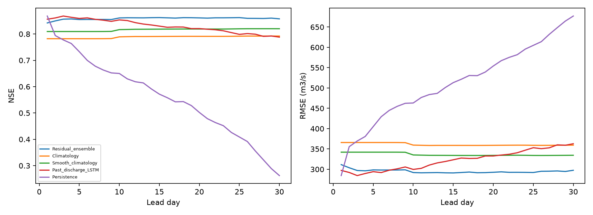

# Thirty-day climatology-residual LSTM ensemble

Day-30 mean-flow NSE is **0.858**, versus exact climatology **0.792** and smoothed climatology **0.820**. Beats the original climatology: **True**; beats the smoothed control: **True**.

Three seeds were trained sequentially: [42, 43, 44]. Selected epochs: [4, 2, 10]; total fitting time 150.5 seconds. All choices, blend strengths and empirical quantile offsets were fixed using 2021 before this benchmark evaluation.

Observed benchmark: 2022-2024, 1084 unique target dates, 31932 issue/lead/target pairs, and 1055 day-30 observations. Original targets and NaNs were never changed.

## Day-30 observed scores

| model | lead_day | n | NSE | KGE | RMSE_cumecs | MAE_cumecs | PBIAS_pct |
| --- | --- | --- | --- | --- | --- | --- | --- |
| Residual_ensemble | 30 | 1055 | 0.858 | 0.874 | 297.556 | 191.690 | 4.150 |
| Raw_residual_ensemble | 30 | 1055 | 0.858 | 0.874 | 297.556 | 191.690 | 4.150 |
| Climatology | 30 | 1055 | 0.792 | 0.845 | 359.398 | 231.857 | 8.837 |
| Smooth_climatology | 30 | 1055 | 0.820 | 0.835 | 334.475 | 219.162 | 8.781 |
| Weather_only_LSTM | 30 | 1055 | 0.784 | 0.884 | 366.025 | 224.066 | 3.333 |
| Past_discharge_LSTM | 30 | 1055 | 0.788 | 0.871 | 362.871 | 215.196 | -5.660 |
| Persistence | 30 | 1055 | 0.262 | 0.629 | 677.066 | 446.424 | 1.149 |

## Selected leads

| model | lead_day | n | NSE | KGE | RMSE_cumecs | MAE_cumecs | PBIAS_pct |
| --- | --- | --- | --- | --- | --- | --- | --- |
| Residual_ensemble | 1 | 1067 | 0.842 | 0.918 | 311.492 | 200.324 | -1.192 |
| Climatology | 1 | 1067 | 0.782 | 0.849 | 365.863 | 235.512 | 7.634 |
| Smooth_climatology | 1 | 1067 | 0.809 | 0.839 | 342.114 | 223.249 | 7.626 |
| Residual_ensemble | 10 | 1067 | 0.861 | 0.919 | 292.000 | 187.616 | 1.686 |
| Climatology | 10 | 1067 | 0.789 | 0.850 | 359.501 | 233.108 | 8.020 |
| Smooth_climatology | 10 | 1067 | 0.817 | 0.840 | 335.291 | 221.013 | 8.004 |
| Residual_ensemble | 20 | 1065 | 0.861 | 0.897 | 292.670 | 186.284 | 3.041 |
| Climatology | 20 | 1065 | 0.791 | 0.847 | 358.981 | 232.234 | 8.482 |
| Smooth_climatology | 20 | 1065 | 0.819 | 0.838 | 334.238 | 219.511 | 8.443 |
| Residual_ensemble | 30 | 1055 | 0.858 | 0.874 | 297.556 | 191.690 | 4.150 |
| Climatology | 30 | 1055 | 0.792 | 0.845 | 359.398 | 231.857 | 8.837 |
| Smooth_climatology | 30 | 1055 | 0.820 | 0.835 | 334.475 | 219.162 | 8.781 |

## High-flow and other days at day 30

| model | group | n | NSE | RMSE_cumecs | MAE_cumecs | flood_hit_rate | false_alarm_ratio |
| --- | --- | --- | --- | --- | --- | --- | --- |
| Residual_ensemble | flood | 51 | -1.284 | 826.055 | 637.186 | 0.333 | 0.000 |
| Residual_ensemble | non_flood | 1004 | 0.854 | 241.609 | 169.060 | NA | 1.000 |
| Climatology | flood | 51 | -2.173 | 973.625 | 743.534 | 0.255 | 0.000 |
| Climatology | non_flood | 1004 | 0.781 | 295.932 | 205.866 | NA | 1.000 |
| Smooth_climatology | flood | 51 | -2.155 | 970.846 | 771.454 | 0.000 | NA |
| Smooth_climatology | non_flood | 1004 | 0.826 | 263.966 | 191.108 | NA | NA |
| Past_discharge_LSTM | flood | 51 | -1.734 | 903.829 | 705.947 | 0.471 | 0.000 |
| Past_discharge_LSTM | non_flood | 1004 | 0.758 | 311.236 | 190.267 | NA | 1.000 |

High-flow proxy: observed discharge above training-only Q95 = 2494.714185 cumecs. This is not an official flood category or an independent event count.

## Day-30 seasons

| model | lead_day | season | n | NSE | KGE | RMSE_cumecs | MAE_cumecs | PBIAS_pct | peak_n | peak_MAPE_pct | flood_hit_rate | false_alarm_rate | false_alarm_ratio |
| --- | --- | --- | --- | --- | --- | --- | --- | --- | --- | --- | --- | --- | --- |
| Residual_ensemble | 30 | Apr-Jun | 273 | 0.525 | 0.640 | 319.187 | 270.664 | 21.097 | 3 | 24.178 | 0.000 | 0.000 | NA |
| Residual_ensemble | 30 | Jul-Sep | 276 | 0.611 | 0.746 | 451.890 | 320.550 | -4.316 | 47 | 18.978 | 0.362 | 0.061 | 0.452 |
| Residual_ensemble | 30 | Oct-Mar | 506 | 0.410 | 0.511 | 135.098 | 78.794 | 6.732 | 1 | 69.532 | 0.000 | 0.000 | NA |
| Climatology | 30 | Apr-Jun | 273 | 0.283 | 0.571 | 392.331 | 310.523 | 22.996 | 3 | 40.333 | 0.000 | 0.000 | NA |
| Climatology | 30 | Jul-Sep | 276 | 0.470 | 0.657 | 527.632 | 380.299 | -0.117 | 47 | 20.938 | 0.277 | 0.087 | 0.606 |
| Climatology | 30 | Oct-Mar | 506 | -0.113 | 0.331 | 185.507 | 108.447 | 17.340 | 1 | 88.229 | 0.000 | 0.000 | NA |
| Smooth_climatology | 30 | Apr-Jun | 273 | 0.309 | 0.583 | 385.059 | 312.840 | 24.403 | 3 | 37.033 | 0.000 | 0.000 | NA |
| Smooth_climatology | 30 | Jul-Sep | 276 | 0.553 | 0.639 | 484.327 | 341.152 | -1.453 | 47 | 22.248 | 0.000 | 0.000 | NA |
| Smooth_climatology | 30 | Oct-Mar | 506 | 0.181 | 0.388 | 159.088 | 102.081 | 19.356 | 1 | 83.428 | 0.000 | 0.000 | NA |

## Day-30 interval coverage

| lead_day | version | n | coverage_05_95 | interval_width_cumecs |
| --- | --- | --- | --- | --- |
| 30 | raw | 1055 | 0.924 | 886.058 |
| 30 | validation_adjusted | 1055 | 0.906 | 769.340 |

Nominal P05-P95 coverage is 90%. The separate quantile head is trained with pinball loss. Empirical offsets use validation residual quantiles in three predefined lead groups; ordering is projected after correction. The same validation year was used for checkpoint selection and correction fitting, so there is no independent conformal coverage guarantee. Quantiles remain daily marginal values, not joint event probabilities.

## Model and objective

The mean-flow head predicts a correction to a 31-day circular, count-weighted climatology fitted only on observed 2016-2020 discharge. Training anchors are cross-fitted by excluding the target year. Validation and benchmark use full training climatology. A separate exact month/day climatology is retained as the original benchmark.

The encoder and decoder start from the saved past-discharge LSTM; the extra climatology input column is zero-initialized. Mean and quantile heads are new. Training uses linear-flow MSE scaled by training flow standard deviation, auxiliary ordered-quantile pinball loss, and a residual penalty. Leads 21-30 receive double training weight. Selection uses validation mean scaled MSE across leads 21-30, with the initial smooth-climatology prediction retained as an epoch-zero fallback.

The three selected mean/quantile outputs are averaged. A validation-fitted coefficient in each predefined group (1-10, 11-20, 21-30) shrinks them toward exact climatology. Mean and median are separate outputs; NSE is scored on the mean forecast, unlike the earlier median-based LSTMs.

## Limits and interpretation

Weather is still noisy future reanalysis, not archived operational forecasts. Only past observed flow through issue time is an input. Source publication latency is unverified. These previously inspected 2022-2024 years are a comparison benchmark, not a fresh project-wide holdout. One three-seed ensemble does not establish general performance across future periods. There was no test-driven retry after this evaluation.

Both the original and smoothed climatology controls are reported so a benefit from calendar smoothing is not attributed automatically to the neural network. Epoch-zero selections, if any, appear in the training summaries. No other model family was trained in this step.

