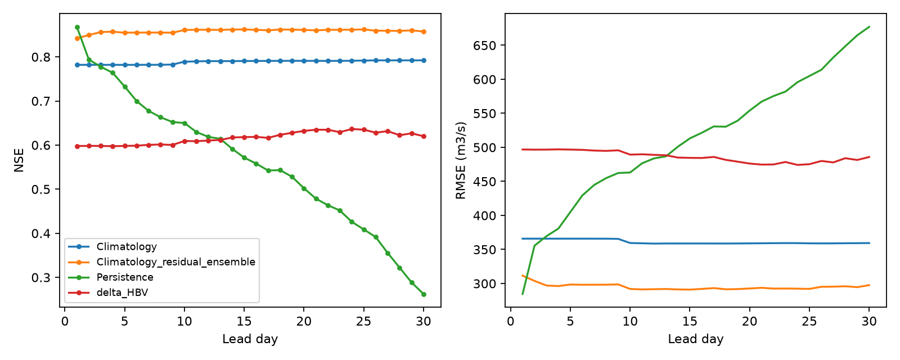

# Marala 30-day differentiable HBV: actual results

The authors' HBV 1.0 equations are coupled to a new causal LSTM parameter network and trained end to end on Marala. This is a single-basin adaptation of delta-HBV, not downloaded pretrained delta-HBV weights or delta-HBV 2.0.

Train: [2016, 2017, 2018, 2019, 2020]; validation/checkpoint selection: [2021]; test: [2022, 2023, 2024]. Observed test days: **1084**; observed issue/lead pairs: **31932**. Missing targets were never filled or scored.

Actual training: **226.6 seconds**, 80 epochs, selected epoch 80, seed 42, 6,668 trainable parameters. One fixed configuration; no HPO sweep.

## Scores on identical observed records

| model | lead_day | n | NSE | KGE | RMSE_cumecs | MAE_cumecs | PBIAS_pct |
| --- | --- | --- | --- | --- | --- | --- | --- |
| delta_HBV | 1 | 1067 | 0.598 | 0.761 | 496.901 | 301.488 | -15.009 |
| Climatology_residual_ensemble | 1 | 1067 | 0.842 | 0.918 | 311.492 | 200.324 | -1.192 |
| Persistence | 1 | 1067 | 0.868 | 0.934 | 284.578 | 135.985 | -0.003 |
| Climatology | 1 | 1067 | 0.782 | 0.849 | 365.863 | 235.512 | 7.634 |
| delta_HBV | 10 | 1067 | 0.609 | 0.773 | 489.337 | 300.821 | -13.522 |
| Climatology_residual_ensemble | 10 | 1067 | 0.861 | 0.919 | 292.000 | 187.616 | 1.686 |
| Persistence | 10 | 1067 | 0.650 | 0.825 | 463.111 | 275.109 | 0.328 |
| Climatology | 10 | 1067 | 0.789 | 0.850 | 359.501 | 233.108 | 8.020 |
| delta_HBV | 20 | 1065 | 0.632 | 0.802 | 476.230 | 289.151 | -9.206 |
| Climatology_residual_ensemble | 20 | 1065 | 0.861 | 0.897 | 292.670 | 186.284 | 3.041 |
| Persistence | 20 | 1065 | 0.502 | 0.751 | 554.099 | 349.167 | 0.756 |
| Climatology | 20 | 1065 | 0.791 | 0.847 | 358.981 | 232.234 | 8.482 |
| delta_HBV | 30 | 1055 | 0.620 | 0.814 | 485.844 | 302.985 | -0.757 |
| Climatology_residual_ensemble | 30 | 1055 | 0.858 | 0.874 | 297.556 | 191.690 | 4.150 |
| Persistence | 30 | 1055 | 0.262 | 0.629 | 677.066 | 446.424 | 1.149 |
| Climatology | 30 | 1055 | 0.792 | 0.845 | 359.398 | 231.857 | 8.837 |

## Flood and other days at lead 30

| model | group | n | NSE | KGE | RMSE_cumecs | MAE_cumecs |
| --- | --- | --- | --- | --- | --- | --- |
| delta_HBV | flood | 51 | -3.472 | -0.344 | 1155.823 | 951.072 |
| delta_HBV | non_flood | 1004 | 0.550 | 0.781 | 424.469 | 270.064 |
| Climatology_residual_ensemble | flood | 51 | -1.284 | 0.268 | 826.055 | 637.186 |
| Climatology_residual_ensemble | non_flood | 1004 | 0.854 | 0.886 | 241.609 | 169.060 |
| Persistence | flood | 51 | -7.479 | -0.087 | 1591.603 | 1388.691 |
| Persistence | non_flood | 1004 | 0.119 | 0.586 | 594.161 | 398.560 |
| Climatology | flood | 51 | -2.173 | 0.024 | 973.625 | 743.534 |
| Climatology | non_flood | 1004 | 0.781 | 0.808 | 295.932 | 205.866 |

Flood proxy: observed Q above training Q95 = **2494.714185 m3/s**; other days are at or below it. This is not an official flood category. NSE is not an accuracy percentage.

## Seasonal scores

| model | lead_day | season | n | NSE | KGE | RMSE_cumecs | MAE_cumecs | PBIAS_pct | peak_n | peak_MAPE_pct | flood_hit_rate | false_alarm_rate | false_alarm_ratio |
| --- | --- | --- | --- | --- | --- | --- | --- | --- | --- | --- | --- | --- | --- |
| delta_HBV | 30 | Apr-Jun | 273 | 0.334 | 0.668 | 378.122 | 292.810 | 13.668 | 3 | 12.907 | 1.000 | 0.007 | 0.400 |
| delta_HBV | 30 | Jul-Sep | 276 | -0.262 | 0.444 | 813.922 | 590.660 | -9.747 | 47 | 32.693 | 0.468 | 0.083 | 0.463 |
| delta_HBV | 30 | Oct-Mar | 506 | -0.736 | 0.305 | 231.649 | 151.562 | 7.457 | 1 | 82.128 | 0.000 | 0.000 | NA |

## Interpretation and limits

Future precipitation/temperature are realized ERA5-Land plus the same seeded standardized noise used in the earlier LSTM experiment. Future PET is a training-only monthly climatology. Real archived weather forecasts are unavailable; operational skill is unverified.

The weather inputs differ from the eight-input original LSTM: this model uses ERA5-Land precipitation, temperature and PET, with no observed flow as a predictor. Architecture differences cannot be isolated from these input differences. The record is short, regulated, and these test years were inspected in earlier experiments; they are not a fresh project-wide holdout.

Three HBV components are averaged. The LSTM learns time-varying BETA, CFMAX and K1; other HBV and gamma-routing parameters are learned as basin constants. Outputs are routed physical runoff converted using a delineated area of 28,780.646 km2. No residual ML discharge head is present. The deterministic model does not provide calibrated forecast intervals.

Every third eligible training issue is used per epoch to control CPU cost; validation and test use every eligible issue. Each sample contains 365 history days and 30 forecast days; the first 305 physical days are upstream no-gradient warmup, leaving 60 history days plus the forecast window for parameter gradients. Missing predictor values use training means and indicators; the target series remains observed or NaN.

## Provenance and license

[MHPI hydrodl2](https://github.com/mhpi/hydrodl2), pinned commit b163a3c0125c5188f730f379643437d83b4e5d35; unmodified upstream sources and their SHA256 values are in source_reference/. Upstream code is licensed for non-commercial use; commercial use requires permission from PSU. See source_reference/LICENSE.

Synthetic tests check gradients, masking, alignment and loading only; they do not establish forecast accuracy.

