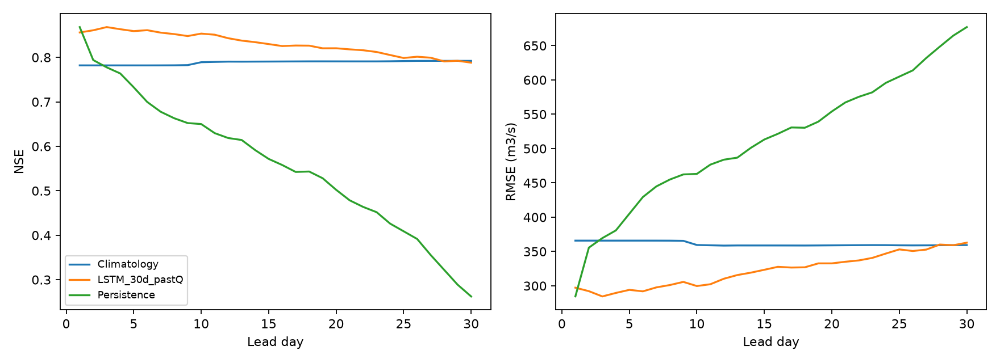

# Thirty-day LSTM with past discharge: matched input experiment

This step trains only the past-discharge variant from scratch. The weather-only reference is retained unchanged; other model families remain pending feedback.

Train: [2016, 2017, 2018, 2019, 2020]; validation selection: [2021]; observed test years: [2022, 2023, 2024]. Training used 1767 issue windows; validation used 336.

Actual fitting took **80.0 seconds**, 33 epochs; selected epoch **21**, seed 42, 42,549 parameters. Stop: validation patience reached. One fixed configuration, no HPO sweep.

Observed test dates: **1084**; observed issue/lead/target pairs: **31932**; day-30 observations: **1055**. Missing targets were never filled or scored.

## Matched observed-day comparison

| model | lead_day | n | NSE | KGE | RMSE_cumecs | MAE_cumecs | PBIAS_pct |
| --- | --- | --- | --- | --- | --- | --- | --- |
| LSTM_30d_pastQ | 1 | 1067 | 0.856 | 0.898 | 297.275 | 172.651 | -5.982 |
| Persistence | 1 | 1067 | 0.868 | 0.934 | 284.578 | 135.985 | -0.003 |
| Climatology | 1 | 1067 | 0.782 | 0.849 | 365.863 | 235.512 | 7.634 |
| LSTM_30d_pastQ | 10 | 1067 | 0.853 | 0.922 | 299.689 | 181.220 | -2.605 |
| Persistence | 10 | 1067 | 0.650 | 0.825 | 463.111 | 275.109 | 0.328 |
| Climatology | 10 | 1067 | 0.789 | 0.850 | 359.501 | 233.108 | 8.020 |
| LSTM_30d_pastQ | 15 | 1067 | 0.830 | 0.910 | 323.386 | 192.185 | -1.935 |
| Persistence | 15 | 1067 | 0.572 | 0.786 | 513.233 | 321.546 | 0.601 |
| Climatology | 15 | 1067 | 0.791 | 0.848 | 358.813 | 232.386 | 8.347 |
| LSTM_30d_pastQ | 20 | 1065 | 0.820 | 0.906 | 332.701 | 197.070 | -2.875 |
| Persistence | 20 | 1065 | 0.502 | 0.751 | 554.099 | 349.167 | 0.756 |
| Climatology | 20 | 1065 | 0.791 | 0.847 | 358.981 | 232.234 | 8.482 |
| LSTM_30d_pastQ | 30 | 1055 | 0.788 | 0.871 | 362.871 | 215.196 | -5.660 |
| Persistence | 30 | 1055 | 0.262 | 0.629 | 677.066 | 446.424 | 1.149 |
| Climatology | 30 | 1055 | 0.792 | 0.845 | 359.398 | 231.857 | 8.837 |

## Day-30 flood and non-flood results

| model | group | n | NSE | KGE | RMSE_cumecs | MAE_cumecs |
| --- | --- | --- | --- | --- | --- | --- |
| LSTM_30d_pastQ | flood | 51 | -1.734 | 0.290 | 903.829 | 705.947 |
| LSTM_30d_pastQ | non_flood | 1004 | 0.758 | 0.874 | 311.236 | 190.267 |
| Persistence | flood | 51 | -7.479 | -0.087 | 1591.603 | 1388.691 |
| Persistence | non_flood | 1004 | 0.119 | 0.586 | 594.161 | 398.560 |
| Climatology | flood | 51 | -2.173 | 0.024 | 973.625 | 743.534 |
| Climatology | non_flood | 1004 | 0.781 | 0.808 | 295.932 | 205.866 |

Flood proxy is observed discharge strictly above observed-training Q95 = **2494.714185 m3/s**. This is not an official flood warning category or an independent event count. Subset NSE uses that subset's mean and variance and can be negative.

## Day-30 season scores

| model | lead_day | season | n | NSE | KGE | RMSE_cumecs | MAE_cumecs | PBIAS_pct | peak_n | peak_MAPE_pct | flood_hit_rate | false_alarm_rate | false_alarm_ratio |
| --- | --- | --- | --- | --- | --- | --- | --- | --- | --- | --- | --- | --- | --- |
| LSTM_30d_pastQ | 30 | Apr-Jun | 273 | 0.575 | 0.675 | 301.909 | 224.924 | -5.248 | 3 | 18.224 | 0.667 | 0.000 | 0.000 |
| LSTM_30d_pastQ | 30 | Jul-Sep | 276 | 0.281 | 0.636 | 614.413 | 469.940 | -3.791 | 47 | 22.917 | 0.468 | 0.109 | 0.532 |
| LSTM_30d_pastQ | 30 | Oct-Mar | 506 | 0.371 | 0.503 | 139.474 | 70.996 | -12.593 | 1 | 75.803 | 0.000 | 0.000 | NA |
| Persistence | 30 | Apr-Jun | 273 | -0.089 | 0.341 | 483.474 | 343.733 | -31.215 | 3 | 64.871 | 0.000 | 0.004 | 1.000 |
| Persistence | 30 | Jul-Sep | 276 | -1.334 | -0.150 | 1107.067 | 916.696 | 1.079 | 47 | 43.867 | 0.106 | 0.197 | 0.900 |
| Persistence | 30 | Oct-Mar | 506 | -4.213 | -0.511 | 401.466 | 245.316 | 51.009 | 1 | 88.999 | 0.000 | 0.000 | NA |
| Climatology | 30 | Apr-Jun | 273 | 0.283 | 0.571 | 392.331 | 310.523 | 22.996 | 3 | 40.333 | 0.000 | 0.000 | NA |
| Climatology | 30 | Jul-Sep | 276 | 0.470 | 0.657 | 527.632 | 380.299 | -0.117 | 47 | 20.938 | 0.277 | 0.087 | 0.606 |
| Climatology | 30 | Oct-Mar | 506 | -0.113 | 0.331 | 185.507 | 108.447 | 17.340 | 1 | 88.229 | 0.000 | 0.000 | NA |

## Quantile calibration

| lead_day | n | coverage_05_95 | mean_interval_width_cumecs | fraction_below_q0.05 | fraction_below_q0.25 | fraction_below_q0.5 | fraction_below_q0.75 | fraction_below_q0.95 |
| --- | --- | --- | --- | --- | --- | --- | --- | --- |
| 1 | 1067 | 0.872 | 836.465 | 0.037 | 0.181 | 0.420 | 0.667 | 0.909 |
| 10 | 1067 | 0.788 | 655.554 | 0.074 | 0.267 | 0.425 | 0.612 | 0.862 |
| 15 | 1067 | 0.776 | 682.593 | 0.084 | 0.264 | 0.438 | 0.628 | 0.860 |
| 20 | 1065 | 0.765 | 643.211 | 0.093 | 0.281 | 0.445 | 0.608 | 0.858 |
| 30 | 1055 | 0.768 | 679.129 | 0.100 | 0.266 | 0.404 | 0.613 | 0.868 |

The nominal P05-P95 coverage is 90%. Quantiles are ordered by construction; this does not guarantee calibration. Quantiles are marginal daily values and do not define joint 30-day flood-event probabilities.

## Limits

Archived 30-day TIGGE/GFS weather forecasts were not found. Future rain and temperature are realized ERA5-Land plus the existing configurable lead-growing standardized noise (0.05 at lead 1, increasing 0.025 per day to 0.775 at lead 30). The assumed error distribution is not validated against operational weather forecasts. These results therefore establish only retrospective proxy-weather performance, not operational 30-day flood forecast accuracy.

Past weather uses the same eight variables as the original weather-only LSTM, including CHIRPS rainfall; future rainfall is ERA5-Land. Product differences, short observed flow history, regulation, sparse extremes and previously inspected test years limit interpretation. Overlapping forecast windows are not independent samples. Observed discharge through issue day t is supplied with a missing indicator. Future observed discharge is never supplied. Missing past discharge uses the training log-flow mean inside model samples only; the source discharge series is unchanged.

Persistence holds the last observation available at issue time. Climatology uses only training-period month/day means. Both are evaluated on exactly the same observed targets as the LSTM. Flow normalization and input mean filling use training years only; original target NaNs and source bytes are preserved.

Synthetic tests establish code behavior only and are not accuracy evidence. Further 30-day architectures will be trained only after feedback on this run.

