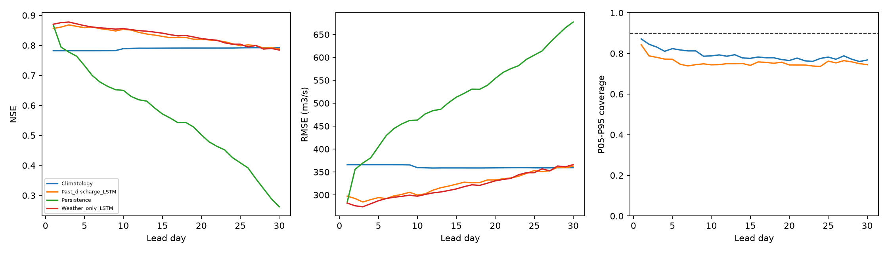

# Thirty-day LSTM: adding past observed discharge

Day-30 NSE changed from **0.784** to **0.788** (+0.004). RMSE reduction: **+0.9%** overall, **+3.0%** on high-flow days, and **-0.1%** on other days. Positive reductions indicate improvement.

One matched input experiment was run. Hidden size, recurrent layers, dropout, optimizer settings, seed, weather features, weather noise and time splits were held fixed. Adding normalized past flow and its missing indicator increases the input dimension from 18 to 20 and adds 512 input weights. Both models were trained from scratch; this run did not load the weather-only weights.

Train 2016-2020; selection 2021; observed benchmark 2022-2024. All **31932** issue/target/lead records align exactly, including **1055** at day 30. Threshold: training observed Q95 = 2494.714185 cumecs.

New model: 80.0 seconds, 33 epochs, selected epoch 21; validation patience reached. One seed, one configuration, no HPO or test-driven retry.

## Matched lead scores

| model | lead_day | n | NSE | KGE | RMSE_cumecs | MAE_cumecs | PBIAS_pct |
| --- | --- | --- | --- | --- | --- | --- | --- |
| Weather_only_LSTM | 1 | 1067 | 0.870 | 0.916 | 282.123 | 167.986 | -3.061 |
| Past_discharge_LSTM | 1 | 1067 | 0.856 | 0.898 | 297.275 | 172.651 | -5.982 |
| Persistence | 1 | 1067 | 0.868 | 0.934 | 284.578 | 135.985 | -0.003 |
| Climatology | 1 | 1067 | 0.782 | 0.849 | 365.863 | 235.512 | 7.634 |
| Weather_only_LSTM | 10 | 1067 | 0.856 | 0.927 | 297.220 | 180.196 | -0.806 |
| Past_discharge_LSTM | 10 | 1067 | 0.853 | 0.922 | 299.689 | 181.220 | -2.605 |
| Persistence | 10 | 1067 | 0.650 | 0.825 | 463.111 | 275.109 | 0.328 |
| Climatology | 10 | 1067 | 0.789 | 0.850 | 359.501 | 233.108 | 8.020 |
| Weather_only_LSTM | 15 | 1067 | 0.841 | 0.920 | 313.078 | 190.045 | 0.399 |
| Past_discharge_LSTM | 15 | 1067 | 0.830 | 0.910 | 323.386 | 192.185 | -1.935 |
| Persistence | 15 | 1067 | 0.572 | 0.786 | 513.233 | 321.546 | 0.601 |
| Climatology | 15 | 1067 | 0.791 | 0.848 | 358.813 | 232.386 | 8.347 |
| Weather_only_LSTM | 20 | 1065 | 0.823 | 0.910 | 330.740 | 202.641 | 1.159 |
| Past_discharge_LSTM | 20 | 1065 | 0.820 | 0.906 | 332.701 | 197.070 | -2.875 |
| Persistence | 20 | 1065 | 0.502 | 0.751 | 554.099 | 349.167 | 0.756 |
| Climatology | 20 | 1065 | 0.791 | 0.847 | 358.981 | 232.234 | 8.482 |
| Weather_only_LSTM | 30 | 1055 | 0.784 | 0.884 | 366.025 | 224.066 | 3.333 |
| Past_discharge_LSTM | 30 | 1055 | 0.788 | 0.871 | 362.871 | 215.196 | -5.660 |
| Persistence | 30 | 1055 | 0.262 | 0.629 | 677.066 | 446.424 | 1.149 |
| Climatology | 30 | 1055 | 0.792 | 0.845 | 359.398 | 231.857 | 8.837 |

## High-flow and other days at day 30

| model | group | n | NSE | KGE | RMSE_cumecs | MAE_cumecs |
| --- | --- | --- | --- | --- | --- | --- |
| Weather_only_LSTM | flood | 51 | -1.903 | 0.287 | 931.351 | 725.652 |
| Weather_only_LSTM | non_flood | 1004 | 0.759 | 0.833 | 310.995 | 198.587 |
| Past_discharge_LSTM | flood | 51 | -1.734 | 0.290 | 903.829 | 705.947 |
| Past_discharge_LSTM | non_flood | 1004 | 0.758 | 0.874 | 311.236 | 190.267 |
| Persistence | flood | 51 | -7.479 | -0.087 | 1591.603 | 1388.691 |
| Persistence | non_flood | 1004 | 0.119 | 0.586 | 594.161 | 398.560 |
| Climatology | flood | 51 | -2.173 | 0.024 | 973.625 | 743.534 |
| Climatology | non_flood | 1004 | 0.781 | 0.808 | 295.932 | 205.866 |

## Day-30 seasons

| model | lead_day | season | n | NSE | KGE | RMSE_cumecs | MAE_cumecs | PBIAS_pct | peak_n | peak_MAPE_pct | flood_hit_rate | false_alarm_rate | false_alarm_ratio |
| --- | --- | --- | --- | --- | --- | --- | --- | --- | --- | --- | --- | --- | --- |
| Weather_only_LSTM | 30 | Apr-Jun | 273 | 0.383 | 0.597 | 363.879 | 282.007 | 12.999 | 3 | 26.610 | 0.000 | 0.000 | NA |
| Weather_only_LSTM | 30 | Jul-Sep | 276 | 0.338 | 0.620 | 589.572 | 447.670 | 1.645 | 47 | 22.735 | 0.489 | 0.122 | 0.549 |
| Weather_only_LSTM | 30 | Oct-Mar | 506 | 0.408 | 0.562 | 135.272 | 70.840 | -5.791 | 1 | 72.125 | 0.000 | 0.000 | NA |
| Past_discharge_LSTM | 30 | Apr-Jun | 273 | 0.575 | 0.675 | 301.909 | 224.924 | -5.248 | 3 | 18.224 | 0.667 | 0.000 | 0.000 |
| Past_discharge_LSTM | 30 | Jul-Sep | 276 | 0.281 | 0.636 | 614.413 | 469.940 | -3.791 | 47 | 22.917 | 0.468 | 0.109 | 0.532 |
| Past_discharge_LSTM | 30 | Oct-Mar | 506 | 0.371 | 0.503 | 139.474 | 70.996 | -12.593 | 1 | 75.803 | 0.000 | 0.000 | NA |
| Persistence | 30 | Apr-Jun | 273 | -0.089 | 0.341 | 483.474 | 343.733 | -31.215 | 3 | 64.871 | 0.000 | 0.004 | 1.000 |
| Persistence | 30 | Jul-Sep | 276 | -1.334 | -0.150 | 1107.067 | 916.696 | 1.079 | 47 | 43.867 | 0.106 | 0.197 | 0.900 |
| Persistence | 30 | Oct-Mar | 506 | -4.213 | -0.511 | 401.466 | 245.316 | 51.009 | 1 | 88.999 | 0.000 | 0.000 | NA |
| Climatology | 30 | Apr-Jun | 273 | 0.283 | 0.571 | 392.331 | 310.523 | 22.996 | 3 | 40.333 | 0.000 | 0.000 | NA |
| Climatology | 30 | Jul-Sep | 276 | 0.470 | 0.657 | 527.632 | 380.299 | -0.117 | 47 | 20.938 | 0.277 | 0.087 | 0.606 |
| Climatology | 30 | Oct-Mar | 506 | -0.113 | 0.331 | 185.507 | 108.447 | 17.340 | 1 | 88.229 | 0.000 | 0.000 | NA |

## Day-30 uncertainty coverage

| model | lead_day | n | coverage_05_95 | interval_width_cumecs |
| --- | --- | --- | --- | --- |
| Weather_only_LSTM | 30 | 1055 | 0.745 | 742.839 |
| Past_discharge_LSTM | 30 | 1055 | 0.768 | 679.129 |

P05-P95 should contain about 90% of observations. Ordering prevents quantile crossing but does not ensure calibration. No interval recalibration or multiple-seed ensemble was applied in this step.

## Scope and interpretation

Only observed discharge through the issue day is supplied as an input. Missing historical flow is represented inside samples by the training log-flow mean and a missing indicator. The original target series and all its NaNs are retained unchanged; future discharge never enters a predictor.

Weather remains noisy realized ERA5-Land; no archived 30-day forecast inputs were available. Historical availability/latency of the daily discharge readings is not established. Operational 30-day flood forecast skill is unverified.

These test years were already inspected before this experiment and serve as a comparison benchmark, not a fresh project-wide holdout. A single-seed comparison cannot establish a reliable general improvement. Settings and checkpoint selection used validation data only, and no other model family was trained.

