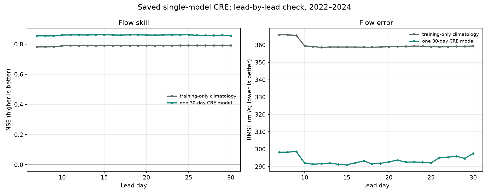

# Multi-horizon CRE proof of concept

## Question

Can one horizon-aware climatology-residual model share learning across forecast days 7–30, or do separate models for each lead work better? The POC compares both on the same dates, features, baseline and rolling-year folds.

## Walk-forward results

| strategy     |   macro_mean_lead_rmse |   macro_mean_lead_skill |   mean_nse |   leads_beating_climatology |
|:-------------|-----------------------:|------------------------:|-----------:|----------------------------:|
| separate_CRE |                374.021 |                  -0.009 |      0.769 |                           4 |
| shared_CRE   |                393.024 |                  -0.060 |      0.745 |                           0 |

The shared model had lower macro-average RMSE on **0 of 24 leads**. Shared macro-RMSE: **393.0 m³/s**; separate-model macro-RMSE: **374.0 m³/s**. See the lead-by-lead CSV and plot; do not interpret the aggregate alone.

## Horizon groups

| horizon_band   | strategy     | lead_days   |   macro_mean_lead_rmse_cumecs |   leads_beating_climatology |
|:---------------|:-------------|:------------|------------------------------:|----------------------------:|
| 7-13 days      | shared_CRE   | 7-13        |                       390.415 |                           0 |
| 7-13 days      | separate_CRE | 7-13        |                       369.541 |                           4 |
| 14-20 days     | shared_CRE   | 14-20       |                       390.882 |                           0 |
| 14-20 days     | separate_CRE | 14-20       |                       372.962 |                           0 |
| 21-30 days     | shared_CRE   | 21-30       |                       396.350 |                           0 |
| 21-30 days     | separate_CRE | 21-30       |                       377.899 |                           0 |

## Interpretation and limits

This answers only the 7–30-day daily-flow POC. It is not evidence of skill at 1–6 months. Future weather covariates use realized ERA5-Land at each target date with lead-growing synthetic noise, matching the project's earlier retrospective proxy setup; these are not archived forecasts available at issue time. The expanding-year checks use 2019–2024 target years; these years have already been examined elsewhere in the project, so the results are developmental, not a fresh independent test. The validation data contain only WAPDA-labelled targets (2016–2024); FFD-only 2025–2026 rows are excluded from this prototype pending source-period consistency review.

The model fit at long lead can be compared only with climatology/persistence, and flood recall varies sharply with the number of high-flow dates. Do not call the POC operationally validated.

## Existing trained LSTM CRE: all daily leads 7–30

The project's already-trained single 30-day LSTM CRE emits a forecast for every daily lead 1–30. Re-scoring its saved predictions shows it beat the matched training-only seasonal climatology by RMSE on **24/24** leads from 7 through 30.

| Lead | CRE NSE | Climatology NSE | CRE RMSE (m³/s) | Climatology RMSE (m³/s) | N |
|---:|---:|---:|---:|---:|---:|
| 7 | 0.855 | 0.782 | 298.2 | 365.9 | 1067 |
| 14 | 0.862 | 0.791 | 291.3 | 358.8 | 1067 |
| 21 | 0.860 | 0.791 | 293.7 | 359.1 | 1064 |
| 30 | 0.858 | 0.792 | 297.6 | 359.4 | 1055 |

**Important:** this existing LSTM CRE is not the Ridge POC above. It has a 365-day encoder, future-weather sequence and observed-flow history. Its comparison uses noisy realized ERA5-Land weather, not archived forecasts available at issue time. The 2022–2024 comparison years have also been inspected in earlier project work. This confirms the model can produce useful hindcast scores across those leads under the proxy setup; it does not prove operational skill or prove one architecture is universally better.

