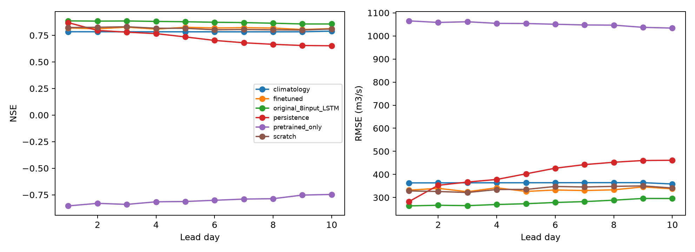

# Multi-basin pretraining and Marala fine-tuning

**Real observed-data experiment using realized future weather plus noise. This is not measured operational TIGGE/GFS forecast accuracy.**

Day-10 overall NSE: fine-tuned **0.814**, matched scratch **0.810** (difference +0.0037). Day-10 monsoon NSE: fine-tuned **0.506**, scratch **0.507**. This pilot shows a small overall transfer gain, with no monsoon NSE improvement. These results do not establish a robust advantage across seeds, basins or extremes.

## Data and method

8 real US CAMELS catchments were selected before scoring, without using Marala test outcomes. Original forcing and observed USGS discharge were downloaded selectively from the publisher archive, not from a tutorial sample or simulated runoff. Missing CAMELS -999 readings become NaN; nonnegative discharge is converted from cusecs to cumecs. Marala targets are identical to the existing observed-only table. No discharge is filled.

[CAMELS original dataset](https://doi.org/10.5065/D6MW2F4D) ([download record](https://zenodo.org/records/15529996), CC BY 4.0). [NeuralHydrology fine-tuning method](https://neuralhydrology.readthedocs.io/en/latest/tutorials/finetuning.html). This is this project's PyTorch implementation of that pretrain/fine-tune approach, not a downloaded official NeuralHydrology checkpoint.

| basin_id | observed_training_days | first_date | last_date |
| --- | --- | --- | --- |
| 13340000 | 3652 | 1980-01-01 | 2014-12-31 |
| 06191500 | 3652 | 1980-01-01 | 2014-12-31 |
| 12358500 | 3652 | 1980-01-01 | 2014-12-31 |
| 12414500 | 3652 | 1980-01-01 | 2014-12-31 |
| 06043500 | 3652 | 1980-01-01 | 2014-12-31 |
| 11528700 | 3652 | 1980-01-01 | 2014-12-31 |
| 12189500 | 3652 | 1980-01-01 | 2014-12-31 |
| 13235000 | 3652 | 1980-01-01 | 2014-12-31 |

Pretraining uses 1985-1994, validation [1995, 1996]. Marala training years: [2016, 2017, 2018, 2019, 2020]; validation: [2021]; test: [2022, 2023, 2024]. The test years are absent from inherited training and validation years. US donor test years were reserved but not scored in this Marala experiment.

The transferred and matched scratch networks use 365 history days, 10 future days, hidden size 32 and 1 LSTM layer(s). Inputs: ['precipitation_mm', 'temperature_c']; calendar enabled: True; static attributes enabled: False; past discharge enabled: False. Source temperature is the midpoint of NLDAS daily Tmax/Tmin; Marala uses ERA5 mean temperature. Forecast mode: reanalysis_with_noise. Recompute normalization on Marala training years: True; the coordinate change requires readaptation. Discharge magnitudes and forcing products differ across domains.

| stage | epochs_run | selected_epoch | validation_pinball | train_samples | validation_samples | training_seconds |
| --- | --- | --- | --- | --- | --- | --- |
| pretrain | 7 | 4 | 0.150 | 29144 | 5776 | 163.871 |
| finetune | 30 | 27 | 0.077 | 1767 | 356 | 41.243 |
| scratch | 30 | 30 | 0.077 | 1767 | 356 | 66.787 |

Each model checkpoint was selected by its own validation loss. Fine-tuning uses a smaller learning rate; scratch uses fresh weights. Pinball losses from different normalizations are not directly comparable accuracy scores. No test-driven retry or hyperparameter selection was performed.

## Observed Marala test data

| year | observed_days |
| --- | --- |
| 2022 | 365 |
| 2023 | 365 |
| 2024 | 354 |

Unique observed days: **1084**; observed issue/lead/target pairs: **10795**. Target dates determine seasons. Overlapping windows are not independent flood events.

## Comparison

The matched control for transfer benefit is `scratch` (same two variables, architecture and split). `pretrained_only` is the donor model without Marala adaptation. `original_8input_LSTM` is context from the earlier, larger model with additional inputs; it is not a matched transfer ablation. Persistence uses the last known flow; climatology uses Marala training month/day means.

| model | lead_day | n | NSE | KGE | PBIAS_pct | RMSE_cumecs |
| --- | --- | --- | --- | --- | --- | --- |
| pretrained_only | 1 | 1084 | -0.854 | -0.321 | -91.335 | 1065.174 |
| finetuned | 1 | 1084 | 0.820 | 0.880 | 7.687 | 331.637 |
| scratch | 1 | 1084 | 0.823 | 0.855 | 11.637 | 328.752 |
| original_8input_LSTM | 1 | 1084 | 0.886 | 0.902 | -2.371 | 263.760 |
| persistence | 1 | 1084 | 0.870 | 0.935 | 0.000 | 282.358 |
| climatology | 1 | 1084 | 0.784 | 0.849 | 7.793 | 363.415 |
| pretrained_only | 2 | 1083 | -0.830 | -0.307 | -90.877 | 1058.412 |
| finetuned | 2 | 1083 | 0.811 | 0.854 | 10.085 | 339.841 |
| scratch | 2 | 1083 | 0.826 | 0.857 | 11.431 | 326.149 |
| original_8input_LSTM | 2 | 1083 | 0.884 | 0.920 | -1.081 | 266.586 |
| persistence | 2 | 1083 | 0.796 | 0.898 | 0.002 | 353.017 |
| climatology | 2 | 1083 | 0.784 | 0.849 | 7.791 | 363.582 |
| pretrained_only | 3 | 1082 | -0.840 | -0.313 | -90.939 | 1061.349 |
| finetuned | 3 | 1082 | 0.827 | 0.883 | 8.094 | 325.176 |
| scratch | 3 | 1082 | 0.831 | 0.862 | 11.314 | 321.827 |
| original_8input_LSTM | 3 | 1082 | 0.885 | 0.920 | -0.901 | 264.887 |
| persistence | 3 | 1082 | 0.780 | 0.890 | 0.005 | 367.001 |
| climatology | 3 | 1082 | 0.784 | 0.849 | 7.790 | 363.749 |
| pretrained_only | 4 | 1081 | -0.816 | -0.301 | -90.378 | 1054.435 |
| finetuned | 4 | 1081 | 0.809 | 0.841 | 11.315 | 342.196 |
| scratch | 4 | 1081 | 0.817 | 0.842 | 12.777 | 334.626 |
| original_8input_LSTM | 4 | 1081 | 0.881 | 0.932 | 0.423 | 269.735 |
| persistence | 4 | 1081 | 0.766 | 0.883 | 0.006 | 378.291 |
| climatology | 4 | 1081 | 0.784 | 0.849 | 7.790 | 363.917 |
| pretrained_only | 5 | 1080 | -0.813 | -0.299 | -90.246 | 1053.716 |
| finetuned | 5 | 1080 | 0.826 | 0.870 | 8.877 | 326.451 |
| scratch | 5 | 1080 | 0.817 | 0.840 | 12.696 | 335.201 |
| original_8input_LSTM | 5 | 1080 | 0.878 | 0.928 | 0.503 | 273.180 |
| persistence | 5 | 1080 | 0.735 | 0.868 | 0.012 | 402.659 |
| climatology | 5 | 1080 | 0.784 | 0.849 | 7.791 | 364.085 |
| pretrained_only | 6 | 1079 | -0.801 | -0.291 | -90.092 | 1050.508 |
| finetuned | 6 | 1079 | 0.819 | 0.848 | 10.680 | 332.661 |
| scratch | 6 | 1079 | 0.802 | 0.812 | 14.642 | 347.891 |
| original_8input_LSTM | 6 | 1079 | 0.873 | 0.928 | 2.244 | 278.576 |
| persistence | 6 | 1079 | 0.702 | 0.851 | 0.020 | 426.990 |
| climatology | 6 | 1079 | 0.783 | 0.848 | 7.792 | 364.254 |
| pretrained_only | 7 | 1078 | -0.790 | -0.285 | -89.819 | 1047.479 |
| finetuned | 7 | 1078 | 0.822 | 0.848 | 10.371 | 330.218 |
| scratch | 7 | 1078 | 0.805 | 0.811 | 14.483 | 345.664 |
| original_8input_LSTM | 7 | 1078 | 0.870 | 0.925 | 3.709 | 282.328 |
| persistence | 7 | 1078 | 0.680 | 0.840 | 0.033 | 442.631 |
| climatology | 7 | 1078 | 0.783 | 0.848 | 7.806 | 364.407 |
| pretrained_only | 8 | 1077 | -0.787 | -0.283 | -89.756 | 1046.688 |
| finetuned | 8 | 1077 | 0.819 | 0.839 | 11.199 | 333.380 |
| scratch | 8 | 1077 | 0.802 | 0.803 | 14.979 | 348.321 |
| original_8input_LSTM | 8 | 1077 | 0.864 | 0.917 | 5.009 | 288.485 |
| persistence | 8 | 1077 | 0.666 | 0.833 | 0.060 | 452.803 |
| climatology | 8 | 1077 | 0.783 | 0.848 | 7.830 | 364.532 |
| pretrained_only | 9 | 1076 | -0.753 | -0.268 | -88.945 | 1037.150 |
| finetuned | 9 | 1076 | 0.805 | 0.817 | 12.660 | 345.996 |
| scratch | 9 | 1076 | 0.800 | 0.806 | 14.972 | 350.379 |
| original_8input_LSTM | 9 | 1076 | 0.857 | 0.909 | 5.887 | 296.085 |
| persistence | 9 | 1076 | 0.655 | 0.827 | 0.114 | 460.423 |
| climatology | 9 | 1076 | 0.784 | 0.848 | 7.886 | 364.430 |
| pretrained_only | 10 | 1075 | -0.747 | -0.265 | -88.878 | 1033.909 |
| finetuned | 10 | 1075 | 0.814 | 0.830 | 12.171 | 337.712 |
| scratch | 10 | 1075 | 0.810 | 0.823 | 14.180 | 341.090 |
| original_8input_LSTM | 10 | 1075 | 0.857 | 0.910 | 5.644 | 295.702 |
| persistence | 10 | 1075 | 0.652 | 0.826 | 0.364 | 461.403 |
| climatology | 10 | 1075 | 0.790 | 0.850 | 8.144 | 358.575 |

## Seasonal metrics

| model | lead_day | season | n | NSE | KGE | PBIAS_pct | RMSE_cumecs | MAE_cumecs | peak_MAPE_pct | peak_n | flood_hit_rate | false_alarm_rate | false_alarm_ratio |
| --- | --- | --- | --- | --- | --- | --- | --- | --- | --- | --- | --- | --- | --- |
| pretrained_only | 1 | Apr-Jun | 273 | -2.326 | -0.328 | -84.175 | 844.923 | 721.167 | 90.065 | 3 | 0.000 | 0.000 | NA |
| finetuned | 1 | Apr-Jun | 273 | 0.221 | 0.634 | 22.586 | 408.916 | 286.507 | 11.824 | 3 | 1.000 | 0.007 | 0.400 |
| scratch | 1 | Apr-Jun | 273 | 0.254 | 0.635 | 27.253 | 400.172 | 293.450 | 11.963 | 3 | 0.667 | 0.000 | 0.000 |
| original_8input_LSTM | 1 | Apr-Jun | 273 | 0.732 | 0.787 | -1.821 | 240.008 | 173.036 | 16.885 | 3 | 0.000 | 0.000 | NA |
| persistence | 1 | Apr-Jun | 273 | 0.813 | 0.899 | -1.821 | 200.460 | 124.781 | 21.215 | 3 | 0.667 | 0.004 | 0.333 |
| climatology | 1 | Apr-Jun | 273 | 0.283 | 0.571 | 22.996 | 392.331 | 310.523 | 40.333 | 3 | 0.000 | 0.000 | NA |
| pretrained_only | 1 | Jul-Sep | 276 | -5.667 | -0.325 | -93.600 | 1871.068 | 1745.404 | 93.210 | 47 | 0.000 | 0.000 | NA |
| finetuned | 1 | Jul-Sep | 276 | 0.606 | 0.787 | 5.198 | 454.892 | 336.051 | 13.101 | 47 | 0.660 | 0.170 | 0.557 |
| scratch | 1 | Jul-Sep | 276 | 0.588 | 0.770 | 7.604 | 465.379 | 348.131 | 12.425 | 47 | 0.745 | 0.179 | 0.539 |
| original_8input_LSTM | 1 | Jul-Sep | 276 | 0.689 | 0.718 | -1.827 | 404.138 | 279.943 | 16.142 | 47 | 0.468 | 0.022 | 0.185 |
| persistence | 1 | Jul-Sep | 276 | 0.612 | 0.803 | 0.708 | 451.497 | 284.851 | 21.537 | 47 | 0.596 | 0.083 | 0.404 |
| climatology | 1 | Jul-Sep | 276 | 0.470 | 0.657 | -0.117 | 527.632 | 380.299 | 20.938 | 47 | 0.277 | 0.087 | 0.606 |
| pretrained_only | 1 | Oct-Mar | 535 | -2.114 | -0.508 | -94.361 | 358.505 | 296.676 | 99.110 | 1 | 0.000 | 0.000 | NA |
| finetuned | 1 | Oct-Mar | 535 | 0.254 | 0.391 | -5.414 | 175.408 | 87.275 | 76.201 | 1 | 0.000 | 0.000 | NA |
| scratch | 1 | Oct-Mar | 535 | 0.381 | 0.489 | 2.265 | 159.811 | 81.024 | 71.103 | 1 | 0.000 | 0.000 | NA |
| original_8input_LSTM | 1 | Oct-Mar | 535 | 0.338 | 0.517 | -4.799 | 165.247 | 85.958 | 84.177 | 1 | 0.000 | 0.000 | NA |
| persistence | 1 | Oct-Mar | 535 | 0.131 | 0.568 | 0.369 | 189.394 | 61.244 | 92.079 | 1 | 0.000 | 0.002 | 1.000 |
| climatology | 1 | Oct-Mar | 535 | -0.101 | 0.218 | 10.855 | 213.148 | 118.160 | 88.229 | 1 | 0.000 | 0.000 | NA |
| pretrained_only | 2 | Apr-Jun | 273 | -2.266 | -0.289 | -83.642 | 837.268 | 716.603 | 88.709 | 3 | 0.000 | 0.000 | NA |
| finetuned | 2 | Apr-Jun | 273 | 0.168 | 0.613 | 26.248 | 422.666 | 300.709 | 9.509 | 3 | 1.000 | 0.007 | 0.400 |
| scratch | 2 | Apr-Jun | 273 | 0.224 | 0.624 | 28.958 | 408.105 | 303.976 | 11.150 | 3 | 0.667 | 0.000 | 0.000 |
| original_8input_LSTM | 2 | Apr-Jun | 273 | 0.731 | 0.804 | 1.247 | 240.155 | 176.903 | 16.637 | 3 | 0.000 | 0.000 | NA |
| persistence | 2 | Apr-Jun | 273 | 0.707 | 0.834 | -3.557 | 250.589 | 172.225 | 16.403 | 3 | 0.333 | 0.007 | 0.667 |
| climatology | 2 | Apr-Jun | 273 | 0.283 | 0.571 | 22.996 | 392.331 | 310.523 | 40.333 | 3 | 0.000 | 0.000 | NA |
| pretrained_only | 2 | Jul-Sep | 276 | -5.577 | -0.310 | -93.038 | 1858.326 | 1734.927 | 92.397 | 47 | 0.000 | 0.000 | NA |
| finetuned | 2 | Jul-Sep | 276 | 0.591 | 0.786 | 7.992 | 463.661 | 347.175 | 12.057 | 47 | 0.745 | 0.197 | 0.562 |
| scratch | 2 | Jul-Sep | 276 | 0.618 | 0.782 | 7.356 | 448.088 | 339.062 | 12.683 | 47 | 0.766 | 0.148 | 0.486 |
| original_8input_LSTM | 2 | Jul-Sep | 276 | 0.684 | 0.733 | -0.096 | 407.030 | 286.860 | 15.213 | 47 | 0.489 | 0.039 | 0.281 |
| persistence | 2 | Jul-Sep | 276 | 0.360 | 0.671 | 1.341 | 579.876 | 369.802 | 21.704 | 47 | 0.553 | 0.092 | 0.447 |
| climatology | 2 | Jul-Sep | 276 | 0.470 | 0.657 | -0.117 | 527.632 | 380.299 | 20.938 | 47 | 0.277 | 0.087 | 0.606 |
| pretrained_only | 2 | Oct-Mar | 534 | -2.115 | -0.502 | -94.326 | 358.696 | 296.827 | 99.027 | 1 | 0.000 | 0.000 | NA |
| finetuned | 2 | Oct-Mar | 534 | 0.230 | 0.409 | -6.002 | 178.280 | 90.277 | 76.509 | 1 | 0.000 | 0.000 | NA |
| scratch | 2 | Oct-Mar | 534 | 0.351 | 0.462 | -0.482 | 163.745 | 79.113 | 74.987 | 1 | 0.000 | 0.000 | NA |
| original_8input_LSTM | 2 | Oct-Mar | 534 | 0.297 | 0.469 | -7.336 | 170.349 | 85.031 | 83.774 | 1 | 0.000 | 0.000 | NA |
| persistence | 2 | Oct-Mar | 534 | -0.134 | 0.443 | 0.854 | 216.435 | 76.705 | 91.419 | 1 | 0.000 | 0.002 | 1.000 |
| climatology | 2 | Oct-Mar | 534 | -0.102 | 0.217 | 10.848 | 213.343 | 118.324 | 88.229 | 1 | 0.000 | 0.000 | NA |
| pretrained_only | 3 | Apr-Jun | 273 | -2.262 | -0.297 | -83.421 | 836.742 | 714.707 | 89.215 | 3 | 0.000 | 0.000 | NA |
| finetuned | 3 | Apr-Jun | 273 | 0.241 | 0.632 | 26.092 | 403.706 | 296.215 | 9.794 | 3 | 1.000 | 0.004 | 0.250 |
| scratch | 3 | Apr-Jun | 273 | 0.215 | 0.613 | 31.154 | 410.382 | 315.266 | 8.142 | 3 | 1.000 | 0.000 | 0.000 |
| original_8input_LSTM | 3 | Apr-Jun | 273 | 0.734 | 0.790 | 1.597 | 238.743 | 177.655 | 17.508 | 3 | 0.000 | 0.000 | NA |
| persistence | 3 | Apr-Jun | 273 | 0.600 | 0.767 | -5.319 | 293.090 | 207.273 | 23.820 | 3 | 0.000 | 0.007 | 1.000 |
| climatology | 3 | Apr-Jun | 273 | 0.283 | 0.571 | 22.996 | 392.331 | 310.523 | 40.333 | 3 | 0.000 | 0.000 | NA |
| pretrained_only | 3 | Jul-Sep | 276 | -5.619 | -0.315 | -93.326 | 1864.324 | 1740.294 | 92.669 | 47 | 0.000 | 0.000 | NA |
| finetuned | 3 | Jul-Sep | 276 | 0.637 | 0.790 | 4.479 | 436.714 | 319.164 | 13.126 | 47 | 0.638 | 0.157 | 0.545 |
| scratch | 3 | Jul-Sep | 276 | 0.643 | 0.777 | 6.203 | 433.161 | 322.502 | 12.451 | 47 | 0.723 | 0.135 | 0.477 |
| original_8input_LSTM | 3 | Jul-Sep | 276 | 0.693 | 0.740 | -0.118 | 401.379 | 285.849 | 14.806 | 47 | 0.468 | 0.026 | 0.214 |
| persistence | 3 | Jul-Sep | 276 | 0.352 | 0.665 | 1.865 | 583.387 | 396.395 | 22.179 | 47 | 0.468 | 0.114 | 0.542 |
| climatology | 3 | Jul-Sep | 276 | 0.470 | 0.657 | -0.117 | 527.632 | 380.299 | 20.938 | 47 | 0.277 | 0.087 | 0.606 |
| pretrained_only | 3 | Oct-Mar | 533 | -2.104 | -0.491 | -94.097 | 358.234 | 296.367 | 98.863 | 1 | 0.000 | 0.000 | NA |
| finetuned | 3 | Oct-Mar | 533 | 0.216 | 0.406 | -5.898 | 180.047 | 90.975 | 78.653 | 1 | 0.000 | 0.000 | NA |
| scratch | 3 | Oct-Mar | 533 | 0.351 | 0.465 | -0.656 | 163.816 | 79.599 | 75.402 | 1 | 0.000 | 0.000 | NA |
| original_8input_LSTM | 3 | Oct-Mar | 533 | 0.279 | 0.442 | -6.782 | 172.679 | 84.165 | 82.074 | 1 | 0.000 | 0.000 | NA |
| persistence | 3 | Oct-Mar | 533 | -0.287 | 0.381 | 1.719 | 230.626 | 90.109 | 92.409 | 1 | 0.000 | 0.002 | 1.000 |
| climatology | 3 | Oct-Mar | 533 | -0.103 | 0.216 | 10.844 | 213.541 | 118.502 | 88.229 | 1 | 0.000 | 0.000 | NA |
| pretrained_only | 4 | Apr-Jun | 273 | -2.189 | -0.274 | -82.436 | 827.339 | 706.264 | 87.721 | 3 | 0.000 | 0.000 | NA |
| finetuned | 4 | Apr-Jun | 273 | 0.186 | 0.615 | 28.474 | 418.100 | 305.704 | 13.216 | 3 | 1.000 | 0.004 | 0.250 |
| scratch | 4 | Apr-Jun | 273 | 0.177 | 0.603 | 32.248 | 420.391 | 322.088 | 8.704 | 3 | 1.000 | 0.000 | 0.000 |
| original_8input_LSTM | 4 | Apr-Jun | 273 | 0.718 | 0.801 | 3.718 | 246.088 | 183.396 | 15.550 | 3 | 0.000 | 0.000 | NA |
| persistence | 4 | Apr-Jun | 273 | 0.552 | 0.702 | -7.322 | 310.120 | 220.228 | 32.545 | 3 | 0.000 | 0.004 | 1.000 |
| climatology | 4 | Apr-Jun | 273 | 0.283 | 0.571 | 22.996 | 392.331 | 310.523 | 40.333 | 3 | 0.000 | 0.000 | NA |
| pretrained_only | 4 | Jul-Sep | 276 | -5.531 | -0.304 | -92.731 | 1851.899 | 1729.189 | 91.923 | 47 | 0.000 | 0.000 | NA |
| finetuned | 4 | Jul-Sep | 276 | 0.578 | 0.787 | 9.339 | 470.983 | 354.949 | 12.279 | 47 | 0.766 | 0.201 | 0.561 |
| scratch | 4 | Jul-Sep | 276 | 0.598 | 0.767 | 8.682 | 459.197 | 348.289 | 11.984 | 47 | 0.766 | 0.170 | 0.520 |
| original_8input_LSTM | 4 | Jul-Sep | 276 | 0.684 | 0.755 | 1.710 | 407.505 | 293.546 | 14.010 | 47 | 0.574 | 0.048 | 0.289 |
| persistence | 4 | Jul-Sep | 276 | 0.325 | 0.653 | 2.455 | 595.346 | 420.218 | 22.419 | 47 | 0.468 | 0.118 | 0.551 |
| climatology | 4 | Jul-Sep | 276 | 0.470 | 0.657 | -0.117 | 527.632 | 380.299 | 20.938 | 47 | 0.277 | 0.087 | 0.606 |
| pretrained_only | 4 | Oct-Mar | 532 | -2.110 | -0.489 | -94.233 | 358.765 | 297.039 | 98.910 | 1 | 0.000 | 0.000 | NA |
| finetuned | 4 | Oct-Mar | 532 | 0.199 | 0.403 | -6.552 | 182.078 | 92.174 | 79.564 | 1 | 0.000 | 0.000 | NA |
| scratch | 4 | Oct-Mar | 532 | 0.337 | 0.452 | -1.811 | 165.657 | 79.086 | 78.099 | 1 | 0.000 | 0.000 | NA |
| original_8input_LSTM | 4 | Oct-Mar | 532 | 0.260 | 0.419 | -8.123 | 174.960 | 83.998 | 82.985 | 1 | 0.000 | 0.000 | NA |
| persistence | 4 | Oct-Mar | 532 | -0.391 | 0.349 | 2.714 | 239.891 | 96.943 | 91.419 | 1 | 0.000 | 0.002 | 1.000 |
| climatology | 4 | Oct-Mar | 532 | -0.104 | 0.214 | 10.853 | 213.741 | 118.714 | 88.229 | 1 | 0.000 | 0.000 | NA |
| pretrained_only | 5 | Apr-Jun | 273 | -2.181 | -0.276 | -82.246 | 826.308 | 704.639 | 88.417 | 3 | 0.000 | 0.000 | NA |
| finetuned | 5 | Apr-Jun | 273 | 0.289 | 0.647 | 24.525 | 390.705 | 286.210 | 9.735 | 3 | 1.000 | 0.004 | 0.250 |
| scratch | 5 | Apr-Jun | 273 | 0.217 | 0.615 | 30.915 | 409.995 | 314.460 | 6.946 | 3 | 1.000 | 0.004 | 0.250 |
| original_8input_LSTM | 5 | Apr-Jun | 273 | 0.704 | 0.790 | 4.192 | 252.149 | 188.180 | 15.937 | 3 | 0.000 | 0.000 | NA |
| persistence | 5 | Apr-Jun | 273 | 0.479 | 0.645 | -8.791 | 334.435 | 235.528 | 36.857 | 3 | 0.000 | 0.000 | NA |
| climatology | 5 | Apr-Jun | 273 | 0.283 | 0.571 | 22.996 | 392.331 | 310.523 | 40.333 | 3 | 0.000 | 0.000 | NA |
| pretrained_only | 5 | Jul-Sep | 276 | -5.517 | -0.302 | -92.629 | 1849.918 | 1727.304 | 91.864 | 47 | 0.000 | 0.000 | NA |
| finetuned | 5 | Jul-Sep | 276 | 0.610 | 0.797 | 7.177 | 452.251 | 337.796 | 11.957 | 47 | 0.723 | 0.183 | 0.553 |
| scratch | 5 | Jul-Sep | 276 | 0.578 | 0.774 | 9.358 | 470.883 | 357.285 | 11.819 | 47 | 0.787 | 0.175 | 0.519 |
| original_8input_LSTM | 5 | Jul-Sep | 276 | 0.677 | 0.750 | 1.402 | 411.664 | 298.461 | 14.687 | 47 | 0.596 | 0.066 | 0.349 |
| persistence | 5 | Jul-Sep | 276 | 0.224 | 0.599 | 2.941 | 638.156 | 471.650 | 24.815 | 47 | 0.362 | 0.144 | 0.660 |
| climatology | 5 | Jul-Sep | 276 | 0.470 | 0.657 | -0.117 | 527.632 | 380.299 | 20.938 | 47 | 0.277 | 0.087 | 0.606 |
| pretrained_only | 5 | Oct-Mar | 531 | -2.101 | -0.474 | -94.091 | 358.424 | 296.834 | 98.561 | 1 | 0.000 | 0.000 | NA |
| finetuned | 5 | Oct-Mar | 531 | 0.228 | 0.402 | -7.749 | 178.780 | 89.227 | 76.646 | 1 | 0.000 | 0.000 | NA |
| scratch | 5 | Oct-Mar | 531 | 0.352 | 0.452 | -2.487 | 163.879 | 77.679 | 75.989 | 1 | 0.000 | 0.000 | NA |
| original_8input_LSTM | 5 | Oct-Mar | 531 | 0.251 | 0.409 | -7.408 | 176.103 | 83.413 | 82.028 | 1 | 0.000 | 0.000 | NA |
| persistence | 5 | Oct-Mar | 531 | -0.463 | 0.322 | 3.303 | 246.144 | 104.938 | 92.849 | 1 | 0.000 | 0.002 | 1.000 |
| climatology | 5 | Oct-Mar | 531 | -0.105 | 0.213 | 10.859 | 213.942 | 118.923 | 88.229 | 1 | 0.000 | 0.000 | NA |
| pretrained_only | 6 | Apr-Jun | 273 | -2.182 | -0.263 | -82.486 | 826.412 | 706.693 | 87.638 | 3 | 0.000 | 0.000 | NA |
| finetuned | 6 | Apr-Jun | 273 | 0.276 | 0.643 | 25.529 | 394.095 | 290.369 | 11.961 | 3 | 1.000 | 0.000 | 0.000 |
| scratch | 6 | Apr-Jun | 273 | 0.187 | 0.606 | 32.210 | 417.628 | 324.233 | 9.966 | 3 | 1.000 | 0.000 | 0.000 |
| original_8input_LSTM | 6 | Apr-Jun | 273 | 0.675 | 0.789 | 7.417 | 264.192 | 196.594 | 13.304 | 3 | 0.333 | 0.000 | 0.000 |
| persistence | 6 | Apr-Jun | 273 | 0.438 | 0.607 | -10.149 | 347.177 | 243.992 | 42.209 | 3 | 0.000 | 0.000 | NA |
| climatology | 6 | Apr-Jun | 273 | 0.283 | 0.571 | 22.996 | 392.331 | 310.523 | 40.333 | 3 | 0.000 | 0.000 | NA |
| pretrained_only | 6 | Jul-Sep | 276 | -5.459 | -0.293 | -92.250 | 1841.686 | 1720.235 | 91.344 | 47 | 0.000 | 0.000 | NA |
| finetuned | 6 | Jul-Sep | 276 | 0.586 | 0.791 | 9.798 | 466.043 | 354.111 | 11.864 | 47 | 0.787 | 0.197 | 0.549 |
| scratch | 6 | Jul-Sep | 276 | 0.526 | 0.764 | 12.214 | 498.805 | 386.159 | 12.441 | 47 | 0.809 | 0.210 | 0.558 |
| original_8input_LSTM | 6 | Jul-Sep | 276 | 0.668 | 0.734 | 2.826 | 417.238 | 306.489 | 14.783 | 47 | 0.617 | 0.074 | 0.370 |
| persistence | 6 | Jul-Sep | 276 | 0.093 | 0.528 | 3.356 | 690.221 | 504.307 | 25.766 | 47 | 0.383 | 0.140 | 0.640 |
| climatology | 6 | Jul-Sep | 276 | 0.470 | 0.657 | -0.117 | 527.632 | 380.299 | 20.938 | 47 | 0.277 | 0.087 | 0.606 |
| pretrained_only | 6 | Oct-Mar | 530 | -2.101 | -0.468 | -94.084 | 358.622 | 297.055 | 98.455 | 1 | 0.000 | 0.000 | NA |
| finetuned | 6 | Oct-Mar | 530 | 0.224 | 0.403 | -7.364 | 179.413 | 89.439 | 77.252 | 1 | 0.000 | 0.000 | NA |
| scratch | 6 | Oct-Mar | 530 | 0.349 | 0.458 | -2.445 | 164.283 | 78.754 | 76.392 | 1 | 0.000 | 0.000 | NA |
| original_8input_LSTM | 6 | Oct-Mar | 530 | 0.243 | 0.416 | -6.776 | 177.151 | 84.995 | 80.537 | 1 | 0.000 | 0.000 | NA |
| persistence | 6 | Oct-Mar | 530 | -0.471 | 0.325 | 3.972 | 246.985 | 109.084 | 91.419 | 1 | 0.000 | 0.002 | 1.000 |
| climatology | 6 | Oct-Mar | 530 | -0.106 | 0.212 | 10.866 | 214.144 | 119.133 | 88.229 | 1 | 0.000 | 0.000 | NA |
| pretrained_only | 7 | Apr-Jun | 273 | -2.154 | -0.257 | -82.071 | 822.765 | 703.140 | 87.191 | 3 | 0.000 | 0.000 | NA |
| finetuned | 7 | Apr-Jun | 273 | 0.317 | 0.657 | 23.801 | 382.755 | 279.566 | 12.510 | 3 | 1.000 | 0.004 | 0.250 |
| scratch | 7 | Apr-Jun | 273 | 0.217 | 0.615 | 31.104 | 409.821 | 315.695 | 9.633 | 3 | 1.000 | 0.004 | 0.250 |
| original_8input_LSTM | 7 | Apr-Jun | 273 | 0.654 | 0.789 | 9.169 | 272.478 | 200.674 | 10.841 | 3 | 0.667 | 0.000 | 0.000 |
| persistence | 7 | Apr-Jun | 273 | 0.413 | 0.585 | -11.376 | 355.056 | 248.753 | 46.180 | 3 | 0.000 | 0.000 | NA |
| climatology | 7 | Apr-Jun | 273 | 0.283 | 0.571 | 22.996 | 392.331 | 310.523 | 40.333 | 3 | 0.000 | 0.000 | NA |
| pretrained_only | 7 | Jul-Sep | 276 | -5.417 | -0.286 | -91.970 | 1835.602 | 1715.005 | 90.957 | 47 | 0.000 | 0.000 | NA |
| finetuned | 7 | Jul-Sep | 276 | 0.581 | 0.790 | 10.369 | 468.846 | 356.125 | 11.727 | 47 | 0.766 | 0.192 | 0.550 |
| scratch | 7 | Jul-Sep | 276 | 0.526 | 0.766 | 12.754 | 499.095 | 388.362 | 12.417 | 47 | 0.766 | 0.192 | 0.550 |
| original_8input_LSTM | 7 | Jul-Sep | 276 | 0.664 | 0.732 | 4.397 | 420.321 | 313.578 | 14.194 | 47 | 0.596 | 0.087 | 0.417 |
| persistence | 7 | Jul-Sep | 276 | 0.011 | 0.482 | 3.658 | 720.569 | 539.056 | 28.539 | 47 | 0.362 | 0.144 | 0.660 |
| climatology | 7 | Jul-Sep | 276 | 0.470 | 0.657 | -0.117 | 527.632 | 380.299 | 20.938 | 47 | 0.277 | 0.087 | 0.606 |
| pretrained_only | 7 | Oct-Mar | 529 | -2.095 | -0.468 | -94.041 | 358.601 | 296.967 | 98.418 | 1 | 0.000 | 0.000 | NA |
| finetuned | 7 | Oct-Mar | 529 | 0.232 | 0.404 | -8.426 | 178.660 | 89.131 | 76.564 | 1 | 0.000 | 0.000 | NA |
| scratch | 7 | Oct-Mar | 529 | 0.354 | 0.454 | -3.461 | 163.851 | 77.846 | 75.405 | 1 | 0.000 | 0.000 | NA |
| original_8input_LSTM | 7 | Oct-Mar | 529 | 0.231 | 0.417 | -6.054 | 178.722 | 86.381 | 80.749 | 1 | 0.000 | 0.000 | NA |
| persistence | 7 | Oct-Mar | 529 | -0.524 | 0.310 | 4.836 | 251.588 | 115.050 | 84.378 | 1 | 0.000 | 0.002 | 1.000 |
| climatology | 7 | Oct-Mar | 529 | -0.105 | 0.212 | 10.952 | 214.291 | 119.146 | 88.229 | 1 | 0.000 | 0.000 | NA |
| pretrained_only | 8 | Apr-Jun | 273 | -2.164 | -0.255 | -82.295 | 824.077 | 705.061 | 87.654 | 3 | 0.000 | 0.000 | NA |
| finetuned | 8 | Apr-Jun | 273 | 0.330 | 0.659 | 23.908 | 379.082 | 279.094 | 7.679 | 3 | 1.000 | 0.004 | 0.250 |
| scratch | 8 | Apr-Jun | 273 | 0.244 | 0.624 | 30.046 | 402.888 | 308.772 | 7.227 | 3 | 1.000 | 0.000 | 0.000 |
| original_8input_LSTM | 8 | Apr-Jun | 273 | 0.637 | 0.791 | 9.845 | 278.956 | 205.332 | 10.184 | 3 | 0.667 | 0.000 | 0.000 |
| persistence | 8 | Apr-Jun | 273 | 0.392 | 0.555 | -13.055 | 361.165 | 253.908 | 51.803 | 3 | 0.000 | 0.000 | NA |
| climatology | 8 | Apr-Jun | 273 | 0.283 | 0.571 | 22.996 | 392.331 | 310.523 | 40.333 | 3 | 0.000 | 0.000 | NA |
| pretrained_only | 8 | Jul-Sep | 276 | -5.395 | -0.284 | -91.820 | 1832.519 | 1712.211 | 90.802 | 47 | 0.000 | 0.000 | NA |
| finetuned | 8 | Jul-Sep | 276 | 0.561 | 0.780 | 11.647 | 480.337 | 369.185 | 12.418 | 47 | 0.787 | 0.192 | 0.543 |
| scratch | 8 | Jul-Sep | 276 | 0.501 | 0.757 | 14.067 | 511.964 | 400.661 | 12.829 | 47 | 0.787 | 0.214 | 0.570 |
| original_8input_LSTM | 8 | Jul-Sep | 276 | 0.645 | 0.729 | 6.261 | 431.714 | 328.119 | 13.887 | 47 | 0.660 | 0.100 | 0.426 |
| persistence | 8 | Jul-Sep | 276 | -0.045 | 0.447 | 4.169 | 740.693 | 550.127 | 28.781 | 47 | 0.362 | 0.144 | 0.660 |
| climatology | 8 | Jul-Sep | 276 | 0.470 | 0.657 | -0.117 | 527.632 | 380.299 | 20.938 | 47 | 0.277 | 0.087 | 0.606 |
| pretrained_only | 8 | Oct-Mar | 528 | -2.080 | -0.459 | -93.851 | 358.010 | 296.269 | 98.254 | 1 | 0.000 | 0.000 | NA |
| finetuned | 8 | Oct-Mar | 528 | 0.236 | 0.418 | -8.021 | 178.319 | 89.688 | 75.925 | 1 | 0.000 | 0.000 | NA |
| scratch | 8 | Oct-Mar | 528 | 0.362 | 0.455 | -3.350 | 162.924 | 77.515 | 75.746 | 1 | 0.000 | 0.000 | NA |
| original_8input_LSTM | 8 | Oct-Mar | 528 | 0.229 | 0.417 | -5.646 | 179.158 | 87.212 | 80.842 | 1 | 0.000 | 0.000 | NA |
| persistence | 8 | Oct-Mar | 528 | -0.538 | 0.311 | 5.776 | 252.964 | 117.000 | 84.378 | 1 | 0.000 | 0.002 | 1.000 |
| climatology | 8 | Oct-Mar | 528 | -0.104 | 0.212 | 11.089 | 214.339 | 119.018 | 88.229 | 1 | 0.000 | 0.000 | NA |
| pretrained_only | 9 | Apr-Jun | 273 | -2.074 | -0.236 | -80.913 | 812.289 | 693.218 | 86.142 | 3 | 0.000 | 0.000 | NA |
| finetuned | 9 | Apr-Jun | 273 | 0.307 | 0.648 | 24.010 | 385.702 | 285.199 | 7.138 | 3 | 1.000 | 0.000 | 0.000 |
| scratch | 9 | Apr-Jun | 273 | 0.244 | 0.623 | 28.687 | 402.879 | 307.139 | 9.649 | 3 | 0.667 | 0.000 | 0.000 |
| original_8input_LSTM | 9 | Apr-Jun | 273 | 0.614 | 0.781 | 9.723 | 287.732 | 211.180 | 10.472 | 3 | 0.667 | 0.000 | 0.000 |
| persistence | 9 | Apr-Jun | 273 | 0.366 | 0.536 | -14.187 | 368.884 | 256.988 | 55.333 | 3 | 0.000 | 0.000 | NA |
| climatology | 9 | Apr-Jun | 273 | 0.283 | 0.571 | 22.996 | 392.331 | 310.523 | 40.333 | 3 | 0.000 | 0.000 | NA |
| pretrained_only | 9 | Jul-Sep | 276 | -5.280 | -0.267 | -91.029 | 1815.863 | 1697.466 | 89.801 | 47 | 0.000 | 0.000 | NA |
| finetuned | 9 | Jul-Sep | 276 | 0.509 | 0.759 | 14.194 | 507.606 | 401.794 | 13.119 | 47 | 0.809 | 0.231 | 0.582 |
| scratch | 9 | Jul-Sep | 276 | 0.492 | 0.731 | 14.696 | 516.623 | 411.785 | 12.614 | 47 | 0.830 | 0.218 | 0.562 |
| original_8input_LSTM | 9 | Jul-Sep | 276 | 0.623 | 0.713 | 7.531 | 444.825 | 339.648 | 13.484 | 47 | 0.660 | 0.118 | 0.466 |
| persistence | 9 | Jul-Sep | 276 | -0.074 | 0.428 | 4.404 | 751.043 | 562.818 | 29.698 | 47 | 0.340 | 0.148 | 0.680 |
| climatology | 9 | Jul-Sep | 276 | 0.470 | 0.657 | -0.117 | 527.632 | 380.299 | 20.938 | 47 | 0.277 | 0.087 | 0.606 |
| pretrained_only | 9 | Oct-Mar | 527 | -2.075 | -0.465 | -93.796 | 357.178 | 295.498 | 98.221 | 1 | 0.000 | 0.000 | NA |
| finetuned | 9 | Oct-Mar | 527 | 0.219 | 0.424 | -8.084 | 180.045 | 90.808 | 76.472 | 1 | 0.000 | 0.000 | NA |
| scratch | 9 | Oct-Mar | 527 | 0.354 | 0.450 | -3.490 | 163.687 | 76.790 | 76.279 | 1 | 0.000 | 0.000 | NA |
| original_8input_LSTM | 9 | Oct-Mar | 527 | 0.217 | 0.423 | -4.613 | 180.214 | 88.437 | 80.761 | 1 | 0.000 | 0.000 | NA |
| persistence | 9 | Oct-Mar | 527 | -0.613 | 0.290 | 6.962 | 258.702 | 120.446 | 94.279 | 1 | 0.000 | 0.002 | 1.000 |
| climatology | 9 | Oct-Mar | 527 | -0.100 | 0.216 | 11.410 | 213.601 | 118.370 | 88.229 | 1 | 0.000 | 0.000 | NA |
| pretrained_only | 10 | Apr-Jun | 273 | -2.093 | -0.234 | -81.341 | 814.807 | 696.883 | 85.756 | 3 | 0.000 | 0.000 | NA |
| finetuned | 10 | Apr-Jun | 273 | 0.347 | 0.656 | 21.865 | 374.409 | 280.510 | 9.271 | 3 | 1.000 | 0.000 | 0.000 |
| scratch | 10 | Apr-Jun | 273 | 0.266 | 0.626 | 27.199 | 396.942 | 304.528 | 11.119 | 3 | 0.667 | 0.000 | 0.000 |
| original_8input_LSTM | 10 | Apr-Jun | 273 | 0.601 | 0.771 | 9.419 | 292.728 | 215.580 | 12.579 | 3 | 0.333 | 0.000 | 0.000 |
| persistence | 10 | Apr-Jun | 273 | 0.339 | 0.514 | -15.373 | 376.671 | 258.337 | 56.748 | 3 | 0.000 | 0.000 | NA |
| climatology | 10 | Apr-Jun | 273 | 0.283 | 0.571 | 22.996 | 392.331 | 310.523 | 40.333 | 3 | 0.000 | 0.000 | NA |
| pretrained_only | 10 | Jul-Sep | 276 | -5.255 | -0.268 | -90.798 | 1812.348 | 1693.161 | 89.831 | 47 | 0.000 | 0.000 | NA |
| finetuned | 10 | Jul-Sep | 276 | 0.506 | 0.738 | 13.642 | 509.418 | 405.070 | 12.591 | 47 | 0.766 | 0.218 | 0.581 |
| scratch | 10 | Jul-Sep | 276 | 0.507 | 0.697 | 13.506 | 508.959 | 408.422 | 12.877 | 47 | 0.766 | 0.201 | 0.561 |
| original_8input_LSTM | 10 | Jul-Sep | 276 | 0.602 | 0.671 | 6.689 | 456.941 | 351.428 | 15.384 | 47 | 0.617 | 0.096 | 0.431 |
| persistence | 10 | Jul-Sep | 276 | -0.107 | 0.406 | 4.699 | 762.450 | 582.927 | 28.371 | 47 | 0.298 | 0.157 | 0.720 |
| climatology | 10 | Jul-Sep | 276 | 0.470 | 0.657 | -0.117 | 527.632 | 380.299 | 20.938 | 47 | 0.277 | 0.087 | 0.606 |
| pretrained_only | 10 | Oct-Mar | 526 | -2.524 | -0.438 | -93.611 | 341.494 | 291.160 | 98.076 | 1 | 0.000 | 0.000 | NA |
| finetuned | 10 | Oct-Mar | 526 | 0.270 | 0.517 | -6.314 | 155.443 | 87.497 | 76.437 | 1 | 0.000 | 0.000 | NA |
| scratch | 10 | Oct-Mar | 526 | 0.393 | 0.537 | -2.315 | 141.679 | 74.499 | 78.071 | 1 | 0.000 | 0.000 | NA |
| original_8input_LSTM | 10 | Oct-Mar | 526 | 0.254 | 0.520 | -3.041 | 157.070 | 86.150 | 81.073 | 1 | 0.000 | 0.000 | NA |
| persistence | 10 | Oct-Mar | 526 | -0.705 | 0.312 | 9.224 | 237.536 | 118.742 | 78.878 | 1 | 0.000 | 0.002 | 1.000 |
| climatology | 10 | Oct-Mar | 526 | -0.112 | 0.290 | 12.902 | 191.855 | 114.480 | 88.229 | 1 | 0.000 | 0.000 | NA |

High-flow MAPE uses the configured Marala training quantile, **2494.71 cumecs**; the flood threshold is **2494.71 cumecs**. Defaults are training Q95, not official warning categories or return-period floods. Positive bias means overprediction. False-alarm rate = false alerts/non-exceedance days; false-alarm ratio = false alerts/all alerts. NA denotes undefined denominators.

## LSTM interval calibration

| model | lead_day | n | nominal_coverage | actual_coverage |
| --- | --- | --- | --- | --- |
| pretrained_only | 1 | 1084 | 0.900 | 0.051 |
| finetuned | 1 | 1084 | 0.900 | 0.918 |
| scratch | 1 | 1084 | 0.900 | 0.911 |
| original_8input_LSTM | 1 | 1084 | 0.900 | 0.899 |
| pretrained_only | 2 | 1083 | 0.900 | 0.044 |
| finetuned | 2 | 1083 | 0.900 | 0.888 |
| scratch | 2 | 1083 | 0.900 | 0.868 |
| original_8input_LSTM | 2 | 1083 | 0.900 | 0.880 |
| pretrained_only | 3 | 1082 | 0.900 | 0.044 |
| finetuned | 3 | 1082 | 0.900 | 0.872 |
| scratch | 3 | 1082 | 0.900 | 0.862 |
| original_8input_LSTM | 3 | 1082 | 0.900 | 0.878 |
| pretrained_only | 4 | 1081 | 0.900 | 0.046 |
| finetuned | 4 | 1081 | 0.900 | 0.848 |
| scratch | 4 | 1081 | 0.900 | 0.851 |
| original_8input_LSTM | 4 | 1081 | 0.900 | 0.865 |
| pretrained_only | 5 | 1080 | 0.900 | 0.045 |
| finetuned | 5 | 1080 | 0.900 | 0.870 |
| scratch | 5 | 1080 | 0.900 | 0.867 |
| original_8input_LSTM | 5 | 1080 | 0.900 | 0.889 |
| pretrained_only | 6 | 1079 | 0.900 | 0.044 |
| finetuned | 6 | 1079 | 0.900 | 0.844 |
| scratch | 6 | 1079 | 0.900 | 0.844 |
| original_8input_LSTM | 6 | 1079 | 0.900 | 0.874 |
| pretrained_only | 7 | 1078 | 0.900 | 0.044 |
| finetuned | 7 | 1078 | 0.900 | 0.850 |
| scratch | 7 | 1078 | 0.900 | 0.837 |
| original_8input_LSTM | 7 | 1078 | 0.900 | 0.880 |
| pretrained_only | 8 | 1077 | 0.900 | 0.041 |
| finetuned | 8 | 1077 | 0.900 | 0.837 |
| scratch | 8 | 1077 | 0.900 | 0.836 |
| original_8input_LSTM | 8 | 1077 | 0.900 | 0.877 |
| pretrained_only | 9 | 1076 | 0.900 | 0.046 |
| finetuned | 9 | 1076 | 0.900 | 0.838 |
| scratch | 9 | 1076 | 0.900 | 0.827 |
| original_8input_LSTM | 9 | 1076 | 0.900 | 0.849 |
| pretrained_only | 10 | 1075 | 0.900 | 0.041 |
| finetuned | 10 | 1075 | 0.900 | 0.850 |
| scratch | 10 | 1075 | 0.900 | 0.828 |
| original_8input_LSTM | 10 | 1075 | 0.900 | 0.833 |

Non-crossing quantiles are enforced, but interval calibration is not guaranteed. Nominal 5-95% coverage is 90%.

## Limits and interpretation

This is an eight-basin pilot, not a pretrained model from hundreds of diverse basins. The US donor hydrology, monsoon regime, regulation, catchment sizes and weather products differ from Chenab. Shared global flow scaling and no static embedding limit basin specificity. Transfer is not guaranteed to improve Marala, and conceptual models were not evaluated. The 2022-2024 years have already been inspected in earlier workspace experiments; they are held out of this fitting run but not an untouched project-wide holdout. More representative basins and archived forecasts are needed before operational use.

Source hashes match, and Marala target values and NaN positions exactly match the source table. Synthetic tests check code correctness only. Initial source archives and both training stages are retained for retraining.

