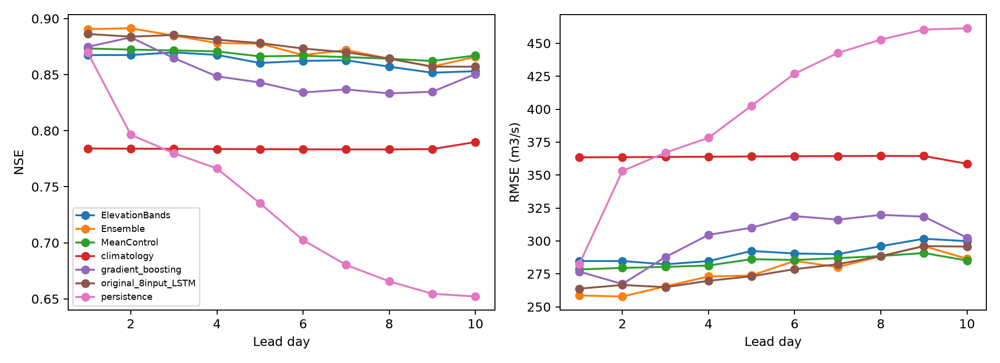
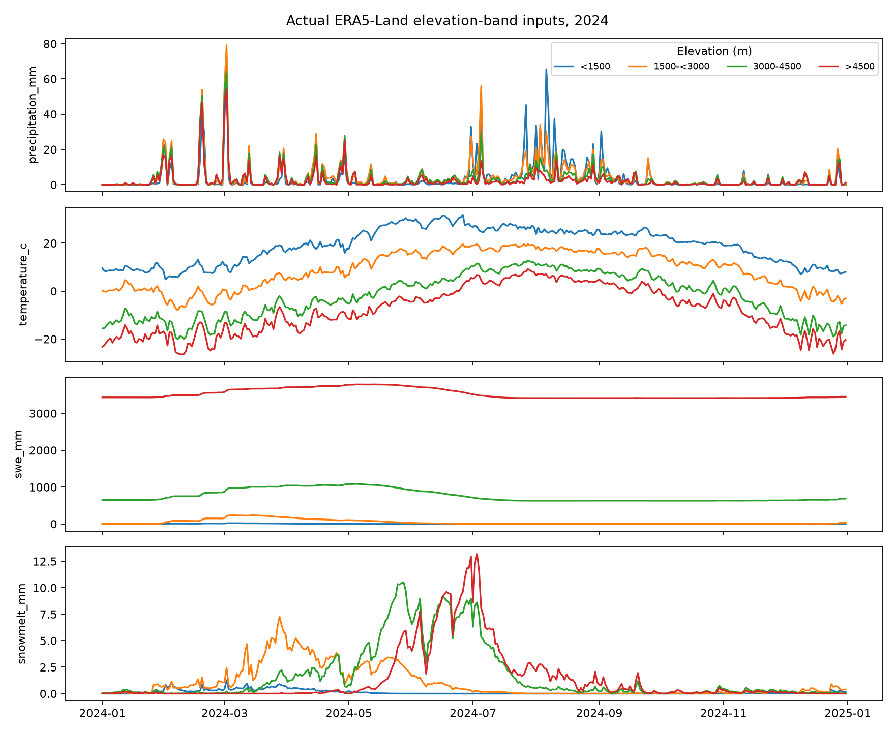

# Elevation-band spatial streamflow experiment

## Measured test accuracy

Lead-10 NSE is **0.853** for the elevation-band model and **0.867** for the same-source catchment-mean control (difference -0.0140). Parameter counts differ; this one-seed pilot does not isolate a universally transferable spatial benefit.

**Future weather is realized ERA5-Land with shared lead-dependent noise. These are not operational archived-forecast scores. NSE is not an accuracy percentage.**

Test years: [2022, 2023, 2024]. Observed basin-days across leads: **1084**; observed issue/lead/target pairs: **10795**. No missing discharge was filled or scored.

| model | lead_day | n | NSE | KGE | PBIAS_pct | RMSE_cumecs |
| --- | --- | --- | --- | --- | --- | --- |
| ElevationBands | 1 | 1084 | 0.867 | 0.890 | -1.098 | 284.750 |
| MeanControl | 1 | 1084 | 0.873 | 0.935 | 0.760 | 278.361 |
| persistence | 1 | 1084 | 0.870 | 0.935 | 0.000 | 282.358 |
| climatology | 1 | 1084 | 0.784 | 0.849 | 7.793 | 363.415 |
| original_8input_LSTM | 1 | 1084 | 0.886 | 0.902 | -2.371 | 263.760 |
| gradient_boosting | 1 | 1084 | 0.875 | 0.916 | 2.670 | 276.755 |
| Ensemble | 1 | 1084 | 0.891 | 0.912 | -0.231 | 258.621 |
| ElevationBands | 10 | 1075 | 0.853 | 0.875 | 5.894 | 299.831 |
| MeanControl | 10 | 1075 | 0.867 | 0.931 | 0.512 | 285.182 |
| persistence | 10 | 1075 | 0.652 | 0.826 | 0.364 | 461.403 |
| climatology | 10 | 1075 | 0.790 | 0.850 | 8.144 | 358.575 |
| original_8input_LSTM | 10 | 1075 | 0.857 | 0.910 | 5.644 | 295.702 |
| gradient_boosting | 10 | 1075 | 0.851 | 0.877 | 0.541 | 302.424 |
| Ensemble | 10 | 1075 | 0.866 | 0.916 | 4.630 | 286.462 |

### Seasonal results at lead 10

| model | lead_day | season | n | NSE | KGE | PBIAS_pct | RMSE_cumecs | MAE_cumecs | peak_MAPE_pct | peak_n | flood_hit_rate | false_alarm_rate | false_alarm_ratio |
| --- | --- | --- | --- | --- | --- | --- | --- | --- | --- | --- | --- | --- | --- |
| ElevationBands | 10 | Apr-Jun | 273 | 0.586 | 0.684 | 16.372 | 298.116 | 240.899 | 21.020 | 3 | 0.000 | 0.000 | NA |
| MeanControl | 10 | Apr-Jun | 273 | 0.735 | 0.777 | -0.976 | 238.394 | 177.264 | 11.149 | 3 | 0.667 | 0.000 | 0.000 |
| ElevationBands | 10 | Jul-Sep | 276 | 0.590 | 0.602 | 1.067 | 464.070 | 330.372 | 20.360 | 47 | 0.213 | 0.044 | 0.500 |
| MeanControl | 10 | Jul-Sep | 276 | 0.587 | 0.729 | 6.546 | 465.481 | 353.085 | 14.762 | 47 | 0.681 | 0.114 | 0.448 |
| ElevationBands | 10 | Oct-Mar | 526 | 0.257 | 0.526 | 6.100 | 156.842 | 92.213 | 77.459 | 1 | 0.000 | 0.000 | NA |
| MeanControl | 10 | Oct-Mar | 526 | 0.304 | 0.446 | -16.346 | 151.744 | 79.086 | 77.045 | 1 | 0.000 | 0.000 | NA |

### Quantile calibration

| model | lead_day | n | nominal_coverage | actual_coverage |
| --- | --- | --- | --- | --- |
| ElevationBands | 10 | 1075 | 0.900 | 0.873 |
| MeanControl | 10 | 1075 | 0.900 | 0.771 |

### Actual training runs

| model | seed | epochs_run | selected_epoch | validation_pinball | training_seconds | parameters | training_samples | validation_samples |
| --- | --- | --- | --- | --- | --- | --- | --- | --- |
| ElevationBands | 42 | 14 | 8 | 0.085 | 108.114 | 46805 | 1767 | 356 |
| MeanControl | 42 | 24 | 18 | 0.074 | 139.273 | 39829 | 1767 | 356 |

Peak/flood thresholds are training Q95 by default: **2494.71 / 2494.71 cumecs**, not official flood levels or return periods. Positive PBIAS means overprediction. False-alarm rate counts false alerts/non-exceedance days; false-alarm ratio counts false alerts/all alerts.

Six spatial and 20 existing synthetic tests passed. Tests establish code correctness, not accuracy. The original eight-input LSTM and earlier ensemble use different predictors and forecast-error models; they are context, not a matched ablation.

## Observed days by year

| year | observed_days |
| --- | --- |
| 2022 | 365 |
| 2023 | 365 |
| 2024 | 354 |

## All seasonal/lead results

| model | lead_day | season | n | NSE | KGE | PBIAS_pct | RMSE_cumecs | MAE_cumecs | peak_MAPE_pct | peak_n | flood_hit_rate | false_alarm_rate | false_alarm_ratio |
| --- | --- | --- | --- | --- | --- | --- | --- | --- | --- | --- | --- | --- | --- |
| ElevationBands | 1 | Apr-Jun | 273 | 0.698 | 0.820 | 8.932 | 254.459 | 189.306 | 16.884 | 3 | 0.000 | 0.000 | NA |
| MeanControl | 1 | Apr-Jun | 273 | 0.807 | 0.810 | -0.724 | 203.452 | 146.952 | 13.699 | 3 | 0.667 | 0.000 | 0.000 |
| persistence | 1 | Apr-Jun | 273 | 0.813 | 0.899 | -1.821 | 200.460 | 124.781 | 21.215 | 3 | 0.667 | 0.004 | 0.333 |
| climatology | 1 | Apr-Jun | 273 | 0.283 | 0.571 | 22.996 | 392.331 | 310.523 | 40.333 | 3 | 0.000 | 0.000 | NA |
| original_8input_LSTM | 1 | Apr-Jun | 273 | 0.732 | 0.787 | -1.821 | 240.008 | 173.036 | 16.885 | 3 | 0.000 | 0.000 | NA |
| gradient_boosting | 1 | Apr-Jun | 273 | 0.561 | 0.693 | 10.764 | 306.782 | 241.935 | 26.051 | 3 | 0.000 | 0.000 | NA |
| Ensemble | 1 | Apr-Jun | 273 | 0.694 | 0.754 | 3.520 | 256.176 | 193.336 | 20.776 | 3 | 0.000 | 0.000 | NA |
| ElevationBands | 1 | Jul-Sep | 276 | 0.618 | 0.729 | -4.959 | 447.734 | 309.171 | 19.755 | 47 | 0.255 | 0.035 | 0.400 |
| MeanControl | 1 | Jul-Sep | 276 | 0.603 | 0.710 | 4.708 | 456.556 | 347.502 | 14.458 | 47 | 0.532 | 0.079 | 0.419 |
| persistence | 1 | Jul-Sep | 276 | 0.612 | 0.803 | 0.708 | 451.497 | 284.851 | 21.537 | 47 | 0.596 | 0.083 | 0.404 |
| climatology | 1 | Jul-Sep | 276 | 0.470 | 0.657 | -0.117 | 527.632 | 380.299 | 20.938 | 47 | 0.277 | 0.087 | 0.606 |
| original_8input_LSTM | 1 | Jul-Sep | 276 | 0.689 | 0.718 | -1.827 | 404.138 | 279.943 | 16.142 | 47 | 0.468 | 0.022 | 0.185 |
| gradient_boosting | 1 | Jul-Sep | 276 | 0.700 | 0.781 | 0.390 | 396.776 | 282.661 | 16.181 | 47 | 0.468 | 0.048 | 0.333 |
| Ensemble | 1 | Jul-Sep | 276 | 0.718 | 0.744 | -0.886 | 384.523 | 269.648 | 15.059 | 47 | 0.511 | 0.031 | 0.226 |
| ElevationBands | 1 | Oct-Mar | 535 | 0.326 | 0.424 | -3.229 | 166.819 | 81.742 | 73.123 | 1 | 0.000 | 0.000 | NA |
| MeanControl | 1 | Oct-Mar | 535 | 0.313 | 0.428 | -9.260 | 168.352 | 80.229 | 71.031 | 1 | 0.000 | 0.000 | NA |
| persistence | 1 | Oct-Mar | 535 | 0.131 | 0.568 | 0.369 | 189.394 | 61.244 | 92.079 | 1 | 0.000 | 0.002 | 1.000 |
| climatology | 1 | Oct-Mar | 535 | -0.101 | 0.218 | 10.855 | 213.148 | 118.160 | 88.229 | 1 | 0.000 | 0.000 | NA |
| original_8input_LSTM | 1 | Oct-Mar | 535 | 0.338 | 0.517 | -4.799 | 165.247 | 85.958 | 84.177 | 1 | 0.000 | 0.000 | NA |
| gradient_boosting | 1 | Oct-Mar | 535 | 0.371 | 0.470 | -1.605 | 161.087 | 75.802 | 80.530 | 1 | 0.000 | 0.000 | NA |
| Ensemble | 1 | Oct-Mar | 535 | 0.376 | 0.499 | -3.443 | 160.478 | 77.688 | 82.629 | 1 | 0.000 | 0.000 | NA |
| ElevationBands | 2 | Apr-Jun | 273 | 0.714 | 0.815 | 6.486 | 247.738 | 182.768 | 16.845 | 3 | 0.000 | 0.000 | NA |
| MeanControl | 2 | Apr-Jun | 273 | 0.808 | 0.818 | 0.177 | 203.098 | 149.379 | 11.383 | 3 | 0.667 | 0.000 | 0.000 |
| persistence | 2 | Apr-Jun | 273 | 0.707 | 0.834 | -3.557 | 250.589 | 172.225 | 16.403 | 3 | 0.333 | 0.007 | 0.667 |
| climatology | 2 | Apr-Jun | 273 | 0.283 | 0.571 | 22.996 | 392.331 | 310.523 | 40.333 | 3 | 0.000 | 0.000 | NA |
| original_8input_LSTM | 2 | Apr-Jun | 273 | 0.731 | 0.804 | 1.247 | 240.155 | 176.903 | 16.637 | 3 | 0.000 | 0.000 | NA |
| gradient_boosting | 2 | Apr-Jun | 273 | 0.560 | 0.685 | 12.830 | 307.203 | 245.382 | 19.691 | 3 | 0.000 | 0.000 | NA |
| Ensemble | 2 | Apr-Jun | 273 | 0.658 | 0.735 | 8.357 | 271.111 | 211.058 | 18.512 | 3 | 0.000 | 0.000 | NA |
| ElevationBands | 2 | Jul-Sep | 276 | 0.616 | 0.715 | -6.492 | 448.993 | 309.176 | 21.284 | 47 | 0.213 | 0.031 | 0.412 |
| MeanControl | 2 | Jul-Sep | 276 | 0.603 | 0.729 | 5.642 | 456.328 | 348.955 | 13.640 | 47 | 0.638 | 0.087 | 0.400 |
| persistence | 2 | Jul-Sep | 276 | 0.360 | 0.671 | 1.341 | 579.876 | 369.802 | 21.704 | 47 | 0.553 | 0.092 | 0.447 |
| climatology | 2 | Jul-Sep | 276 | 0.470 | 0.657 | -0.117 | 527.632 | 380.299 | 20.938 | 47 | 0.277 | 0.087 | 0.606 |
| original_8input_LSTM | 2 | Jul-Sep | 276 | 0.684 | 0.733 | -0.096 | 407.030 | 286.860 | 15.213 | 47 | 0.489 | 0.039 | 0.281 |
| gradient_boosting | 2 | Jul-Sep | 276 | 0.731 | 0.792 | -0.059 | 375.833 | 269.281 | 15.762 | 47 | 0.553 | 0.070 | 0.381 |
| Ensemble | 2 | Jul-Sep | 276 | 0.734 | 0.768 | -0.073 | 373.939 | 262.638 | 14.744 | 47 | 0.574 | 0.052 | 0.308 |
| ElevationBands | 2 | Oct-Mar | 534 | 0.301 | 0.397 | -6.069 | 169.890 | 80.974 | 75.822 | 1 | 0.000 | 0.000 | NA |
| MeanControl | 2 | Oct-Mar | 534 | 0.280 | 0.400 | -10.955 | 172.483 | 80.583 | 75.601 | 1 | 0.000 | 0.000 | NA |
| persistence | 2 | Oct-Mar | 534 | -0.134 | 0.443 | 0.854 | 216.435 | 76.705 | 91.419 | 1 | 0.000 | 0.002 | 1.000 |
| climatology | 2 | Oct-Mar | 534 | -0.102 | 0.217 | 10.848 | 213.343 | 118.324 | 88.229 | 1 | 0.000 | 0.000 | NA |
| original_8input_LSTM | 2 | Oct-Mar | 534 | 0.297 | 0.469 | -7.336 | 170.349 | 85.031 | 83.774 | 1 | 0.000 | 0.000 | NA |
| gradient_boosting | 2 | Oct-Mar | 534 | 0.428 | 0.495 | -0.889 | 153.747 | 74.017 | 78.734 | 1 | 0.000 | 0.000 | NA |
| Ensemble | 2 | Oct-Mar | 534 | 0.395 | 0.487 | -3.378 | 158.016 | 74.036 | 80.680 | 1 | 0.000 | 0.000 | NA |
| ElevationBands | 3 | Apr-Jun | 273 | 0.671 | 0.786 | 13.022 | 265.650 | 203.936 | 13.618 | 3 | 0.667 | 0.000 | 0.000 |
| MeanControl | 3 | Apr-Jun | 273 | 0.803 | 0.828 | 0.224 | 205.752 | 152.537 | 9.734 | 3 | 0.667 | 0.000 | 0.000 |
| persistence | 3 | Apr-Jun | 273 | 0.600 | 0.767 | -5.319 | 293.090 | 207.273 | 23.820 | 3 | 0.000 | 0.007 | 1.000 |
| climatology | 3 | Apr-Jun | 273 | 0.283 | 0.571 | 22.996 | 392.331 | 310.523 | 40.333 | 3 | 0.000 | 0.000 | NA |
| original_8input_LSTM | 3 | Apr-Jun | 273 | 0.734 | 0.790 | 1.597 | 238.743 | 177.655 | 17.508 | 3 | 0.000 | 0.000 | NA |
| gradient_boosting | 3 | Apr-Jun | 273 | 0.485 | 0.675 | 14.351 | 332.571 | 262.554 | 18.392 | 3 | 0.000 | 0.000 | NA |
| Ensemble | 3 | Apr-Jun | 273 | 0.646 | 0.738 | 8.191 | 275.758 | 214.171 | 17.965 | 3 | 0.000 | 0.000 | NA |
| ElevationBands | 3 | Jul-Sep | 276 | 0.646 | 0.729 | -2.319 | 431.175 | 306.044 | 18.276 | 47 | 0.319 | 0.039 | 0.375 |
| MeanControl | 3 | Jul-Sep | 276 | 0.604 | 0.758 | 6.782 | 456.277 | 349.330 | 12.670 | 47 | 0.766 | 0.105 | 0.400 |
| persistence | 3 | Jul-Sep | 276 | 0.352 | 0.665 | 1.865 | 583.387 | 396.395 | 22.179 | 47 | 0.468 | 0.114 | 0.542 |
| climatology | 3 | Jul-Sep | 276 | 0.470 | 0.657 | -0.117 | 527.632 | 380.299 | 20.938 | 47 | 0.277 | 0.087 | 0.606 |
| original_8input_LSTM | 3 | Jul-Sep | 276 | 0.693 | 0.740 | -0.118 | 401.379 | 285.849 | 14.806 | 47 | 0.468 | 0.026 | 0.214 |
| gradient_boosting | 3 | Jul-Sep | 276 | 0.686 | 0.786 | -1.138 | 405.989 | 290.636 | 18.015 | 47 | 0.468 | 0.074 | 0.436 |
| Ensemble | 3 | Jul-Sep | 276 | 0.716 | 0.765 | -0.645 | 386.140 | 272.237 | 15.644 | 47 | 0.468 | 0.044 | 0.312 |
| ElevationBands | 3 | Oct-Mar | 533 | 0.291 | 0.423 | -0.948 | 171.194 | 85.769 | 75.765 | 1 | 0.000 | 0.000 | NA |
| MeanControl | 3 | Oct-Mar | 533 | 0.275 | 0.387 | -12.076 | 173.171 | 80.188 | 77.359 | 1 | 0.000 | 0.000 | NA |
| persistence | 3 | Oct-Mar | 533 | -0.287 | 0.381 | 1.719 | 230.626 | 90.109 | 92.409 | 1 | 0.000 | 0.002 | 1.000 |
| climatology | 3 | Oct-Mar | 533 | -0.103 | 0.216 | 10.844 | 213.541 | 118.502 | 88.229 | 1 | 0.000 | 0.000 | NA |
| original_8input_LSTM | 3 | Oct-Mar | 533 | 0.279 | 0.442 | -6.782 | 172.679 | 84.165 | 82.074 | 1 | 0.000 | 0.000 | NA |
| gradient_boosting | 3 | Oct-Mar | 533 | 0.369 | 0.438 | -0.763 | 161.468 | 73.384 | 80.875 | 1 | 0.000 | 0.000 | NA |
| Ensemble | 3 | Oct-Mar | 533 | 0.348 | 0.442 | -3.670 | 164.191 | 74.646 | 81.454 | 1 | 0.000 | 0.000 | NA |
| ElevationBands | 4 | Apr-Jun | 273 | 0.693 | 0.785 | 10.008 | 256.891 | 193.756 | 14.085 | 3 | 0.000 | 0.000 | NA |
| MeanControl | 4 | Apr-Jun | 273 | 0.794 | 0.832 | 0.857 | 210.327 | 157.216 | 9.132 | 3 | 1.000 | 0.000 | 0.000 |
| persistence | 4 | Apr-Jun | 273 | 0.552 | 0.702 | -7.322 | 310.120 | 220.228 | 32.545 | 3 | 0.000 | 0.004 | 1.000 |
| climatology | 4 | Apr-Jun | 273 | 0.283 | 0.571 | 22.996 | 392.331 | 310.523 | 40.333 | 3 | 0.000 | 0.000 | NA |
| original_8input_LSTM | 4 | Apr-Jun | 273 | 0.718 | 0.801 | 3.718 | 246.088 | 183.396 | 15.550 | 3 | 0.000 | 0.000 | NA |
| gradient_boosting | 4 | Apr-Jun | 273 | 0.424 | 0.652 | 13.740 | 351.533 | 270.651 | 26.561 | 3 | 0.000 | 0.000 | NA |
| Ensemble | 4 | Apr-Jun | 273 | 0.638 | 0.746 | 7.852 | 278.748 | 211.167 | 20.093 | 3 | 0.000 | 0.000 | NA |
| ElevationBands | 4 | Jul-Sep | 276 | 0.630 | 0.718 | -3.719 | 440.763 | 308.340 | 19.442 | 47 | 0.234 | 0.035 | 0.421 |
| MeanControl | 4 | Jul-Sep | 276 | 0.604 | 0.764 | 6.585 | 456.029 | 345.940 | 13.055 | 47 | 0.723 | 0.105 | 0.414 |
| persistence | 4 | Jul-Sep | 276 | 0.325 | 0.653 | 2.455 | 595.346 | 420.218 | 22.419 | 47 | 0.468 | 0.118 | 0.551 |
| climatology | 4 | Jul-Sep | 276 | 0.470 | 0.657 | -0.117 | 527.632 | 380.299 | 20.938 | 47 | 0.277 | 0.087 | 0.606 |
| original_8input_LSTM | 4 | Jul-Sep | 276 | 0.684 | 0.755 | 1.710 | 407.505 | 293.546 | 14.010 | 47 | 0.574 | 0.048 | 0.289 |
| gradient_boosting | 4 | Jul-Sep | 276 | 0.636 | 0.750 | -2.636 | 436.960 | 304.756 | 19.049 | 47 | 0.362 | 0.057 | 0.433 |
| Ensemble | 4 | Jul-Sep | 276 | 0.692 | 0.754 | -0.083 | 401.892 | 281.132 | 15.335 | 47 | 0.511 | 0.052 | 0.333 |
| ElevationBands | 4 | Oct-Mar | 532 | 0.274 | 0.399 | -4.691 | 173.369 | 83.837 | 78.032 | 1 | 0.000 | 0.000 | NA |
| MeanControl | 4 | Oct-Mar | 532 | 0.269 | 0.382 | -13.399 | 173.977 | 80.775 | 76.675 | 1 | 0.000 | 0.000 | NA |
| persistence | 4 | Oct-Mar | 532 | -0.391 | 0.349 | 2.714 | 239.891 | 96.943 | 91.419 | 1 | 0.000 | 0.002 | 1.000 |
| climatology | 4 | Oct-Mar | 532 | -0.104 | 0.214 | 10.853 | 213.741 | 118.714 | 88.229 | 1 | 0.000 | 0.000 | NA |
| original_8input_LSTM | 4 | Oct-Mar | 532 | 0.260 | 0.419 | -8.123 | 174.960 | 83.998 | 82.985 | 1 | 0.000 | 0.000 | NA |
| gradient_boosting | 4 | Oct-Mar | 532 | 0.371 | 0.417 | -1.243 | 161.399 | 72.778 | 78.414 | 1 | 0.000 | 0.000 | NA |
| Ensemble | 4 | Oct-Mar | 532 | 0.328 | 0.421 | -5.284 | 166.748 | 75.294 | 81.099 | 1 | 0.000 | 0.000 | NA |
| ElevationBands | 5 | Apr-Jun | 273 | 0.621 | 0.757 | 15.769 | 285.268 | 224.189 | 14.352 | 3 | 0.333 | 0.000 | 0.000 |
| MeanControl | 5 | Apr-Jun | 273 | 0.790 | 0.829 | -0.229 | 212.136 | 158.536 | 7.636 | 3 | 1.000 | 0.000 | 0.000 |
| persistence | 5 | Apr-Jun | 273 | 0.479 | 0.645 | -8.791 | 334.435 | 235.528 | 36.857 | 3 | 0.000 | 0.000 | NA |
| climatology | 5 | Apr-Jun | 273 | 0.283 | 0.571 | 22.996 | 392.331 | 310.523 | 40.333 | 3 | 0.000 | 0.000 | NA |
| original_8input_LSTM | 5 | Apr-Jun | 273 | 0.704 | 0.790 | 4.192 | 252.149 | 188.180 | 15.937 | 3 | 0.000 | 0.000 | NA |
| gradient_boosting | 5 | Apr-Jun | 273 | 0.383 | 0.634 | 15.423 | 364.003 | 283.155 | 25.520 | 3 | 0.000 | 0.000 | NA |
| Ensemble | 5 | Apr-Jun | 273 | 0.656 | 0.756 | 7.106 | 271.561 | 205.827 | 18.423 | 3 | 0.000 | 0.000 | NA |
| ElevationBands | 5 | Jul-Sep | 276 | 0.627 | 0.718 | 0.489 | 442.524 | 321.136 | 17.290 | 47 | 0.319 | 0.052 | 0.444 |
| MeanControl | 5 | Jul-Sep | 276 | 0.586 | 0.776 | 7.583 | 466.327 | 356.176 | 13.155 | 47 | 0.809 | 0.131 | 0.441 |
| persistence | 5 | Jul-Sep | 276 | 0.224 | 0.599 | 2.941 | 638.156 | 471.650 | 24.815 | 47 | 0.362 | 0.144 | 0.660 |
| climatology | 5 | Jul-Sep | 276 | 0.470 | 0.657 | -0.117 | 527.632 | 380.299 | 20.938 | 47 | 0.277 | 0.087 | 0.606 |
| original_8input_LSTM | 5 | Jul-Sep | 276 | 0.677 | 0.750 | 1.402 | 411.664 | 298.461 | 14.687 | 47 | 0.596 | 0.066 | 0.349 |
| gradient_boosting | 5 | Jul-Sep | 276 | 0.633 | 0.728 | -3.382 | 438.816 | 308.767 | 19.413 | 47 | 0.298 | 0.052 | 0.462 |
| Ensemble | 5 | Jul-Sep | 276 | 0.688 | 0.745 | 0.161 | 404.728 | 290.311 | 15.134 | 47 | 0.553 | 0.048 | 0.297 |
| ElevationBands | 5 | Oct-Mar | 531 | 0.270 | 0.415 | -0.814 | 173.906 | 87.155 | 77.803 | 1 | 0.000 | 0.000 | NA |
| MeanControl | 5 | Oct-Mar | 531 | 0.267 | 0.372 | -14.582 | 174.282 | 80.485 | 77.209 | 1 | 0.000 | 0.000 | NA |
| persistence | 5 | Oct-Mar | 531 | -0.463 | 0.322 | 3.303 | 246.144 | 104.938 | 92.849 | 1 | 0.000 | 0.002 | 1.000 |
| climatology | 5 | Oct-Mar | 531 | -0.105 | 0.213 | 10.859 | 213.942 | 118.923 | 88.229 | 1 | 0.000 | 0.000 | NA |
| original_8input_LSTM | 5 | Oct-Mar | 531 | 0.251 | 0.409 | -7.408 | 176.103 | 83.413 | 82.028 | 1 | 0.000 | 0.000 | NA |
| gradient_boosting | 5 | Oct-Mar | 531 | 0.341 | 0.393 | -1.220 | 165.258 | 76.031 | 80.093 | 1 | 0.000 | 0.000 | NA |
| Ensemble | 5 | Oct-Mar | 531 | 0.291 | 0.407 | -5.803 | 171.417 | 78.322 | 81.526 | 1 | 0.000 | 0.000 | NA |
| ElevationBands | 6 | Apr-Jun | 273 | 0.655 | 0.749 | 12.159 | 272.047 | 211.020 | 16.870 | 3 | 0.000 | 0.000 | NA |
| MeanControl | 6 | Apr-Jun | 273 | 0.778 | 0.816 | 0.704 | 218.275 | 164.057 | 7.666 | 3 | 1.000 | 0.000 | 0.000 |
| persistence | 6 | Apr-Jun | 273 | 0.438 | 0.607 | -10.149 | 347.177 | 243.992 | 42.209 | 3 | 0.000 | 0.000 | NA |
| climatology | 6 | Apr-Jun | 273 | 0.283 | 0.571 | 22.996 | 392.331 | 310.523 | 40.333 | 3 | 0.000 | 0.000 | NA |
| original_8input_LSTM | 6 | Apr-Jun | 273 | 0.675 | 0.789 | 7.417 | 264.192 | 196.594 | 13.304 | 3 | 0.333 | 0.000 | 0.000 |
| gradient_boosting | 6 | Apr-Jun | 273 | 0.358 | 0.630 | 13.567 | 371.251 | 291.178 | 22.223 | 3 | 0.000 | 0.000 | NA |
| Ensemble | 6 | Apr-Jun | 273 | 0.575 | 0.727 | 10.148 | 301.860 | 231.005 | 17.264 | 3 | 0.000 | 0.000 | NA |
| ElevationBands | 6 | Jul-Sep | 276 | 0.622 | 0.687 | -2.339 | 445.532 | 315.265 | 19.584 | 47 | 0.234 | 0.039 | 0.450 |
| MeanControl | 6 | Jul-Sep | 276 | 0.595 | 0.756 | 6.474 | 460.913 | 347.549 | 13.563 | 47 | 0.723 | 0.105 | 0.414 |
| persistence | 6 | Jul-Sep | 276 | 0.093 | 0.528 | 3.356 | 690.221 | 504.307 | 25.766 | 47 | 0.383 | 0.140 | 0.640 |
| climatology | 6 | Jul-Sep | 276 | 0.470 | 0.657 | -0.117 | 527.632 | 380.299 | 20.938 | 47 | 0.277 | 0.087 | 0.606 |
| original_8input_LSTM | 6 | Jul-Sep | 276 | 0.668 | 0.734 | 2.826 | 417.238 | 306.489 | 14.783 | 47 | 0.617 | 0.074 | 0.370 |
| gradient_boosting | 6 | Jul-Sep | 276 | 0.600 | 0.717 | -5.002 | 458.546 | 324.694 | 21.454 | 47 | 0.255 | 0.044 | 0.455 |
| Ensemble | 6 | Jul-Sep | 276 | 0.671 | 0.729 | -0.650 | 415.573 | 296.299 | 16.937 | 47 | 0.447 | 0.039 | 0.300 |
| ElevationBands | 6 | Oct-Mar | 530 | 0.270 | 0.411 | -2.445 | 174.047 | 86.299 | 77.900 | 1 | 0.000 | 0.000 | NA |
| MeanControl | 6 | Oct-Mar | 530 | 0.257 | 0.371 | -14.519 | 175.541 | 81.224 | 77.739 | 1 | 0.000 | 0.000 | NA |
| persistence | 6 | Oct-Mar | 530 | -0.471 | 0.325 | 3.972 | 246.985 | 109.084 | 91.419 | 1 | 0.000 | 0.002 | 1.000 |
| climatology | 6 | Oct-Mar | 530 | -0.106 | 0.212 | 10.866 | 214.144 | 119.133 | 88.229 | 1 | 0.000 | 0.000 | NA |
| original_8input_LSTM | 6 | Oct-Mar | 530 | 0.243 | 0.416 | -6.776 | 177.151 | 84.995 | 80.537 | 1 | 0.000 | 0.000 | NA |
| gradient_boosting | 6 | Oct-Mar | 530 | 0.362 | 0.408 | -1.614 | 162.606 | 76.594 | 74.813 | 1 | 0.000 | 0.000 | NA |
| Ensemble | 6 | Oct-Mar | 530 | 0.316 | 0.415 | -4.484 | 168.373 | 77.906 | 77.996 | 1 | 0.000 | 0.000 | NA |
| ElevationBands | 7 | Apr-Jun | 273 | 0.628 | 0.743 | 14.701 | 282.485 | 219.339 | 15.572 | 3 | 0.000 | 0.000 | NA |
| MeanControl | 7 | Apr-Jun | 273 | 0.768 | 0.813 | -0.262 | 222.946 | 165.349 | 10.050 | 3 | 1.000 | 0.000 | 0.000 |
| persistence | 7 | Apr-Jun | 273 | 0.413 | 0.585 | -11.376 | 355.056 | 248.753 | 46.180 | 3 | 0.000 | 0.000 | NA |
| climatology | 7 | Apr-Jun | 273 | 0.283 | 0.571 | 22.996 | 392.331 | 310.523 | 40.333 | 3 | 0.000 | 0.000 | NA |
| original_8input_LSTM | 7 | Apr-Jun | 273 | 0.654 | 0.789 | 9.169 | 272.478 | 200.674 | 10.841 | 3 | 0.667 | 0.000 | 0.000 |
| gradient_boosting | 7 | Apr-Jun | 273 | 0.369 | 0.639 | 14.631 | 368.096 | 290.676 | 15.757 | 3 | 0.333 | 0.000 | 0.000 |
| Ensemble | 7 | Apr-Jun | 273 | 0.631 | 0.770 | 10.019 | 281.480 | 210.032 | 11.606 | 3 | 0.667 | 0.000 | 0.000 |
| ElevationBands | 7 | Jul-Sep | 276 | 0.636 | 0.697 | 0.718 | 437.035 | 315.461 | 17.484 | 47 | 0.383 | 0.061 | 0.438 |
| MeanControl | 7 | Jul-Sep | 276 | 0.595 | 0.764 | 7.069 | 461.153 | 348.917 | 13.317 | 47 | 0.723 | 0.131 | 0.469 |
| persistence | 7 | Jul-Sep | 276 | 0.011 | 0.482 | 3.658 | 720.569 | 539.056 | 28.539 | 47 | 0.362 | 0.144 | 0.660 |
| climatology | 7 | Jul-Sep | 276 | 0.470 | 0.657 | -0.117 | 527.632 | 380.299 | 20.938 | 47 | 0.277 | 0.087 | 0.606 |
| original_8input_LSTM | 7 | Jul-Sep | 276 | 0.664 | 0.732 | 4.397 | 420.321 | 313.578 | 14.194 | 47 | 0.596 | 0.087 | 0.417 |
| gradient_boosting | 7 | Jul-Sep | 276 | 0.610 | 0.719 | -6.606 | 452.469 | 319.533 | 21.728 | 47 | 0.298 | 0.044 | 0.417 |
| Ensemble | 7 | Jul-Sep | 276 | 0.678 | 0.733 | 2.684 | 411.492 | 303.650 | 15.012 | 47 | 0.532 | 0.079 | 0.419 |
| ElevationBands | 7 | Oct-Mar | 529 | 0.267 | 0.421 | -1.387 | 174.547 | 88.205 | 76.661 | 1 | 0.000 | 0.000 | NA |
| MeanControl | 7 | Oct-Mar | 529 | 0.250 | 0.362 | -15.997 | 176.576 | 81.975 | 77.075 | 1 | 0.000 | 0.000 | NA |
| persistence | 7 | Oct-Mar | 529 | -0.524 | 0.310 | 4.836 | 251.588 | 115.050 | 84.378 | 1 | 0.000 | 0.002 | 1.000 |
| climatology | 7 | Oct-Mar | 529 | -0.105 | 0.212 | 10.952 | 214.291 | 119.146 | 88.229 | 1 | 0.000 | 0.000 | NA |
| original_8input_LSTM | 7 | Oct-Mar | 529 | 0.231 | 0.417 | -6.054 | 178.722 | 86.381 | 80.749 | 1 | 0.000 | 0.000 | NA |
| gradient_boosting | 7 | Oct-Mar | 529 | 0.350 | 0.404 | -1.085 | 164.305 | 80.391 | 73.409 | 1 | 0.000 | 0.000 | NA |
| Ensemble | 7 | Oct-Mar | 529 | 0.262 | 0.417 | -5.280 | 175.102 | 83.634 | 79.607 | 1 | 0.000 | 0.000 | NA |
| ElevationBands | 8 | Apr-Jun | 273 | 0.596 | 0.716 | 17.443 | 294.431 | 235.295 | 18.758 | 3 | 0.000 | 0.000 | NA |
| MeanControl | 8 | Apr-Jun | 273 | 0.764 | 0.806 | -1.322 | 225.214 | 167.622 | 8.903 | 3 | 0.667 | 0.000 | 0.000 |
| persistence | 8 | Apr-Jun | 273 | 0.392 | 0.555 | -13.055 | 361.165 | 253.908 | 51.803 | 3 | 0.000 | 0.000 | NA |
| climatology | 8 | Apr-Jun | 273 | 0.283 | 0.571 | 22.996 | 392.331 | 310.523 | 40.333 | 3 | 0.000 | 0.000 | NA |
| original_8input_LSTM | 8 | Apr-Jun | 273 | 0.637 | 0.791 | 9.845 | 278.956 | 205.332 | 10.184 | 3 | 0.667 | 0.000 | 0.000 |
| gradient_boosting | 8 | Apr-Jun | 273 | 0.391 | 0.603 | 13.288 | 361.500 | 286.122 | 27.065 | 3 | 0.000 | 0.000 | NA |
| Ensemble | 8 | Apr-Jun | 273 | 0.637 | 0.791 | 9.845 | 278.956 | 205.332 | 10.184 | 3 | 0.667 | 0.000 | 0.000 |
| ElevationBands | 8 | Jul-Sep | 276 | 0.625 | 0.659 | 1.728 | 443.798 | 317.562 | 17.769 | 47 | 0.404 | 0.052 | 0.387 |
| MeanControl | 8 | Jul-Sep | 276 | 0.590 | 0.764 | 7.661 | 463.965 | 352.677 | 13.368 | 47 | 0.681 | 0.118 | 0.458 |
| persistence | 8 | Jul-Sep | 276 | -0.045 | 0.447 | 4.169 | 740.693 | 550.127 | 28.781 | 47 | 0.362 | 0.144 | 0.660 |
| climatology | 8 | Jul-Sep | 276 | 0.470 | 0.657 | -0.117 | 527.632 | 380.299 | 20.938 | 47 | 0.277 | 0.087 | 0.606 |
| original_8input_LSTM | 8 | Jul-Sep | 276 | 0.645 | 0.729 | 6.261 | 431.714 | 328.119 | 13.887 | 47 | 0.660 | 0.100 | 0.426 |
| gradient_boosting | 8 | Jul-Sep | 276 | 0.592 | 0.704 | -8.192 | 462.938 | 322.446 | 23.174 | 47 | 0.213 | 0.031 | 0.412 |
| Ensemble | 8 | Jul-Sep | 276 | 0.645 | 0.729 | 6.261 | 431.714 | 328.119 | 13.887 | 47 | 0.660 | 0.100 | 0.426 |
| ElevationBands | 8 | Oct-Mar | 528 | 0.256 | 0.442 | 3.139 | 175.992 | 93.564 | 76.380 | 1 | 0.000 | 0.000 | NA |
| MeanControl | 8 | Oct-Mar | 528 | 0.253 | 0.358 | -16.355 | 176.310 | 81.482 | 77.136 | 1 | 0.000 | 0.000 | NA |
| persistence | 8 | Oct-Mar | 528 | -0.538 | 0.311 | 5.776 | 252.964 | 117.000 | 84.378 | 1 | 0.000 | 0.002 | 1.000 |
| climatology | 8 | Oct-Mar | 528 | -0.104 | 0.212 | 11.089 | 214.339 | 119.018 | 88.229 | 1 | 0.000 | 0.000 | NA |
| original_8input_LSTM | 8 | Oct-Mar | 528 | 0.229 | 0.417 | -5.646 | 179.158 | 87.212 | 80.842 | 1 | 0.000 | 0.000 | NA |
| gradient_boosting | 8 | Oct-Mar | 528 | 0.304 | 0.393 | -0.406 | 170.162 | 85.317 | 71.255 | 1 | 0.000 | 0.000 | NA |
| Ensemble | 8 | Oct-Mar | 528 | 0.229 | 0.417 | -5.646 | 179.158 | 87.212 | 80.842 | 1 | 0.000 | 0.000 | NA |
| ElevationBands | 9 | Apr-Jun | 273 | 0.587 | 0.701 | 17.147 | 297.795 | 239.379 | 19.448 | 3 | 0.000 | 0.000 | NA |
| MeanControl | 9 | Apr-Jun | 273 | 0.750 | 0.791 | -1.321 | 231.441 | 173.051 | 8.940 | 3 | 1.000 | 0.000 | 0.000 |
| persistence | 9 | Apr-Jun | 273 | 0.366 | 0.536 | -14.187 | 368.884 | 256.988 | 55.333 | 3 | 0.000 | 0.000 | NA |
| climatology | 9 | Apr-Jun | 273 | 0.283 | 0.571 | 22.996 | 392.331 | 310.523 | 40.333 | 3 | 0.000 | 0.000 | NA |
| original_8input_LSTM | 9 | Apr-Jun | 273 | 0.614 | 0.781 | 9.723 | 287.732 | 211.180 | 10.472 | 3 | 0.667 | 0.000 | 0.000 |
| gradient_boosting | 9 | Apr-Jun | 273 | 0.365 | 0.603 | 12.563 | 369.234 | 289.761 | 25.195 | 3 | 0.000 | 0.000 | NA |
| Ensemble | 9 | Apr-Jun | 273 | 0.614 | 0.781 | 9.723 | 287.732 | 211.180 | 10.472 | 3 | 0.667 | 0.000 | 0.000 |
| ElevationBands | 9 | Jul-Sep | 276 | 0.607 | 0.642 | 2.320 | 454.253 | 322.441 | 18.327 | 47 | 0.298 | 0.066 | 0.517 |
| MeanControl | 9 | Jul-Sep | 276 | 0.586 | 0.756 | 7.680 | 466.218 | 353.671 | 13.822 | 47 | 0.681 | 0.135 | 0.492 |
| persistence | 9 | Jul-Sep | 276 | -0.074 | 0.428 | 4.404 | 751.043 | 562.818 | 29.698 | 47 | 0.340 | 0.148 | 0.680 |
| climatology | 9 | Jul-Sep | 276 | 0.470 | 0.657 | -0.117 | 527.632 | 380.299 | 20.938 | 47 | 0.277 | 0.087 | 0.606 |
| original_8input_LSTM | 9 | Jul-Sep | 276 | 0.623 | 0.713 | 7.531 | 444.825 | 339.648 | 13.484 | 47 | 0.660 | 0.118 | 0.466 |
| gradient_boosting | 9 | Jul-Sep | 276 | 0.616 | 0.728 | -6.402 | 449.102 | 326.115 | 21.146 | 47 | 0.298 | 0.039 | 0.391 |
| Ensemble | 9 | Jul-Sep | 276 | 0.623 | 0.713 | 7.531 | 444.825 | 339.648 | 13.484 | 47 | 0.660 | 0.118 | 0.466 |
| ElevationBands | 9 | Oct-Mar | 527 | 0.234 | 0.448 | 3.665 | 178.275 | 94.573 | 76.458 | 1 | 0.000 | 0.000 | NA |
| MeanControl | 9 | Oct-Mar | 527 | 0.250 | 0.361 | -16.988 | 176.412 | 82.598 | 76.967 | 1 | 0.000 | 0.000 | NA |
| persistence | 9 | Oct-Mar | 527 | -0.613 | 0.290 | 6.962 | 258.702 | 120.446 | 94.279 | 1 | 0.000 | 0.002 | 1.000 |
| climatology | 9 | Oct-Mar | 527 | -0.100 | 0.216 | 11.410 | 213.601 | 118.370 | 88.229 | 1 | 0.000 | 0.000 | NA |
| original_8input_LSTM | 9 | Oct-Mar | 527 | 0.217 | 0.423 | -4.613 | 180.214 | 88.437 | 80.761 | 1 | 0.000 | 0.000 | NA |
| gradient_boosting | 9 | Oct-Mar | 527 | 0.257 | 0.363 | -1.346 | 175.541 | 84.540 | 81.716 | 1 | 0.000 | 0.000 | NA |
| Ensemble | 9 | Oct-Mar | 527 | 0.217 | 0.423 | -4.613 | 180.214 | 88.437 | 80.761 | 1 | 0.000 | 0.000 | NA |
| ElevationBands | 10 | Apr-Jun | 273 | 0.586 | 0.684 | 16.372 | 298.116 | 240.899 | 21.020 | 3 | 0.000 | 0.000 | NA |
| MeanControl | 10 | Apr-Jun | 273 | 0.735 | 0.777 | -0.976 | 238.394 | 177.264 | 11.149 | 3 | 0.667 | 0.000 | 0.000 |
| persistence | 10 | Apr-Jun | 273 | 0.339 | 0.514 | -15.373 | 376.671 | 258.337 | 56.748 | 3 | 0.000 | 0.000 | NA |
| climatology | 10 | Apr-Jun | 273 | 0.283 | 0.571 | 22.996 | 392.331 | 310.523 | 40.333 | 3 | 0.000 | 0.000 | NA |
| original_8input_LSTM | 10 | Apr-Jun | 273 | 0.601 | 0.771 | 9.419 | 292.728 | 215.580 | 12.579 | 3 | 0.333 | 0.000 | 0.000 |
| gradient_boosting | 10 | Apr-Jun | 273 | 0.412 | 0.595 | 12.946 | 355.271 | 279.989 | 25.720 | 3 | 0.000 | 0.000 | NA |
| Ensemble | 10 | Apr-Jun | 273 | 0.588 | 0.745 | 10.120 | 297.456 | 222.642 | 15.189 | 3 | 0.333 | 0.000 | 0.000 |
| ElevationBands | 10 | Jul-Sep | 276 | 0.590 | 0.602 | 1.067 | 464.070 | 330.372 | 20.360 | 47 | 0.213 | 0.044 | 0.500 |
| MeanControl | 10 | Jul-Sep | 276 | 0.587 | 0.729 | 6.546 | 465.481 | 353.085 | 14.762 | 47 | 0.681 | 0.114 | 0.448 |
| persistence | 10 | Jul-Sep | 276 | -0.107 | 0.406 | 4.699 | 762.450 | 582.927 | 28.371 | 47 | 0.298 | 0.157 | 0.720 |
| climatology | 10 | Jul-Sep | 276 | 0.470 | 0.657 | -0.117 | 527.632 | 380.299 | 20.938 | 47 | 0.277 | 0.087 | 0.606 |
| original_8input_LSTM | 10 | Jul-Sep | 276 | 0.602 | 0.671 | 6.689 | 456.941 | 351.428 | 15.384 | 47 | 0.617 | 0.096 | 0.431 |
| gradient_boosting | 10 | Jul-Sep | 276 | 0.642 | 0.762 | -5.154 | 433.528 | 319.371 | 19.793 | 47 | 0.340 | 0.057 | 0.448 |
| Ensemble | 10 | Jul-Sep | 276 | 0.643 | 0.693 | 4.337 | 433.088 | 325.656 | 15.687 | 47 | 0.553 | 0.087 | 0.435 |
| ElevationBands | 10 | Oct-Mar | 526 | 0.257 | 0.526 | 6.100 | 156.842 | 92.213 | 77.459 | 1 | 0.000 | 0.000 | NA |
| MeanControl | 10 | Oct-Mar | 526 | 0.304 | 0.446 | -16.346 | 151.744 | 79.086 | 77.045 | 1 | 0.000 | 0.000 | NA |
| persistence | 10 | Oct-Mar | 526 | -0.705 | 0.312 | 9.224 | 237.536 | 118.742 | 78.878 | 1 | 0.000 | 0.002 | 1.000 |
| climatology | 10 | Oct-Mar | 526 | -0.112 | 0.290 | 12.902 | 191.855 | 114.480 | 88.229 | 1 | 0.000 | 0.000 | NA |
| original_8input_LSTM | 10 | Oct-Mar | 526 | 0.254 | 0.520 | -3.041 | 157.070 | 86.150 | 81.073 | 1 | 0.000 | 0.000 | NA |
| gradient_boosting | 10 | Oct-Mar | 526 | 0.311 | 0.451 | 0.725 | 150.974 | 80.811 | 80.909 | 1 | 0.000 | 0.000 | NA |
| Ensemble | 10 | Oct-Mar | 526 | 0.294 | 0.512 | -2.293 | 152.869 | 82.544 | 81.040 | 1 | 0.000 | 0.000 | NA |

## Source geometry

```json
{
  "catchment_file": "D:\\projects\\flood_model\\flood_model\\riverine flood\\short range\\dataset\\chenab_marala\\processed\\marala\\catchment\\marala_upstream_catchment.geojson",
  "catchment_sha256": "49efd115f5d3ce2d1241fb35adaaf48bf6c8d0705768ac93dc88fbd4f11ab651",
  "weather_collection": "ECMWF/ERA5_LAND/DAILY_AGGR",
  "weather_projection": {
    "type": "Projection",
    "crs": "EPSG:4326",
    "transform": [
      0.1,
      0,
      -180.05,
      0,
      -0.1,
      90.05
    ]
  },
  "dem_image": "MERIT/DEM/v1_0_3",
  "dem_projection": {
    "type": "Projection",
    "crs": "EPSG:4326",
    "transform": [
      0.0008333333333333334,
      0,
      -180.00041666666667,
      0,
      -0.0008333333333333334,
      84.99958333333333
    ]
  },
  "method": "MERIT elevation/catchment indicators averaged to native ERA5-Land cells, multiplied by native cell area; weather weighted by resulting band areas",
  "area_totals_m2": {
    "b0_area_m2": 7053322645.9549885,
    "b1_area_m2": 6452941035.405358,
    "b2_area_m2": 8161428256.061101,
    "b3_area_m2": 7116401105.121706
  },
  "area_fractions": [
    0.24504237932840592,
    0.22418427517823308,
    0.2835395315043776,
    0.24723381398898345
  ],
  "raster_catchment_area_km2": 28784.09304254315,
  "geometric_catchment_area_km2": 28794.390101044257,
  "elevation_edges_m": [
    1500,
    3000,
    4500
  ],
  "bands": [
    "<1500",
    "1500-<3000",
    "3000-4500",
    ">4500"
  ]
}
```

Four independent LSTM encoder/forecast pairs process actual elevation-band ERA5-Land rain, temperature, SWE and melt histories before joining their area-weighted hidden features. DEM elevation masks are derived at about 90 m; meteorology remains native ERA5-Land resolution, about 11 km. This is a semi-distributed elevation-band model, not high-resolution weather or an explicit river-routing model.

The mean control receives exactly the same source values after area aggregation. Both forecast inputs are generated from the same per-band noisy weather before pooling; this was checked in physical units. Noise is shared across bands and is a simplifying experimental assumption. Future SWE and observed future flow are not model inputs.

NASA POWER grids flagged HOLD and incomplete first extraction attempts were excluded. Snow inputs are reanalysis products, not new ground measurements. Regulation, glacier dynamics, elevation lapse-rate subgrid physics and operational data latency remain unresolved. The record is short, extremes are sparse, and overlapping windows are not independent. The test years were inspected in earlier workspace experiments and are not an untouched project-wide holdout.




