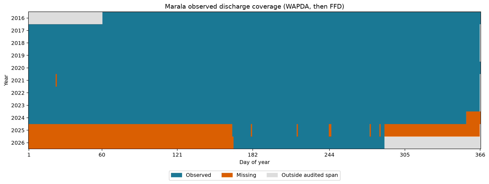
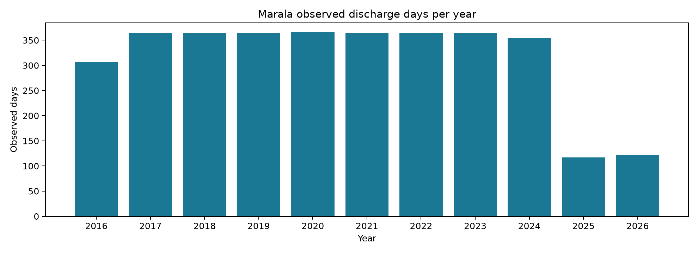

# Marala 10-day streamflow data sufficiency report

Read-only audit. Thresholds are rules of thumb, not guarantees of LSTM skill. No values were filled, interpolated, corrected or written back. Units are converted to cumecs in memory only.

## Located inputs

| input | path | status |
| --- | --- | --- |
| Observed discharge: WAPDA | D:\projects\flood_model\flood_model\riverine flood\short range\dataset\chenab_marala\processed\marala\discharge\marala_wapda_daily_inflow.csv | found |
| Observed discharge: FFD | D:\projects\flood_model\flood_model\riverine flood\short range\dataset\chenab_marala\processed\marala\discharge\marala_ffd_2024_bulletin_discharge.csv | found |
| Observed discharge: FFD | D:\projects\flood_model\flood_model\riverine flood\short range\dataset\chenab_marala\processed\marala\discharge\marala_ffd_2025_bulletin_discharge.csv | found |
| Observed discharge: FFD | D:\projects\flood_model\flood_model\riverine flood\short range\dataset\chenab_marala\processed\marala\discharge\marala_ffd_2026_bulletin_discharge.csv | found |
| Dynamic inputs | D:\projects\flood_model\flood_model\riverine flood\short range\dataset\chenab_marala\processed\marala\rainfall\chirps_v3_primary\marala_chirps_v3_final_rnl_daily_1990_2026.csv | found |
| Dynamic inputs | D:\projects\flood_model\flood_model\riverine flood\short range\dataset\chenab_marala\raw\marala\temperature\google_earth_engine\marala_daily_temperature_1980_2024.csv | found |
| Dynamic inputs | D:\projects\flood_model\flood_model\riverine flood\short range\dataset\chenab_marala\raw\marala\marala_daily_snow_1980_2024.csv | found |
| Dynamic inputs | D:\projects\flood_model\flood_model\riverine flood\short range\dataset\chenab_marala\raw\marala\marala_daily_dewpoint_ssrd_1980_2024.csv | found |
| Dynamic inputs | D:\projects\flood_model\flood_model\riverine flood\short range\dataset\chenab_marala\raw\marala\potential_evaporation_sum\marala_daily_pet_1980_2024.csv | found |
| Dynamic inputs | D:\projects\flood_model\flood_model\riverine flood\short range\dataset\chenab_marala\raw\marala\rainfall\google_earth_engine\marala_daily_precipitation_1980_2024.csv | found |
| Optional MODIS yearly CSVs | D:\projects\flood_model\flood_model\riverine flood\short range\dataset\chenab_marala\raw\marala\NDSI_Snow_Cover\[year].csv | 20 files found; consolidated file missing |
| Static attributes | D:\projects\flood_model\flood_model\riverine flood\short range\dataset\chenab_marala\raw\marala\static_attributes\marala_static_attributes.csv | found |
| Merged daily training table | D:\projects\flood_model\flood_model\riverine flood\short range\dataset\chenab_marala\marala_daily_merged.csv | MISSING; separate inputs audited in memory |

The existing `experiments/marala_observed/data/daily_observed_priority.csv` contains a separate interpolated column and IRSA means; it is not used as observed ground truth here. No `marala_daily_merged.csv` was found. Optional MODIS is incomplete; reanalysis and CHIRPS are not archived weather forecasts.

## 1. Observed discharge coverage

2016-03-01 to 2026-10-15; 3454 observed days; 11 distinct calendar years; 10.62 years elapsed; 9.46 observed-day-equivalent years. Source counts: {'WAPDA': 3215, 'FFD additional dates': 239}.

Observed-year threshold uses observed days / 365.25 so partial seasonal years are not counted as full years. The distinct calendar-year count and elapsed span above are separate measures.

WAPDA takes priority over FFD. The known WAPDA zero and unresolved FFD printed/archive date conflicts are excluded, without correcting original values. WAPDA/FFD disagreements retain the original WAPDA reading; within-source conflicting dates are rejected. IRSA means, outflow, historical event maxima and modeled values are excluded.

Most historical WAPDA observation times remain unconfirmed. FFD labels 06:00 PKT; weather features describe UTC days. This date-level coverage audit does not establish that every predictor was available at a common forecast issue time.

marala_wapda_daily_inflow.csv: 1 nonpositive, date-conflict or unconfirmed-time rows excluded.
marala_ffd_2024_bulletin_discharge.csv: 11 nonpositive, date-conflict or unconfirmed-time rows excluded.
marala_ffd_2025_bulletin_discharge.csv: 2 nonpositive, date-conflict or unconfirmed-time rows excluded.
marala_ffd_2026_bulletin_discharge.csv: 0 nonpositive, date-conflict or unconfirmed-time rows excluded.

| year | observed_days | calendar_days | coverage_pct |
| --- | --- | --- | --- |
| 2016 | 306 | 366 | 83.607 |
| 2017 | 365 | 365 | 100.000 |
| 2018 | 365 | 365 | 100.000 |
| 2019 | 365 | 365 | 100.000 |
| 2020 | 366 | 366 | 100.000 |
| 2021 | 364 | 365 | 99.726 |
| 2022 | 365 | 365 | 100.000 |
| 2023 | 365 | 365 | 100.000 |
| 2024 | 354 | 366 | 96.721 |
| 2025 | 117 | 365 | 32.055 |
| 2026 | 122 | 365 | 33.425 |

### Observed days by year-month

| month | observed_days |
| --- | --- |
| 2016-03 | 31 |
| 2016-04 | 30 |
| 2016-05 | 31 |
| 2016-06 | 30 |
| 2016-07 | 31 |
| 2016-08 | 31 |
| 2016-09 | 30 |
| 2016-10 | 31 |
| 2016-11 | 30 |
| 2016-12 | 31 |
| 2017-01 | 31 |
| 2017-02 | 28 |
| 2017-03 | 31 |
| 2017-04 | 30 |
| 2017-05 | 31 |
| 2017-06 | 30 |
| 2017-07 | 31 |
| 2017-08 | 31 |
| 2017-09 | 30 |
| 2017-10 | 31 |
| 2017-11 | 30 |
| 2017-12 | 31 |
| 2018-01 | 31 |
| 2018-02 | 28 |
| 2018-03 | 31 |
| 2018-04 | 30 |
| 2018-05 | 31 |
| 2018-06 | 30 |
| 2018-07 | 31 |
| 2018-08 | 31 |
| 2018-09 | 30 |
| 2018-10 | 31 |
| 2018-11 | 30 |
| 2018-12 | 31 |
| 2019-01 | 31 |
| 2019-02 | 28 |
| 2019-03 | 31 |
| 2019-04 | 30 |
| 2019-05 | 31 |
| 2019-06 | 30 |
| 2019-07 | 31 |
| 2019-08 | 31 |
| 2019-09 | 30 |
| 2019-10 | 31 |
| 2019-11 | 30 |
| 2019-12 | 31 |
| 2020-01 | 31 |
| 2020-02 | 29 |
| 2020-03 | 31 |
| 2020-04 | 30 |
| 2020-05 | 31 |
| 2020-06 | 30 |
| 2020-07 | 31 |
| 2020-08 | 31 |
| 2020-09 | 30 |
| 2020-10 | 31 |
| 2020-11 | 30 |
| 2020-12 | 31 |
| 2021-01 | 30 |
| 2021-02 | 28 |
| 2021-03 | 31 |
| 2021-04 | 30 |
| 2021-05 | 31 |
| 2021-06 | 30 |
| 2021-07 | 31 |
| 2021-08 | 31 |
| 2021-09 | 30 |
| 2021-10 | 31 |
| 2021-11 | 30 |
| 2021-12 | 31 |
| 2022-01 | 31 |
| 2022-02 | 28 |
| 2022-03 | 31 |
| 2022-04 | 30 |
| 2022-05 | 31 |
| 2022-06 | 30 |
| 2022-07 | 31 |
| 2022-08 | 31 |
| 2022-09 | 30 |
| 2022-10 | 31 |
| 2022-11 | 30 |
| 2022-12 | 31 |
| 2023-01 | 31 |
| 2023-02 | 28 |
| 2023-03 | 31 |
| 2023-04 | 30 |
| 2023-05 | 31 |
| 2023-06 | 30 |
| 2023-07 | 31 |
| 2023-08 | 31 |
| 2023-09 | 30 |
| 2023-10 | 31 |
| 2023-11 | 30 |
| 2023-12 | 31 |
| 2024-01 | 31 |
| 2024-02 | 29 |
| 2024-03 | 31 |
| 2024-04 | 30 |
| 2024-05 | 31 |
| 2024-06 | 30 |
| 2024-07 | 31 |
| 2024-08 | 31 |
| 2024-09 | 30 |
| 2024-10 | 31 |
| 2024-11 | 30 |
| 2024-12 | 19 |
| 2025-01 | 0 |
| 2025-02 | 0 |
| 2025-03 | 0 |
| 2025-04 | 0 |
| 2025-05 | 0 |
| 2025-06 | 15 |
| 2025-07 | 31 |
| 2025-08 | 30 |
| 2025-09 | 28 |
| 2025-10 | 13 |
| 2025-11 | 0 |
| 2025-12 | 0 |
| 2026-01 | 0 |
| 2026-02 | 0 |
| 2026-03 | 0 |
| 2026-04 | 0 |
| 2026-05 | 0 |
| 2026-06 | 15 |
| 2026-07 | 31 |
| 2026-08 | 31 |
| 2026-09 | 30 |
| 2026-10 | 15 |

### Observed days by calendar month across all years

| month_of_year | observed_days |
| --- | --- |
| 1 | 247 |
| 2 | 226 |
| 3 | 279 |
| 4 | 270 |
| 5 | 279 |
| 6 | 300 |
| 7 | 341 |
| 8 | 340 |
| 9 | 328 |
| 10 | 307 |
| 11 | 270 |
| 12 | 267 |

| gap_length | gaps | days |
| --- | --- | --- |
| 1-3 days | 6 | 7 |
| 4-30 days | 0 | 0 |
| over 30 days | 2 | 420 |

Longest continuous observed run: 1789 days = 4.90 years. Bounded 1-3 day gaps would add 7 days IF interpolated; no interpolation was performed.

## 2. Hydrological coverage

Usable Jul-Sep monsoons (>=80% of 92 days): 11, years [2016, 2017, 2018, 2019, 2020, 2021, 2022, 2023, 2024, 2025, 2026]. Usable Apr-Jun snowmelt seasons (>=80% of 91 days): 9, years [2016, 2017, 2018, 2019, 2020, 2021, 2022, 2023, 2024].

| year | season | observed_days | calendar_days | usable |
| --- | --- | --- | --- | --- |
| 2016 | monsoon Jul-Sep | 92 | 92 | True |
| 2016 | snowmelt Apr-Jun | 91 | 91 | True |
| 2017 | monsoon Jul-Sep | 92 | 92 | True |
| 2017 | snowmelt Apr-Jun | 91 | 91 | True |
| 2018 | monsoon Jul-Sep | 92 | 92 | True |
| 2018 | snowmelt Apr-Jun | 91 | 91 | True |
| 2019 | monsoon Jul-Sep | 92 | 92 | True |
| 2019 | snowmelt Apr-Jun | 91 | 91 | True |
| 2020 | monsoon Jul-Sep | 92 | 92 | True |
| 2020 | snowmelt Apr-Jun | 91 | 91 | True |
| 2021 | monsoon Jul-Sep | 92 | 92 | True |
| 2021 | snowmelt Apr-Jun | 91 | 91 | True |
| 2022 | monsoon Jul-Sep | 92 | 92 | True |
| 2022 | snowmelt Apr-Jun | 91 | 91 | True |
| 2023 | monsoon Jul-Sep | 92 | 92 | True |
| 2023 | snowmelt Apr-Jun | 91 | 91 | True |
| 2024 | monsoon Jul-Sep | 92 | 92 | True |
| 2024 | snowmelt Apr-Jun | 91 | 91 | True |
| 2025 | monsoon Jul-Sep | 89 | 92 | True |
| 2025 | snowmelt Apr-Jun | 15 | 91 | False |
| 2026 | monsoon Jul-Sep | 92 | 92 | True |
| 2026 | snowmelt Apr-Jun | 15 | 91 | False |

Q95/Q99 daily-flow proxies: only 8 annual maxima have >=90% annual observations (<10). These are NOT verified 2-/5-year return levels.

Lower threshold: 2529.685 m3/s, 173 observed days above it. Higher threshold: 3599.892 m3/s, 35 observed days above it. Years above Q99 proxy (not a verified 5-year flow): [2016, 2017, 2018, 2019, 2020, 2021, 2022, 2023, 2025, 2026]. These are exceedance DAYS, not independent flood-event counts.

Thresholds here describe the entire collection for the sufficiency audit. Model tuning, bias correction and fitted preprocessing must use training data only.

## 3. Input coverage

Missingness uses every calendar day between the first and last observed discharge dates, including days with no discharge. First/last dates below are the first/last finite values in each saved series. Static fields have no daily timestamp and are checked for a finite scalar only.

| column | role | first_date | last_date | missing_days | missing_pct |
| --- | --- | --- | --- | --- | --- |
| rain_chirps_v3_mm | core | 1990-01-01 | 2026-09-30 | 15 | 0.386 |
| temperature_c | core | 1980-01-01 | 2024-12-31 | 653 | 16.826 |
| swe_mm | core | 1980-01-01 | 2024-12-31 | 653 | 16.826 |
| snow_depth_m | core | 1980-01-01 | 2024-12-31 | 653 | 16.826 |
| snowmelt_mm | core | 1980-01-01 | 2024-12-31 | 653 | 16.826 |
| dewpoint_c | core | 1980-01-01 | 2024-12-31 | 653 | 16.826 |
| ssrd_wm2 | core | 1980-01-01 | 2024-12-31 | 653 | 16.826 |
| pet_mm | core | 1980-01-01 | 2024-12-31 | 653 | 16.826 |
| era5land_mm | optional/alternative | 1980-01-01 | 2024-12-31 | 653 | 16.826 |
| chirps_mm | optional/alternative | 1981-01-01 | 2024-12-31 | 653 | 16.826 |
| persiann_mm | optional/alternative | 1983-01-01 | 2024-12-31 | 654 | 16.851 |
| imerg_mm | optional/alternative | 2000-06-01 | 2024-12-31 | 653 | 16.826 |
| modis_ndsi_index | optional/alternative | 2000-03-01 | 2019-12-31 | 2504 | 64.519 |
| modis_valid_fraction | optional/alternative | 2000-03-01 | 2019-12-31 | 2480 | 63.901 |
| area_km2 | static; not daily | not applicable | not applicable | 0 | 0.000 |
| elev_mean_m | static; not daily | not applicable | not applicable | 0 | 0.000 |
| elev_min_m | static; not daily | not applicable | not applicable | 0 | 0.000 |
| elev_max_m | static; not daily | not applicable | not applicable | 0 | 0.000 |
| elev_p10_m | static; not daily | not applicable | not applicable | 0 | 0.000 |
| elev_p50_m | static; not daily | not applicable | not applicable | 0 | 0.000 |
| elev_p90_m | static; not daily | not applicable | not applicable | 0 | 0.000 |
| slope_mean_deg | static; not daily | not applicable | not applicable | 0 | 0.000 |
| glacier_frac | static; not daily | not applicable | not applicable | 0 | 0.000 |
| landcover_tree_cover | static; not daily | not applicable | not applicable | 0 | 0.000 |
| landcover_shrubland | static; not daily | not applicable | not applicable | 0 | 0.000 |
| landcover_grassland | static; not daily | not applicable | not applicable | 0 | 0.000 |
| landcover_cropland | static; not daily | not applicable | not applicable | 0 | 0.000 |
| landcover_built_up | static; not daily | not applicable | not applicable | 0 | 0.000 |
| landcover_bare_sparse | static; not daily | not applicable | not applicable | 0 | 0.000 |
| landcover_snow_ice | static; not daily | not applicable | not applicable | 0 | 0.000 |
| landcover_permanent_water | static; not daily | not applicable | not applicable | 0 | 0.000 |
| landcover_herbaceous_wetland | static; not daily | not applicable | not applicable | 0 | 0.000 |
| landcover_mangroves | static; not daily | not applicable | not applicable | 0 | 0.000 |
| landcover_moss_lichen | static; not daily | not applicable | not applicable | 0 | 0.000 |
| sand_pct | static; not daily | not applicable | not applicable | 0 | 0.000 |
| silt_pct | static; not daily | not applicable | not applicable | 0 | 0.000 |
| clay_pct | static; not daily | not applicable | not applicable | 0 | 0.000 |
| precip_mean_mm | static; not daily | not applicable | not applicable | 0 | 0.000 |
| aridity | static; not daily | not applicable | not applicable | 0 | 0.000 |
| frac_band1 | static; not daily | not applicable | not applicable | 0 | 0.000 |
| frac_band2 | static; not daily | not applicable | not applicable | 0 | 0.000 |
| frac_band3 | static; not daily | not applicable | not applicable | 0 | 0.000 |
| frac_band4 | static; not daily | not applicable | not applicable | 0 | 0.000 |

Core columns: ['rain_chirps_v3_mm', 'temperature_c', 'swe_mm', 'snow_depth_m', 'snowmelt_mm', 'dewpoint_c', 'ssrd_wm2', 'pet_mm']. Aggregate core missingness: 14.77% of dynamic cells; worst core column: 16.83%. On dates with observed discharge only, aggregate core missingness is 6.11%. Optional precipitation alternatives and MODIS are audited but not required for the primary sample count.

MODIS snow_cover_pct is an NDSI index, not fractional snow-covered area; valid_frac is a QC field. Static climate normals use 1980-2024 and must be recomputed from the training period if used in model fitting. Snow depth/SWE magnitudes and weighting still need physical review. Temporal completeness is not a quality or issue-time availability clearance.

## 4. Archived weather forecast coverage

not available; not downloaded yet

Observed-day-equivalent years overlapping archive issue dates: 0.000. ERA5-Land/CHIRPS are historical analyzed weather, not forecasts available for t+1 through t+10. Missing source components: archived TIGGE/GFS issue/valid/lead data, plus a consolidated daily training table and the incomplete optional MODIS continuation.

## 5. Usable samples

Issue day t: observed Q on >=8 of t+1...t+10; the prior 365 calendar days t-365...t-1 have <=10% missing core input CELLS. Historical weather/state features are counted; discharge targets are never imputed. All 365 prior dates must be present as calendar positions. No forecast archive requirement is included in the history-only counts.

Literal core-input candidates: 3208. Stricter <=10% missing in EVERY core column: 3208. If past discharge is also a hindcast input with <=10% missing: 2879. Including every optional/alternative dynamic feature (QC excluded), cell-rule candidates: 3208; per-column-strict candidates: 1430. Complete candidates also having forecast lead labels 1-10: 0.

| year | literal_core_samples | per_column_strict_samples | also_require_past_Q | all_optional_dynamic_samples | all_optional_per_column_strict |
| --- | --- | --- | --- | --- | --- |
| 2016 | 306 | 306 | 0 | 306 | 306 |
| 2017 | 365 | 365 | 342 | 365 | 365 |
| 2018 | 365 | 365 | 365 | 365 | 365 |
| 2019 | 365 | 365 | 365 | 365 | 365 |
| 2020 | 366 | 366 | 366 | 366 | 29 |
| 2021 | 365 | 365 | 365 | 365 | 0 |
| 2022 | 365 | 365 | 365 | 365 | 0 |
| 2023 | 365 | 365 | 365 | 365 | 0 |
| 2024 | 346 | 346 | 346 | 346 | 0 |
| 2025 | 0 | 0 | 0 | 0 | 0 |
| 2026 | 0 | 0 | 0 | 0 | 0 |

These are overlapping structural samples before split-boundary purging, not independent flood events. A literal cell average can hide a completely missing individual feature, so the per-column count is also shown. Publication latency, valid spatial coverage, and a genuine forecast issue timestamp still need validation.

## 6. Proposed chronological split

Target-only proposal: train 2016-2022, validation 2023, test 2024-2026. Test has 3 usable monsoons and high-flow proxy years [2025, 2026]. This is NOT executable as a hindcast-forecast LSTM split without archived forecasts and matching dynamic inputs.

History-input-only alternative: train 2016-2020, validation 2021, test 2022-2024. This consumes much of the short record for testing; it still has no archived future weather.

An executable complete hindcast-forecast LSTM split is IMPOSSIBLE with no verified archived forecasts. Keep whole 10-day target windows within their partition; historical context may precede its partition. Fit scalers and imputers on training data only. No split is written or model fitted by this script.

## 7. Verdict

| requirement | value | status |
| --- | --- | --- |
| Observed years (observed-day equivalent) | 9.46 | FAIL |
| Longest continuous run, years | 4.90 | WARN |
| Monsoon seasons >=80% observed | 11 | WARN |
| Observed years overlapping archived forecasts | 0.00 | FAIL |
| Missing core inputs: calendar-period cell % | 14.77% | WARN |
| Worst core input column missing % | 16.83% | FAIL |
| Complete hindcast-forecast samples (lead labels checked) | 0 | FAIL |

Status rules: observed years PASS >=20 / WARN >=10 / FAIL <10; continuous years PASS >=8 / WARN >=4 / FAIL <4; monsoons PASS >=15 / WARN >=8 / FAIL <8; archive-overlap years PASS >=8 / WARN >=4 / FAIL <4; missing input cells PASS <=5% / WARN <=15% / FAIL >15%. Extra worst-column and complete-sample rows expose limitations hidden by averages.

**Recommendation: gradient boosting baseline only.** The full 10-day hindcast-forecast LSTM is not data-ready. A history-only baseline can be evaluated now. Multi-basin pretraining plus fine-tuning is a later experiment after source QC and basin-specific weather; it cannot replace a missing forecast archive or observed Marala test targets.

## 8. Plots

Run: `python check_data_sufficiency.py` (optional `--forecasts archive.csv`, with issue_date and lead_days). Only pandas, numpy and matplotlib are required in addition to the Python standard library.

Integrity check: all 31 input-file SHA-256 hashes were identical before and after inspection.
